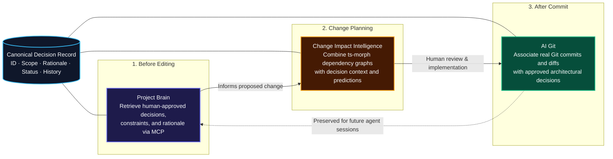
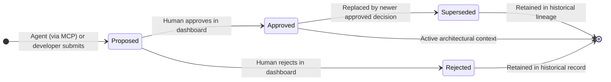
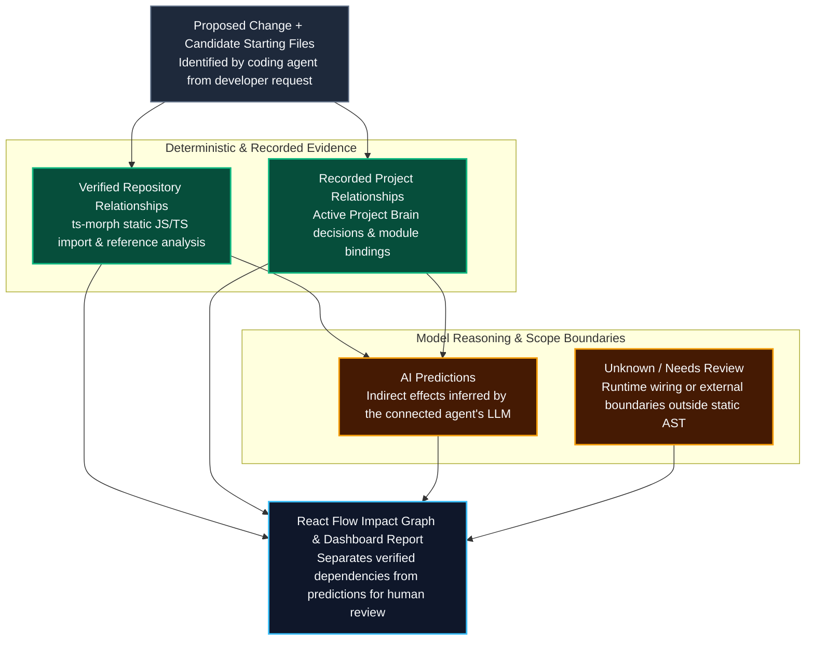
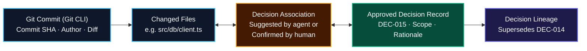
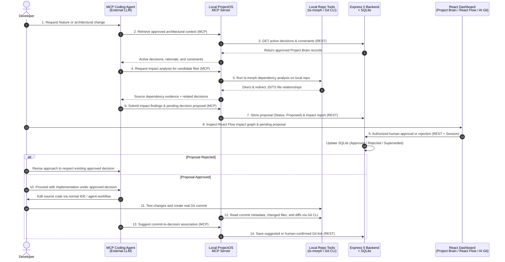
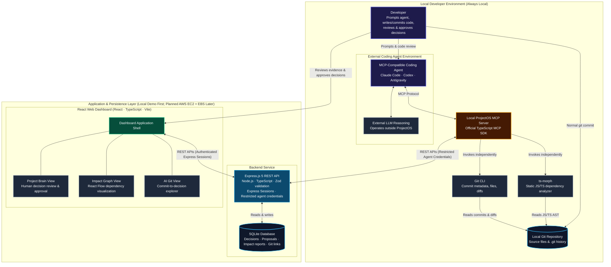

# ProjectOS

**Architectural context, repository-backed change-impact analysis, and commit-to-decision traceability for MCP-compatible AI coding agents.**

[](#system-architecture)
[](#technology-stack)
[](#2-change-impact-intelligence)
[](#technology-stack)

ProjectOS is an MCP-centric software engineering platform that connects AI coding agents—such as Claude Code, Codex, and Antigravity—with a project's human-approved architectural decisions, static source-code dependency evidence, and Git commit history.

Rather than replacing existing coding agents or version control workflows, ProjectOS exposes a local **Model Context Protocol (MCP)** server alongside a human review dashboard. Coding agents query ProjectOS to retrieve active architectural constraints before proposing code edits, inspect actual JavaScript/TypeScript dependency relationships before modifying shared modules, and link completed Git commits back to the approved architectural decisions that motivated them.



---

## Contents

- [The Problem](#the-problem)
- [Core Features](#core-features)
  - [1. Project Brain](#1-project-brain)
  - [2. Change Impact Intelligence](#2-change-impact-intelligence)
  - [3. AI Git](#3-ai-git)
- [How ProjectOS Works](#how-projectos-works)
- [System Architecture](#system-architecture)
- [Practical Example](#practical-example)
- [Key Engineering Trade-Offs](#key-engineering-trade-offs)
- [Competitive Landscape](#competitive-landscape)
- [Technology Stack](#technology-stack)
- [Getting Started](#getting-started)
- [Current Development Status](#current-development-status)
- [Maintainer](#maintainer)

---

## The Problem

AI coding agents can read and modify source files quickly, but a source tree rarely records the architectural reasoning that shaped it. As development spans multiple sessions, contributors, or different coding tools, engineering knowledge breaks down at three points in the development lifecycle:

| Lifecycle Stage | Failure Mode | Operational Consequence |
| :--- | :--- | :--- |
| **Before a change** | **Context fragmentation** | Architectural choices, rejected alternatives, and system constraints sit in expired chat threads or developer memory. A new agent session can implement code that directly contradicts an approved design decision. |
| **During change planning** | **Impact blind spots** | A request that appears local can affect transitive module dependencies or violate an active architectural rule. Prompt-only LLM guesses cannot reliably separate actual source imports from speculative side effects. |
| **After a change** | **Traceability gaps** | Git records *what* lines changed (`commit SHA`, `author`, `diff`), but not the structured architectural decision or human approval that authorized the modification. |

ProjectOS addresses these three failure modes as a single lifecycle: **recover approved architectural intent before coding, inspect source-backed change impact before approving policy changes, and bind real Git commits back to their approved rationale.**

---

## Core Features

ProjectOS is built around three finalized capabilities that read and update the same underlying decision records.

### 1. Project Brain

Project Brain is the structured system of record for a repository's architectural decisions, technical constraints, requirements, and design rationale. Unlike chat memory or unstructured markdown notes, each decision is stored as an explicit record with a lifecycle status, scope, approval provenance, and supersession history.

- **Structured Decision Records:** Stores a stable identifier (such as `DEC-014`), title, approved technical choice, architectural scope, engineering rationale, constraints, affected code bindings, and references to older decisions it supersedes.
- **Agent Retrieval and Proposal via MCP:** Compatible coding agents query Project Brain through MCP to align with current architecture or submit pending decision proposals when a task requires an architectural change.
- **Human-Only Approval Governance:** AI agents cannot approve their own proposals. Only an authenticated human developer using the ProjectOS dashboard can transition a proposed decision to `Approved` or `Rejected`.



| Lifecycle State | Meaning in ProjectOS |
| :--- | :--- |
| **Proposed** | Submitted by a coding agent via MCP or by a developer. Holds no architectural authority until reviewed. |
| **Approved** | Explicitly authorized by the developer in the React dashboard. Served to connected coding agents as active project policy. |
| **Rejected** | Evaluated and declined. Preserved in history so future sessions know why the approach was ruled out, but never treated as active policy. |
| **Superseded** | Replaced by a newer human-approved decision while keeping the earlier rationale and commit links intact. |

---

### 2. Change Impact Intelligence

Change Impact Intelligence investigates the potential blast radius of a proposed change before code is modified:

> *"If we pursue this change, which files, dependent modules, and approved architectural decisions are involved—and which findings are verified code facts versus AI predictions?"*

How the analysis works:

1. **Candidate Identification:** The connected coding agent interprets the developer's natural-language request and identifies candidate starting files or architectural domains.
2. **Deterministic Source Inspection (`ts-morph`):** The local ProjectOS MCP server runs `ts-morph` against the JavaScript/TypeScript repository to trace actual static imports, symbol references, and direct or indirect module dependencies.
3. **Architectural Cross-Referencing:** ProjectOS compares the affected modules and proposed design against active Project Brain decisions to surface potential conflicts.
4. **Tiered Impact Reporting & Visualization:** The connected agent combines the deterministic source findings with approved architectural context to explain potential consequences, while **React Flow** renders the dependency and decision relationships in the dashboard.



ProjectOS enforces a strict separation between verified evidence and model inference:

| Evidence Category | Source of Finding | Interpretation |
| :--- | :--- | :--- |
| **Verified repository relationship** | `ts-morph` static AST analysis or `Git CLI` | A confirmed code dependency (for example, Module A imports Module B). Appearing in the dependency graph does **not** automatically mean every dependent file requires modification, nor does static analysis guarantee complete impact detection. |
| **Recorded project relationship** | Project Brain (`SQLite`) | An explicit association between an approved architectural decision and specific modules or files. |
| **AI prediction** | Connected coding agent's external LLM | A plausible indirect consequence suggested by the agent's reasoning, visually distinguished from verified source facts. |
| **Unknown / needs review** | Explicit analysis boundary | Dynamic runtime behavior, reflection, external service calls, or non-JS/TS boundaries that static AST analysis cannot verify. |

---

### 3. AI Git

AI Git connects real Git commits and modified files in the repository to the approved architectural decisions that explain why those changes were made.

- **Real Git Metadata via `Git CLI`:** ProjectOS inspects the local repository using `Git CLI` to read factual commit hashes, changed file paths, commit history, and diffs.
- **Agent-Assisted Association:** The active coding agent uses its existing LLM reasoning to suggest associations between commits/changed files and relevant Project Brain decisions.
- **Suggested vs. Confirmed Links:** ProjectOS persists commit-to-decision links in SQLite and explicitly distinguishes **agent-suggested associations** from **human-confirmed associations**.
- **Bidirectional Exploration:** In the dashboard, a developer can select a commit or modified file to read the linked architectural rationale, or select an approved decision to inspect the commits that implemented it.



**Boundaries of AI Git:**
- AI Git is **not** an automated committer, commit-message generator, branch sandbox, or replacement for Git.
- Developers create commits through their normal Git workflow; ProjectOS never silently rewrites Git history or executes autonomous merges.
- *Implementation note:* While commit metadata retrieval (`Git CLI`), agent-suggested associations, and human confirmation are defined in the architecture, the exact automated versus manual trigger mechanism for initiating post-commit analysis remains an open design detail during initial development.

---

## How ProjectOS Works

The diagram below traces the integrated development lifecycle across the developer, the external coding agent, the local ProjectOS MCP server, the backend, and the review dashboard.



### Step-by-Step Lifecycle

1. **Context Recovery (Steps 1–3):** When a developer prompts an MCP-compatible coding agent, the agent queries the local ProjectOS MCP server to retrieve active architectural decisions from Project Brain before planning edits.
2. **Evidence Collection (Steps 4–5):** The agent identifies candidate starting files and requests an impact scan. The MCP server invokes `ts-morph` against the local repository to extract actual JavaScript/TypeScript import and dependency relationships.
3. **Proposal Submission (Steps 6–7):** The agent combines source evidence with architectural context, distinguishes verified dependencies from its own LLM predictions, and—if the change alters architectural policy—submits a pending decision proposal via MCP.
4. **Human Governance Gate (Steps 8–9):** The developer reviews the proposal and the **React Flow** dependency visualization in the React dashboard. Only the authenticated human developer can approve or reject the decision.
5. **Implementation & Commit Traceability (Steps 10–14):** After approval, the developer and coding agent implement the change and create a normal Git commit. ProjectOS uses `Git CLI` to read the commit metadata and diffs, records the association with the approved decision ID, and makes the updated architectural context available to future agent sessions.

---

## System Architecture

ProjectOS separates **local repository access** from **application state and human governance**.



### Existing Repository Architecture Reference

The diagram below is the existing high-level architecture illustration included in the repository at [`assets/projectos-architecture.png`](assets/projectos-architecture.png):

<div align="center">
  
</div>

> **Architectural Clarification on Component Connections:** In the actual ProjectOS system design (shown in the Mermaid diagram above), the **ProjectOS MCP Server** invokes **`ts-morph`** and **`Git CLI`** *independently* against the local repository (`Git CLI` does not feed into `ts-morph` as a sequential processing stage), and the three dashboard views (**Project Brain View**, **Impact Graph**, and **AI Git Timeline**) are **independent feature views** inside the React dashboard rather than a top-to-bottom processing chain.

### Communication Paths & Boundary Rules

| Source | Destination | Interface | Architectural Boundary |
| :--- | :--- | :--- | :--- |
| **MCP-Compatible Coding Agent** | **Local ProjectOS MCP Server** | **MCP** | Exposes tools to query decisions, run local impact analysis, submit pending proposals, and record commit links. |
| **Local ProjectOS MCP Server** | **`ts-morph` & `Git CLI`** | **Local Execution** | Invoked independently by the MCP server against the local Git repository. |
| **Local ProjectOS MCP Server** | **Express.js 5 Backend** | **REST APIs** | Uses restricted agent credentials; can submit proposals and evidence but cannot approve architectural decisions. |
| **React Dashboard** | **Express.js 5 Backend** | **REST APIs** | Uses authenticated **Express Sessions** so only the human developer can approve or reject architectural decisions. |
| **Express.js 5 Backend** | **SQLite Database** | **Local SQL Driver** | Reads and writes structured decisions, history, impact reports, and commit-to-decision links. |

---

## Practical Example

> **Note:** The scenario below is an **illustrative walkthrough** demonstrating how Project Brain, Change Impact Intelligence, and AI Git interact during a database architecture change. It is not a claim of pre-recorded benchmark output.

### Scenario: Evaluating a PostgreSQL to MongoDB Persistence Migration

#### 1. Existing Approved Context in Project Brain
The project already contains an approved architectural decision recorded in Project Brain:

```text
Decision ID : DEC-014
Title       : Primary Application Database Architecture
Choice      : PostgreSQL
Status      : Approved
Scope       : Persistence layer and order processing modules
Rationale   : Relational order integrity, multi-step ACID transactions, and existing SQL schema constraints.
```

#### 2. Developer Request & Pre-Change Impact Analysis
The developer asks their connected coding agent to replace the persistence layer with MongoDB.
1. The agent queries Project Brain via MCP and retrieves `DEC-014`, recognizing that the request conflicts with an active approved decision.
2. The agent identifies `src/db/client.ts` as a candidate starting file and requests Change Impact Intelligence via MCP.
3. `ts-morph` scans the local TypeScript repository and combines its findings with Project Brain records and the agent's own reasoning:

| Finding | Source | Evidence Classification |
| :--- | :--- | :--- |
| `src/db/client.ts` defines the database client module | `ts-morph` static analysis | **Verified repository evidence** |
| `src/orders/repository.ts` imports `src/db/client.ts` | `ts-morph` static analysis | **Verified dependency relationship** |
| `DEC-014` mandates PostgreSQL for the persistence layer | Project Brain (`SQLite`) | **Recorded architectural decision conflict** |
| Authentication session store may rely on relational transaction semantics | Connected agent's external LLM | **AI prediction (unconfirmed hypothesis)** |

#### 3. Human Decision Review in the Dashboard
Because the change contradicts `DEC-014`, the coding agent submits a pending proposal (`DEC-015 — Migrate persistence layer to MongoDB`) via MCP.
- In the **React dashboard**, the developer inspects the **React Flow** dependency graph alongside the proposal rationale.
- If the developer **rejects** `DEC-015`, `DEC-014` remains active and the agent must keep PostgreSQL.
- If the developer **approves** `DEC-015`, Project Brain marks `DEC-015` as `Approved` and transitions `DEC-014` to `Superseded` without deleting its history.

#### 4. Implementation & AI Git Traceability
After the developer approves `DEC-015`, the coding agent edits the codebase through its normal IDE workflow and the developer creates a real Git commit (`a82f1c`).
- AI Git uses `Git CLI` to read commit `a82f1c` and the diff on `src/db/client.ts`.
- The commit is linked to `DEC-015` (either suggested by the agent and confirmed by the developer, or linked directly).
- In subsequent coding sessions—even in a different MCP-compatible client—querying ProjectOS returns `DEC-015` as active policy and traces commit `a82f1c` directly to the approved migration rationale.

---

## Key Engineering Trade-Offs

ProjectOS makes several deliberate architectural choices to keep the system practical, provider-neutral, and trustworthy:

| Architectural Decision | Why It Works for ProjectOS | Trade-Off Accepted |
| :--- | :--- | :--- |
| **MCP-first integration with external agent LLMs** | Works with the developer's existing MCP-compatible agent (Claude Code, Codex, Antigravity). Eliminates the cost, latency, and configuration burden of hosting a dedicated LLM or requiring a separate model API key inside ProjectOS. | Reasoning quality for candidate file selection, indirect impact predictions, and commit link suggestions depends on the connected external agent's model. |
| **Separating `ts-morph` static AST analysis from LLM reasoning** | `ts-morph` deterministically resolves JavaScript/TypeScript imports and symbol references without hallucinating file paths, while the external LLM handles natural-language intent and broader architectural hypotheses. | Deep static dependency analysis is initially scoped to JavaScript/TypeScript repositories and cannot detect every dynamic runtime call or cross-service dependency. |
| **Human-only architectural approval via Express Sessions** | Separates IDE file-edit permissions from project-level architectural governance. Restricted MCP agent credentials cannot invoke approval endpoints, preventing silent architectural drift. | Introduces a deliberate human review checkpoint in the dashboard when a change modifies or supersedes an architectural decision. |
| **Local repository analysis + deferred cloud hosting** | Running the MCP server, `ts-morph`, and `Git CLI` locally keeps raw source files and `.git` history on the developer's machine. Even when the backend and web app are later hosted on AWS EC2, the remote server never mounts the local repository. | Requires the ProjectOS MCP server to run locally alongside the developer's repository rather than as a purely browser-hosted SaaS tool. |
| **SQLite for relational persistence** | Provides transactional storage for decisions, proposals, impact reports, and Git commit links with zero external database server setup for the local demo—and maps cleanly to an Amazon EBS volume when deployed to AWS EC2. | Scoped initially for a single-developer account and single-node persistence rather than high-concurrency distributed database writes. |

---

## Competitive Landscape

Existing tools in the AI software engineering ecosystem address individual parts of project memory, dependency mapping, decision records, or session logging. ProjectOS focuses on connecting those stages through a shared decision record over MCP:

| Capability Area | Representative Existing Tool | ProjectOS Approach |
| :--- | :--- | :--- |
| **Cross-Session Memory** | **ProjectMem** — Persistent cross-agent memory, decision history, and pre-commit warnings | Stores structured, human-approved architectural decisions (`Project Brain`) with explicit lifecycle states (`Proposed`, `Approved`, `Rejected`, `Superseded`) rather than general session memory |
| **Dependency & Impact Analysis** | **GitNexus** — Codebase dependency mapping and pre-change impact analysis | Combines `ts-morph` dependency graphs with active Project Brain decisions, explicitly distinguishing verified source/decision evidence from AI predictions |
| **Decision Governance** | **AsDecided** — Architectural decision management, read-only MCP access, and compliance checks | Supports bidirectional MCP workflows where agents submit impact-informed decision proposals while enforcing human-only approval in the dashboard |
| **Git Session Traceability** | **Entire** — Links AI coding sessions, prompts, and reasoning to Git history | Links real Git commits and modified files (`AI Git`) directly to approved architectural decision records and their supersession history |

---

## Technology Stack

| Category | Technology | Role in ProjectOS |
| :--- | :--- | :--- |
| **Frontend** | React.js, TypeScript, Vite | Human review dashboard for inspecting architectural decisions, impact reports, and commit history |
| **Graph Visualization** | React Flow | Renders interactive dependency and decision-impact graphs from evidence collected during analysis |
| **Backend** | Node.js, Express.js 5, TypeScript | REST API server managing decision lifecycle transitions, impact reports, and Git commit associations |
| **Validation** | Zod | Runtime schema validation across REST payloads and MCP tool boundaries |
| **Database** | SQLite | Relational persistence for decision records, proposals, approval history, impact metadata, and Git links |
| **Agent Protocol** | Model Context Protocol (MCP), Official TypeScript MCP SDK | Standardized local tool interface enabling MCP-compatible coding agents to retrieve and contribute context |
| **Code Intelligence** | `ts-morph`, `Git CLI` | Local static AST dependency analysis for JavaScript/TypeScript (`ts-morph`) and factual Git commit/diff inspection (`Git CLI`) |
| **AI Reasoning** | Agent-agnostic external LLM | Provided by the developer's connected MCP coding agent; ProjectOS hosts no internal LLM and requires no separate model API |
| **APIs & Security** | REST APIs, HTTPS (for hosted communication), Express Sessions | Connects the MCP server and dashboard to the backend; enforces human-only approval and restricted agent credentials |
| **Planned Cloud Infrastructure** | AWS EC2, Amazon EBS *(Planned after local demo)* | Intended future hosting for the Express backend and built React dashboard on EC2 with SQLite persisted on EBS |

---

## Getting Started

ProjectOS is currently in the **architecture and specification stage**. The repository presently contains the system design documentation and architectural diagram (`README.md` and `assets/projectos-architecture.png`); the runnable application packages (Local MCP Server, Express.js 5 + SQLite backend, and React + Vite dashboard), `package.json` scripts, and environment configuration files have not yet been committed to this repository.

Once the initial local application packages are published to the repository, setup instructions for starting the Express backend, launching the React dashboard, and registering the local ProjectOS MCP server with an MCP-compatible coding client will be documented in this section.

---

## Current Development Status

To provide an accurate view of the project based on actual repository contents:

| Area | Current Status | Notes |
| :--- | :--- | :--- |
| **Product Architecture & Specification** | **Completed** | Core feature boundaries (`Project Brain`, `Change Impact Intelligence`, `AI Git`), MCP/REST communication paths, human governance rules, and technology stack are finalized and documented. |
| **Local MCP Server (`TypeScript MCP SDK`)** | **In Development (Planned MVP)** | Tool definitions for decision retrieval, proposal submission, `ts-morph` analysis, and `Git CLI` inspection are specified for the initial local demo. |
| **Code Intelligence (`ts-morph` & `Git CLI`)** | **In Development (Planned MVP)** | Scoped initially to JavaScript/TypeScript repositories running locally on the developer's machine. |
| **Backend & Storage (`Express 5`, `Zod`, `SQLite`)** | **In Development (Planned MVP)** | Scoped initially for a single developer account with Express Session authentication and human-only decision approval. |
| **Web Dashboard (`React`, `Vite`, `React Flow`)** | **In Development (Planned MVP)** | Three independent views: Project Brain governance view, React Flow impact graph, and AI Git commit-to-decision timeline. |
| **AI Git Commit-Analysis Trigger** | **Open Technical Detail** | Commit metadata retrieval and suggested vs. confirmed links are defined; the exact trigger mechanism for initiating commit analysis is being finalized during implementation. |
| **Cloud Hosting (`AWS EC2` + `Amazon EBS`)** | **Planned (Post-Local Demo)** | Deferred until the complete local working demonstration is finished; local repository analysis and the MCP server will remain local even after cloud deployment. |

---

## Maintainer

**Prajwal Govekar** — [@prajwal-govekar17](https://github.com/prajwal-govekar17)
