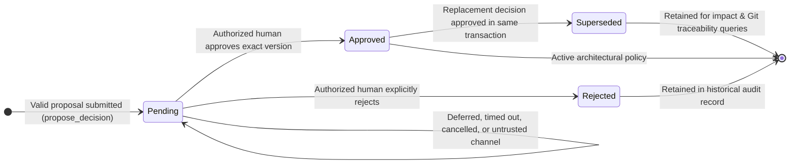
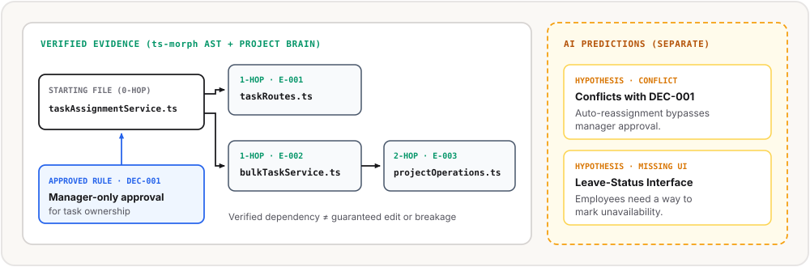
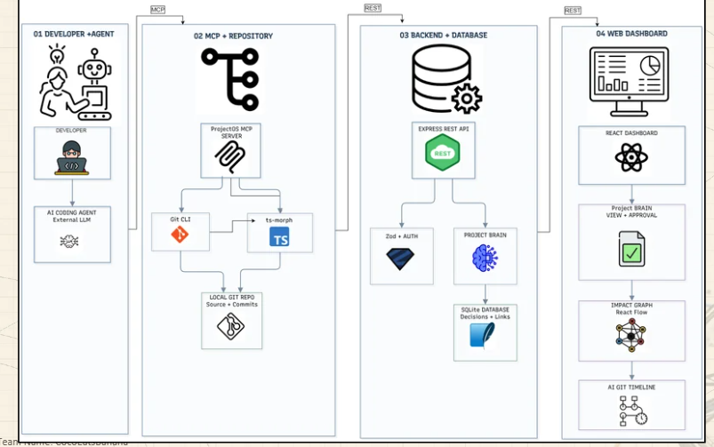
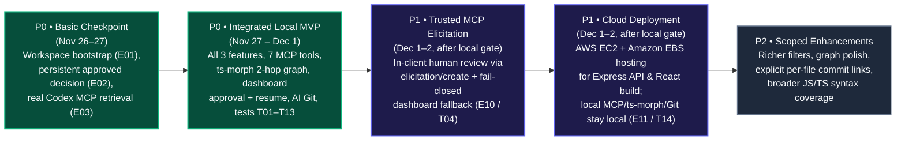

<div align="center">


<br/>

[](#the-seven-mcp-tools)
[](#2-change-impact-intelligence)
[](#system-architecture)
[](#dashboard-views)

**An MCP-centric developer tool that preserves human-approved architectural decisions, investigates proposed changes using real repository evidence, and records bidirectional provenance between approved decisions and actual Git commits.**

[The Problem](#the-problem) · [Core Features](#three-interconnected-core-features) · [System Architecture](#system-architecture) · [7 MCP Tools](#the-seven-mcp-tools) · [Human Approval](#human-approval-workflow) · [TeamFlow Walkthrough](#end-to-end-walkthrough-the-teamflow-scenario) · [Engineering Specs](#engineering-specification--target-monorepo) · [Roadmap](#development-roadmap--current-status)

</div>

---

## Overview

**ProjectOS** brings architectural continuity, source-grounded impact analysis, and commit provenance to AI-assisted software engineering. It integrates with existing **Model Context Protocol (MCP)** coding agents—targeting **Codex** as the first interactive client alongside compatible tools such as Claude Code and Antigravity—rather than replacing them.

When developers use AI coding agents across multiple sessions, source code alone rarely explains the architectural rules that shaped it. ProjectOS solves this by connecting the developer's local coding agent and Git repository to a shared architectural knowledge base across three capabilities:

1. **Project Brain** — Stores authoritative, human-approved architectural decisions, rationale, file bindings, and supersession history.
2. **Change Impact Intelligence** — Traces direct and indirect (two-hop) JavaScript/TypeScript source dependencies using `ts-morph`, maps them to active decisions, and separates verified source evidence from AI predictions.
3. **AI Git** — Connects real Git commit hashes and changed file paths (resolved locally via `Git CLI`) to the exact approved decision versions that motivated them.

> [!IMPORTANT]
> **Architectural Boundaries:** ProjectOS makes **no separately billed LLM API calls** and hosts no proprietary model; the connected coding agent supplies natural-language reasoning while `ts-morph` and `Git CLI` supply deterministic local evidence. AI agents can retrieve context and submit proposals, but **only an authorized human reviewer can approve or reject architectural decisions**.

---

## The Problem

As AI-assisted development spans multiple chat sessions, features, or teammates, engineering context breaks down at three distinct stages of the software lifecycle:

| User & Lifecycle Stage | Engineering Problem | Desired Outcome with ProjectOS |
| :--- | :--- | :--- |
| **Developer starting a coding session** *(Before a change)* | Important architectural reasoning, constraints, and rejected alternatives sit scattered across old chat threads and developer memory. | Retrieve the project's active, human-approved decisions (`get_decisions`) before writing or modifying code. |
| **Developer planning a feature or refactor** *(During change planning)* | Keyword search or free-form LLM guesses do not reliably show how dependent modules or existing architectural rules will be affected. | Inspect actual AST dependency paths (`ts-morph`), related decisions, and explicitly separated AI predictions (`analyze_change`). |
| **Project maintainer / reviewer** *(Architectural governance)* | Reviewing an architectural change requires evidence; letting an AI agent silently alter architectural policy risks unreviewed drift. | Review proposals with their impact reports in the authenticated dashboard first (`P0`), and later via trusted in-client MCP elicitation (`P1`). |
| **Developer returning to an existing codebase** *(After a change)* | `git log` and `git blame` show *what* changed, but not the approved architectural decision or rationale behind the commit. | Query bidirectional provenance (`get_git_traceability`) between real Git commits, changed files, and approved decision versions. |

---

## Three Interconnected Core Features

Project Brain, Change Impact Intelligence, and AI Git are not three standalone utilities. They operate as a continuous lifecycle around a **single shared decision record** stored in SQLite and exposed through the Express.js 5 backend.

<div align="center">
  
</div>

### 1. Project Brain

Project Brain is the authoritative system of record for a project's architectural decisions, rationale, and review history.

* **Structured Decision Records (`PB-01`):** Each record maintains a stable `decision_id` (such as `DEC-001`), version, title, decision statement, engineering rationale, lifecycle status (`pending`, `approved`, `rejected`, or `superseded`), reviewer identity, timestamps, normalized repository-relative paths (`related_paths`), and optional predecessor pointers.
* **Topic and Path Discovery (`PB-02`):** Coding agents can query decisions by keyword (`query`), repository-relative file path (`related_files`), status, or exact ID without knowing decision IDs in advance. Discovery defaults to active `approved` decisions; historical and superseded records are opt-in (`include_history: true`).
* **Immutable History & Atomic Supersession (`PB-03`, `PB-04`):** ProjectOS never overwrites an approved decision's statement or rationale in place. Submitting a replacement creates a `pending` proposal while the predecessor remains active. When an authorized human approves the exact pending version, the backend activates the replacement and marks the predecessor `superseded` in a single atomic SQLite transaction.



---

### 2. Change Impact Intelligence

Change Impact Intelligence investigates the real codebase before implementation to answer: *"If we make this change, which connected files and active architectural decisions are involved—and what is verified code evidence versus an AI hypothesis?"*

* **Agent-Selected Starting Points (`CI-01`):** An arbitrary natural-language request cannot be parsed by a static AST scanner alone. The connected coding agent interprets the developer's prompt, identifies candidate starting files (`starting_files`) or resolvable code symbols (`starting_symbols`), and passes them to `analyze_change`.
* **Direct & Indirect `ts-morph` Traversal (`CI-02`, `CI-08`):** The local analysis engine validates the paths against the registered repository and uses `ts-morph` to follow reverse dependency edges (consumers that import or reference the target code) up to an initial **two-hop traversal bound**. A visited set prevents infinite loops on cyclic graphs, and traversal bounds (100 files, 300 edges, configurable time budget) return explicitly labelled partial results if reached.
* **Fact vs. Prediction Separation (`CI-03`, `CI-05`):** Every verified dependency edge records an `evidence_id` (e.g., `E-001`), source file, target file, relationship type (`direct_dependent` or `indirect_dependent`), source line/range, and a bounded snippet. When the coding agent reasons about indirect semantic consequences or decision conflicts, it saves them via `record_impact_assessment` into a separate `predictions` table—never overwriting verified AST edges.
* **Snapshot Freshness (`CI-06`):** Each impact report records the repository `HEAD`, worktree content fingerprint, analyzer options, and consulted decision versions so the dashboard can distinguish a fresh analysis from an earlier historical snapshot.

<div align="center">
  
</div>

> [!NOTE]
> **Honest Analysis Scope (`CI-03`):** A verified dependency edge means Module A imports or references Module B—it does **not** prove that every dependent file requires modification or will break. Static AST analysis is initially scoped to JavaScript/TypeScript and honestly reports unresolved imports or runtime boundaries.

---

### 3. AI Git

AI Git preserves implementation provenance by linking existing, real Git commits to the approved architectural decisions they implement.

* **Read-Only Local Git Verification (`GT-01`):** After the developer reviews, tests, and commits code through their normal Git workflow, `link_commit_to_decision` invokes the local `Git CLI` using safe argument arrays to resolve the full commit hash, parent hashes, commit message, author metadata, and actual changed file paths.
* **Provenance & Precision (`GT-02`, `GT-04`):** ProjectOS supports many-to-many associations (one commit implementing multiple decisions, or one decision spanning multiple commits) with idempotent duplicate handling. It distinguishes commit-level associations from explicit `file_associations` and tracks whether a link was recorded by an agent, recorded by a human, or human-confirmed.
* **Bidirectional Traceability (`GT-03`, `GT-05`):** Through `get_git_traceability` or the dashboard timeline, engineers can query by `decision_id` (*which commits implemented this rule?*), `commit_hash` (*why was this commit made?*), or `file_path` (*which decisions and commits shaped this file?*). Superseding an older decision never rewrites the rationale recorded for earlier commits.

---

## System Architecture

ProjectOS is organized into four connected layers with strict data-ownership and security boundaries:

1. **Layer 1 — Developer & External AI Coding Agent:** The developer prompts tasks, reviews evidence, approves architectural proposals, and commits code. The external coding agent (**Codex** initially) provides natural-language reasoning and invokes ProjectOS tools over MCP.
2. **Layer 2 — Local ProjectOS MCP Server & Repository Adapters:** Built with the official **TypeScript MCP SDK**, the local MCP server exposes the seven ProjectOS tools and invokes `ts-morph` and `Git CLI` **independently** against the local Git repository. It never opens the SQLite database directly.
3. **Layer 3 — Express.js 5 Backend & SQLite Database:** Owns project authorization, Zod input validation, the reusable human-approval domain service, Express Session management, and the persistent SQLite relational database.
4. **Layer 4 — React Web Dashboard:** Built with React, TypeScript, Vite, and **React Flow**, providing five independent views for human governance and exploration.

<div align="center">
  
</div>

### Existing High-Level Architecture Illustration

For quick visual reference alongside the detailed specification diagram above, the repository also includes the original four-column overview graphic at [`assets/projectos-architecture.png`](assets/projectos-architecture.png):

<div align="center">
  
</div>

> **Architectural Precision Note:** In the authoritative specification, `ts-morph` and `Git CLI` are **independent local adapters** invoked by the MCP server (Git does not pipe into `ts-morph`), and the React dashboard views (**Project Brain**, **Impact Graph**, and **AI Git Timeline**) are **independent UI views** backed by Express REST endpoints rather than a sequential pipeline.

### Communication & Deployment Boundaries

| Boundary | Transport & Auth Mechanism | Security & Data Rule |
| :--- | :--- | :--- |
| **Coding Agent ↔ Local MCP Server** | **MCP** (`tools/list`, `tools/call`, and P1 `elicitation/create`) | Agent discovers the 7 tools and exchanges structured JSON payloads. No raw repository dump is sent over MCP. |
| **Local MCP Server → Local Repo** | **Local Process / FS** (`ts-morph` & `Git CLI`) | Canonicalized path containment (including symlink checks). Always runs on the developer's machine, never on AWS. |
| **Local MCP Server ↔ Express API** | **REST over HTTP(S)** (Project-scoped agent credential) | Permits reading decisions and creating pending proposals, impact reports, and commit links. **Cannot approve decisions.** |
| **React Dashboard ↔ Express API** | **REST over HTTP(S)** (Authenticated **Express Sessions**) | Protected by `HttpOnly` cookies (`Secure` under HTTPS), `SameSite` policy, and CSRF tokens for state-mutating human reviews. |
| **Local Demo (`P0`) vs. Cloud (`P1`)** | Loopback HTTP (`P0`) → **AWS EC2 + Amazon EBS** (`P1`) | In `P1`, EC2 hosts the Express API and static React build with SQLite persisted on EBS; each developer's MCP server, `ts-morph`, `Git CLI`, and repo stay local. |

---

## The Seven MCP Tools

ProjectOS exposes exactly **seven business tools** over MCP. Every tool requires `project_id` to scope operations to an authorized ProjectOS workspace.

| # | MCP Tool Name | Feature & Mode | Required Inputs | Optional / Conditional Inputs | Result & Side Effect |
| :-: | :--- | :--- | :--- | :--- | :--- |
| **1** | `get_decisions` | **Project Brain** *(Read-only)* | `project_id` | `query`, `decision_id`, `related_files`, `status`, `include_history`, `limit` | Returns matching decision records, statements, rationale, status, file bindings, and opt-in supersession history. Discovery defaults to active `approved` decisions (default limit 10, max 50). |
| **2** | `analyze_change` | **Change Impact** *(Analyze + Save Report)* | `project_id`, `change_description`, plus `starting_files` or `starting_symbols` | Either `starting_files` (repo-relative paths) or `starting_symbols` (resolvable symbols) | Runs `ts-morph` reverse dependency traversal (up to 2 hops), matches active decisions by path, persists report (`IMP-001`), and returns verified edges (`E-001..`), source snippets, snapshot metadata, and limitations. |
| **3** | `record_impact_assessment` | **Change Impact** *(Write Predictions)* | `project_id`, `report_id`, `predictions` | Per prediction: `evidence_ids`, `decision_ids` | Persists the coding agent's semantic predictions and potential decision conflicts separately from verified AST edges. Cannot alter approved decisions or upgrade predictions to facts. |
| **4** | `propose_decision` | **Project Brain** *(Write Pending Proposal)* | `project_id`, `title`, `decision`, `rationale`, `related_paths` | `related_decision_ids`, `impact_report_id`, `supersedes_decision_id` | Saves proposal as `pending` (`DEC-004`) with a stable version and request identity. Returns pending ID, version, and dashboard review URL in `P0` (or initiates trusted elicitation in `P1`). |
| **5** | `get_decision_status` | **Project Brain** *(Read Status)* | `project_id`, `decision_id` | — | Returns the authoritative persisted review status (`approved`, `pending`, `rejected`, `superseded`), version, reviewer feedback, and timestamp when the agent resumes after human review. |
| **6** | `link_commit_to_decision` | **AI Git** *(Write Provenance)* | `project_id`, `commit_hash`, `decision_id` | `file_associations` | Resolves the full commit SHA and changed paths via local `Git CLI`, verifies the decision is `approved`, and saves an idempotent commit-to-decision link in SQLite. Never creates commits or pushes. |
| **7** | `get_git_traceability` | **AI Git** *(Read-only)* | `project_id`, plus one selector | One of: `decision_id`, `commit_hash`, or `file_path` | Returns bidirectional provenance: commits implementing a decision, decisions and rationale explaining a commit, or commit/decision history for a specific file. Flags unlinked changes honestly. |

<details>
<summary><strong>Inspect Example MCP Tool Payloads (JSON Wire Contracts)</strong></summary>

#### 1. Retrieve Approved Context (`get_decisions`)
```json
{
  "project_id": "teamflow",
  "query": "task reassignment",
  "status": "approved"
}
```

#### 2. Trace Source Dependencies & Related Decisions (`analyze_change`)
```json
{
  "project_id": "teamflow",
  "change_description": "Automatically reassign unfinished tasks when an employee becomes unavailable",
  "starting_files": ["src/services/taskAssignmentService.ts"]
}
```

#### 3. Persist Labelled AI Predictions (`record_impact_assessment`)
```json
{
  "project_id": "teamflow",
  "report_id": "IMP-001",
  "predictions": [
    {
      "prediction": "Automatic reassignment may conflict with manager-only authorization.",
      "reason": "The proposed workflow changes ownership without manager approval.",
      "decision_ids": ["DEC-001"]
    },
    {
      "prediction": "A leave-status interface may be needed.",
      "reason": "Employees need a way to report that they are unavailable."
    }
  ]
}
```

#### 4. Submit a Pending Architectural Proposal (`propose_decision`)
```json
{
  "project_id": "teamflow",
  "title": "Leave-related task reassignment",
  "decision": "Suggest reassignment options when an employee is unavailable; a manager must authorize any ownership change.",
  "rationale": "Reduce manual coordination while preserving managerial accountability.",
  "related_decision_ids": ["DEC-001"],
  "related_paths": ["src/services/taskAssignmentService.ts"],
  "impact_report_id": "IMP-002"
}
```

#### 5. Resume After Dashboard Review (`get_decision_status`)
```json
{
  "project_id": "teamflow",
  "decision_id": "DEC-004"
}
```

#### 6. Link a Real Git Commit to an Approved Decision (`link_commit_to_decision`)
```json
{
  "project_id": "teamflow",
  "commit_hash": "a7c92f1e4b8d093c6a12e5f7890123456789abcd",
  "decision_id": "DEC-004"
}
```

#### 7. Query File or Commit Provenance (`get_git_traceability`)
```json
{
  "project_id": "teamflow",
  "file_path": "src/services/taskAssignmentService.ts"
}
```

</details>

---

## Human Approval Workflow

The most important security invariant in ProjectOS is the boundary between **an AI agent proposing an architectural decision** and **an authorized human approving it** (`PB-05` through `PB-08`).

<div align="center">
  
</div>

### P0 Primary Path — Authenticated Dashboard Review & Manual Resumption

1. **Immediate Pending Persistence:** When the coding agent calls `propose_decision`, Express validates the payload with Zod, assigns a stable ID and version (e.g., `DEC-004`, version `1`), stores it as `pending` in SQLite, and immediately returns the `decision_id`, `version`, `status: "pending"`, and the dashboard review URL.
2. **Clean Agent Pause (No Polling):** The coding agent stops work on the pending architectural change. No SQLite transaction is held open, and the agent does not run a continuous polling loop.
3. **Version-Bound Dashboard Approval:** The developer opens the authenticated React dashboard (`POST /api/projects/:id/decisions/:decisionId/review`), inspects the exact proposal text, predecessor, rationale, and linked impact report (`IMP-002`), and explicitly clicks **Approve** or **Reject**.
4. **Single-Lookup Resumption:** When the developer returns to their coding client and asks the agent to continue, the agent invokes `get_decision_status` once to verify the persisted outcome before writing code.

### P1 Enhancement (After Local Core Gate) — Trusted MCP Elicitation

After the entire `P0` local workflow passes verification (`T13`), `propose_decision` can be extended to request in-client human review using MCP protocol elicitation (`elicitation/create` or structured input-required retry):

* **Client-Presented Review:** The proposal is saved as `pending` first. The MCP client (not the LLM) displays the exact decision statement, version, rationale, and impact report reference to the human user.
* **Shared Backend Review Service & Fail-Closed Fallback:** A trusted, reviewer-bound channel submits the human's explicit response to the **same Express review domain service** used by the dashboard. If elicitation is unsupported, cancelled, timed out, deferred, or comes from an untrusted channel, ProjectOS **fails closed**: the proposal remains `pending` and falls back to the `P0` dashboard review flow.

> [!NOTE]
> **Routine Changes Avoid Unnecessary Friction (`PB-08`):** Ordinary code changes that comply with existing approved decisions proceed directly to implementation without calling `propose_decision` or triggering an approval gate.

---

## End-to-End Walkthrough: The TeamFlow Scenario

To demonstrate how all three core features and all seven MCP tools work together on a real codebase, ProjectOS uses **TeamFlow**—a TypeScript project-management application developed by **Rahul** (using Codex) and later continued by his teammate **Ananya** in a fresh session.

### Initial Seeded Architecture in TeamFlow's Project Brain

| Decision ID | Approved Decision Statement | Recorded Rationale | Associated Repository Path |
| :--- | :--- | :--- | :--- |
| **`DEC-001`** | Only project managers can authorize task ownership changes. | Preserve accountability. | `src/services/taskAssignmentService.ts` |
| **`DEC-002`** | Every ownership change must appear in the activity log. | Maintain an audit trail. | `src/services/activityLog.ts` |
| **`DEC-003`** | Notifications are sent only after a change is successfully saved. | Avoid notifying people about failed changes. | `src/services/notificationService.ts` |

### The 18-Step Lifecycle Across Four Phases

<div align="center">
  
</div>

#### Phase 01 — Setup & Retrieve (Steps 1–4)
* **Steps 1–2 (Workspace Binding & MCP Discovery):** Rahul registers the local TeamFlow Git repository under `project_id: "teamflow"`. He connects Codex to the local ProjectOS MCP server; Codex runs `tools/list` and discovers the seven ProjectOS tools.
* **Step 3 (Seed Project Brain):** The team's three baseline architectural rules (`DEC-001`, `DEC-002`, `DEC-003`) are recorded and approved in Project Brain.
* **Step 4 (Session Context Retrieval):** Starting a new coding session, Codex calls `get_decisions({project_id: "teamflow"})` and retrieves the three active approved rules without needing Rahul's earlier chat history.

#### Phase 02 — Analyze Impact Before Coding (Steps 5–8)
* **Step 5 (Feature Request):** Rahul prompts Codex: *"Add a feature that automatically reassigns unfinished tasks when an employee goes on leave. Before editing, use ProjectOS to check what this might affect."* Codex identifies `src/services/taskAssignmentService.ts` as the candidate starting file.
* **Steps 6–7 (Static Dependency Tracing):** Codex calls `analyze_change`. Locally, `ts-morph` traces reverse dependencies up to two hops:
  * **1-hop direct dependents:** `src/routes/taskRoutes.ts` (`E-001`) and `src/services/bulkTaskService.ts` (`E-002`).
  * **2-hop indirect dependent:** `src/services/projectOperations.ts` (`E-003`, via `bulkTaskService.ts` → `taskAssignmentService.ts`).
  * **Matched decision:** Project Brain surfaces `DEC-001` because it governs `taskAssignmentService.ts`.
* **Step 8 (Separate AI Predictions):** ProjectOS saves report `IMP-001`. Codex reasons that fully automatic reassignment conflicts with `DEC-001` (manager-only authorization) and that a leave-status UI may be needed. Codex calls `record_impact_assessment` to store these hypotheses as **AI predictions**, kept visually and structurally separate from edges `E-001..E-003`.

#### Phase 03 — Human Review & Decision Governance (Steps 9–12)
* **Step 9 (Plan Redesign):** Reviewing `IMP-001`, Rahul decides not to bypass managers. Instead, TeamFlow will *suggest* reassignment options when an employee is on leave and notify the manager to approve them. Codex runs `analyze_change` on the revised design, producing report `IMP-002`.
* **Step 10 (Submit Pending Proposal):** To preserve this new rule for the team, Codex calls `propose_decision` linked to `DEC-001` and `IMP-002`. Express stores **`DEC-004`** (*"Leave-related task reassignment"*) with `status: "pending"`.
* **Step 11 (Authenticated Human Approval):** Codex pauses architectural work. Rahul opens the ProjectOS React dashboard, reviews `DEC-004` alongside `IMP-002`, and approves it under his authenticated Express Session.
* **Step 12 (Manual Resumption):** Rahul asks Codex to proceed. Codex calls `get_decision_status({project_id: "teamflow", decision_id: "DEC-004"})`, confirms `status: "approved"`, and continues.

#### Phase 04 — Record & Reuse Across Sessions (Steps 13–18)
* **Steps 13–15 (Implementation & Normal Git Commit):** Codex implements the manager-approved reassignment workflow (`taskAssignmentService.ts`, `managerApproval.ts`, `leaveStatus.ts`). Rahul reviews, runs tests, and creates a real Git commit (`feat: add manager-approved task reassignment`, short display hash `a7c92f1`).
* **Steps 16–17 (Explicit Commit-to-Decision Link):** Codex calls `link_commit_to_decision` with the full commit SHA and `DEC-004`. The local MCP server verifies the commit and changed paths via `Git CLI` and persists the association in SQLite. Rahul can now inspect the commit-to-rationale link in the AI Git dashboard view.
* **Step 18 (Cross-Session Knowledge Continuity):** Later, **Ananya** opens TeamFlow in a fresh session and asks: *"Why does task reassignment require manager approval? Can I remove that step?"* Her agent calls `get_decisions` and `get_git_traceability({project_id: "teamflow", file_path: "src/services/taskAssignmentService.ts"})`, recovering `DEC-001`, `DEC-004`, the exact rationale, and commit `a7c92f1`—answering the question from verified project records rather than guessing.

---

## Engineering Specification & Target Monorepo

### Technology Stack

| Layer | Finalized Technology | Role in ProjectOS |
| :--- | :--- | :--- |
| **Frontend** | **React.js**, **TypeScript**, **Vite**, **React Flow** | Human review dashboard (`Project Brain`, `Decision Review`, `Impact Report`, `AI Git`) and interactive dependency graph visualization |
| **Backend** | **Node.js**, **Express.js 5**, **TypeScript**, **Zod** | Authoritative REST API, domain services, runtime schema validation, access control, and transactional decision lifecycle engine |
| **Database** | **SQLite** | Relational persistence for projects, decisions, review events, impact reports, dependency edges, AI predictions, and Git commit links |
| **Agent Protocol** | **Model Context Protocol (MCP)**, **Official TypeScript MCP SDK** | Exposes the 7 ProjectOS business tools to interactive coding clients (`tools/list`, `tools/call`, and P1 `elicitation/create`) |
| **Code Intelligence** | **`ts-morph`**, **`Git CLI`** | Independent local adapters for static JS/TS AST dependency traversal (`ts-morph`) and read-only commit/diff inspection (`Git CLI`) |
| **AI / LLM** | **Agent-Agnostic External LLM** *(Codex initial target)* | Connected coding agent interprets prompts, picks starting files, and suggests predictions; ProjectOS hosts no internal LLM |
| **APIs & Security** | **REST over HTTP(S)**, **Express Sessions**, **Scoped Credentials** | Separates human session authority (`HttpOnly`, CSRF-protected review mutations) from restricted MCP agent credentials |
| **Planned Cloud** | **AWS EC2**, **Amazon EBS** *(P1 after local release gate)* | Hosts the shared Express API and static React build on EC2 with SQLite data persisted on an attached EBS volume |

### Dashboard Views

The React dashboard is the primary human governance and inspection surface (`P0`) and remains the fallback after `P1` elicitation is added:

| Dashboard View | Core Capabilities |
| :--- | :--- |
| **1. Project Setup** | Create or select a project, view MCP connection/configuration guidance, and verify local repository binding and agent readiness. |
| **2. Project Brain** | Search and filter decisions by status (`approved`, `pending`, `rejected`, `superseded`), inspect rationale, related code paths, supersession history, and open the pending review queue. |
| **3. Decision Review** | Inspect the exact pending proposal version, predecessor decision, rationale, and linked impact report; execute authorized **Approve** or **Reject** actions with optional feedback. |
| **4. Impact Report** | Explore the **React Flow** dependency graph, click nodes/edges to view source locations and snippets (`E-001..`), check report snapshot freshness, and compare verified relationships against the separate **AI Predictions** panel. |
| **5. AI Git Timeline** | Browse linked commits (short and full SHA), commit messages, changed paths, provenance (`agent-recorded`, `human-recorded`, `human-confirmed`), and navigate bidirectionally between decisions and commits. |

### Target TypeScript Monorepo Architecture (`ORG-01` – `ORG-05`)

The PRD defines a mandatory TypeScript npm-workspaces monorepo structure with strict layering rules: applications (`apps/web`, `apps/api`, `apps/mcp`) may import shared packages (`packages/contracts`, `packages/repo-analysis`, `packages/git-adapter`), but shared packages never import application internals, and neither `apps/web` nor `apps/mcp` accesses SQLite directly.

```text
projectos/
├── apps/
│   ├── web/                           # React + TypeScript + Vite dashboard (REST client only)
│   │   └── src/
│   │       ├── app/                   # App shell, routing, providers
│   │       ├── features/              # projects/, project-brain/, impact-analysis/, ai-git/
│   │       ├── components/            # Reusable accessible UI components
│   │       └── lib/                   # Shared browser REST client and helpers
│   ├── api/                           # Express.js 5 + TypeScript + SQLite authoritative backend
│   │   ├── src/
│   │   │   ├── modules/               # projects/, decisions/, impact-reports/, git-traceability/
│   │   │   ├── auth/                  # Express Session & scoped agent credential policies
│   │   │   ├── middleware/            # Zod boundary validation & error mapping
│   │   │   ├── db/                    # SQLite connection & transactional migration runner
│   │   │   ├── app.ts                 # Express composition
│   │   │   └── server.ts              # Process entry point
│   │   └── migrations/                # Ordered immutable SQL migrations (0001-initial-schema.sql)
│   └── mcp/                           # Official TypeScript MCP SDK local server
│       └── src/
│           ├── tools/                 # 7 tool handlers (get-decisions.tool.ts .. get-git-traceability.tool.ts)
│           ├── clients/               # Backend REST client
│           ├── repository/            # Canonical path validation & project binding
│           └── server.ts              # MCP server registration
├── packages/
│   ├── contracts/                     # Shared Zod schemas and transport-independent DTOs (@projectos/contracts)
│   ├── repo-analysis/                 # Deterministic local ts-morph AST dependency engine
│   └── git-adapter/                   # Read-only local Git CLI evidence adapter
├── tests/                             # Cross-component integration/, e2e/, and real-source fixtures/
├── docs/                              # Specifications and architectural visual assets
└── package.json                       # Root npm workspace lockfile and quality gate scripts
```

### Logical Persistence & REST API Summary

<details>
<summary><strong>Expand Logical SQLite Entities &amp; Express 5 REST Route Families</strong></summary>

#### Logical SQLite Entities
* **`projects`** — Stable project ID, name, repository identity, owner, timestamps (local absolute paths stay in local client config).
* **`users` / `project_access`** — Authorized human reviewer identity and project membership.
* **`decisions` & `decision_paths`** — Project ID, stable `decision_id`, reviewed version, title, statement, rationale, status, predecessor ID, and normalized repo-relative paths.
* **`review_events`** — Append-only audit log of decision ID/version, reviewer, channel (`dashboard` or `elicitation`), outcome, feedback, and timestamp.
* **`impact_reports`, `dependency_edges` & `predictions`** — Snapshot metadata (`HEAD`, worktree fingerprint), verified AST edges (`E-001..` with source line/snippet and traversal chain), and separately stored AI predictions.
* **`git_commits` & `commit_associations`** — Full Git SHA, parent hashes, changed paths, linked `decision_id`/version, link origin, and confirmation provenance.
* **`sessions` & `request_identities`** — Express session records, hashed scoped credentials, and idempotency fingerprints for duplicate-safe retries.

#### Illustrative Express 5 REST Contracts
| Method & Route | Caller & Responsibility |
| :--- | :--- |
| `POST /api/projects` · `GET /api/projects/:id` | Human session creates project; authorized client retrieves scoped project metadata. |
| `GET /api/projects/:id/decisions` | Human or scoped agent retrieves filtered decisions or exact-ID history. |
| `POST /api/projects/:id/decisions` | Human or scoped agent creates a `pending` decision proposal only. |
| `GET /api/projects/:id/decisions/:decisionId/status` | Human or scoped agent checks authoritative review status on resumption. |
| `POST /api/projects/:id/decisions/:decisionId/review` | **Authenticated human session only:** executes version-bound approval or rejection. |
| `POST /api/projects/:id/impact-reports` · `GET .../:reportId` | Local MCP component persists verified analysis findings; clients read saved reports. |
| `POST /api/projects/:id/impact-reports/:reportId/assessments` | Scoped agent persists labelled AI predictions separately from verified edges. |
| `POST /api/projects/:id/git-links` · `GET .../git-traceability` | Local MCP component submits verified Git metadata and decision links; clients query bidirectional provenance. |

</details>

---

## Development Roadmap & Current Status

### Current Repository Status (Honest Implementation Disclosure)

> [!IMPORTANT]
> **Specification Complete · Application Workspaces in Active Development:**
> This repository currently contains the complete architectural specification, visual diagrams, and engineering standards for ProjectOS. The runnable TypeScript monorepo workspaces (`apps/web`, `apps/api`, `apps/mcp`, `packages/*`), SQLite migrations, and root `package.json` scripts defined in the PRD are **planned implementation deliverables** and have not yet been committed to this repository.
>
> Consequently, do not run `npm ci` or `npm run build` against this repository root yet. Once task **`E01`** (monorepo bootstrap) lands, the standard verification contract (`npm ci`, `npm run lint`, `npm run format:check`, `npm run typecheck`, `npm test`, `npm run build`) and local startup commands will be activated here.

### Prioritized Delivery Roadmap (`P0` → `P2`)



### Engineering Workstream Sequence (`E01` – `E11`)

| Task ID | Workstream Deliverable | Primary Owner Role | Dependency & Exit Verification Gate |
| :--- | :--- | :--- | :--- |
| **`E01`** | Bootstrap npm workspaces monorepo, `ORG-01`–`ORG-05` lint/boundary checks, shared `@projectos/contracts` | Integration Lead | All team members can run root quality checks and share Zod DTO contracts. |
| **`E02`** | SQLite schema migrations, project scoping, decision retrieval, and lifecycle state machine | Backend Lead | `WS-01..04` and `PB-01..04` foundation tests (`T01`–`T03`) pass; states survive restart. |
| **`E03`** | Local MCP server registration, repository binding validation, and backend REST client | Integration Lead | Real interactive Codex session discovers the 7 tools and retrieves seeded decisions (`T01`). |
| **`E04`** | Authenticated dashboard review UI and reusable backend human-approval domain service | Backend + Integration Leads | `T03`, `T05` (`P0`), and `T06` pass; `propose_decision` returns `pending` and `get_decision_status` resumes cleanly. |
| **`E05`** | Local `ts-morph` reverse dependency analyzer and controlled two-hop JS/TS test fixtures | Analysis Lead | `T07` passes on real source files with direct, two-hop, cyclic, and unresolved imports. |
| **`E06`** | Impact report persistence, snapshot freshness tracking, and separate AI predictions storage | Analysis + Backend Leads | `T08`–`T09` pass; verified edges and AI assessments remain strictly separated. |
| **`E07`** | Read-only `Git CLI` adapter and explicit commit-to-decision association services | UI/Git + Backend Leads | `T10`–`T11` pass; bidirectional lookup works and supersession preserves historical commit rationale. |
| **`E08`** | React dashboard views (`Project Brain`, `Decision Review`, `React Flow Impact Graph`, `AI Git`) | UI/Git Lead | All views render live Express REST data with keyboard-accessible review controls. |
| **`E09`** | End-to-end local integration, security verification (`T12`), and full TeamFlow scenario (`T13`) | Entire Team (Integration Lead) | **P0 Local Release Gate:** Complete 18-step TeamFlow demo passes end to end without mocked outputs. |
| **`E10`** | Trusted MCP Elicitation integration (`P1`, only after `E09` passes) | Backend + Integration Leads | `T04` and `T05` (`P1`) pass with reviewer-bound verification and fail-closed dashboard fallback. |
| **`E11`** | AWS EC2 + Amazon EBS deployment with HTTPS and scoped credentials (`P1`, after `E09`) | Deployment Owner | `T14` passes against hosted API while preserving the working local fallback. |

### Explicit Non-Goals & Deferred Capabilities

To keep the platform focused, reliable, and verifiable, the following are explicitly outside the ProjectOS MVP scope:

* **No standalone coding agent or paid inference API:** ProjectOS never replaces the developer's IDE/agent and makes no independent LLM calls.
* **No automatic Git mutations:** ProjectOS never auto-commits, auto-pushes, creates experimental branches, or runs competing architectures.
* **No claim of universal static analysis or runtime enforcement:** `ts-morph` dependency tracing does not guarantee complete runtime impact detection and cannot forcibly block an external coding agent that holds independent local filesystem write permissions.
* **Capabilities explicitly on hold:** Proof Engine, Cross-Agent Conflict Detection, Decision Comparison, automated testing/CI orchestration as a product feature, automatic architectural-violation detection, universal token optimization, Intent Drift Detector, Assumption Radar, MCP Tool Trust Sentinel, MCP RetryShield, and MCP Value Meter.

---

## Maintainer

**Prajwal Govekar** — [@prajwal-govekar17](https://github.com/prajwal-govekar17)
