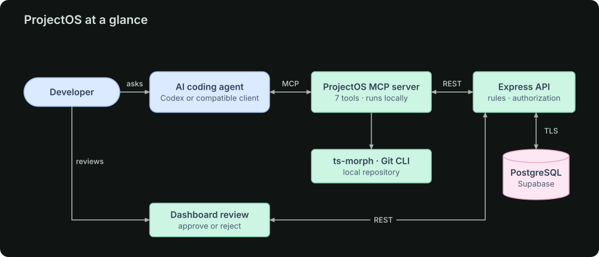
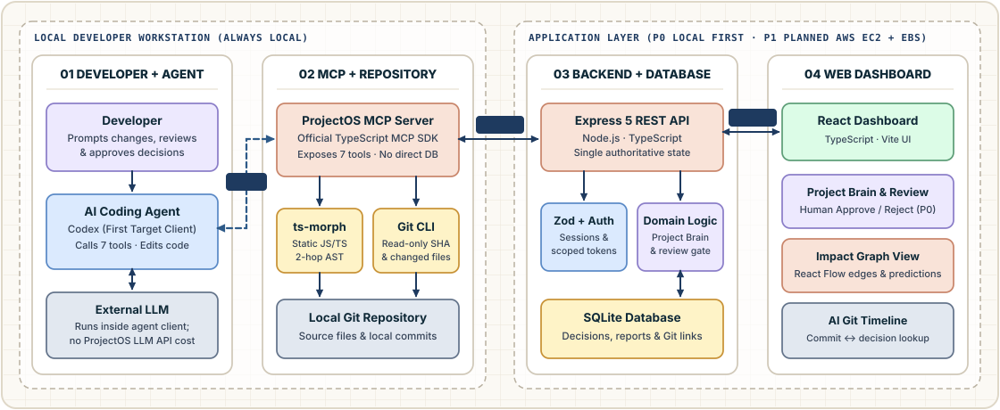

<div align="center">
  
</div>

<p align="center">
  <a href="#what-projectos-does">What It Does</a> ·
  <a href="#the-three-core-features">Core Features</a> ·
  <a href="#how-it-works-the-teamflow-walkthrough">TeamFlow Walkthrough</a> ·
  <a href="#system-architecture">System Architecture</a> ·
  <a href="#the-seven-mcp-tools">7 MCP Tools</a> ·
  <a href="#human-approval-governance">Human Approval</a> ·
  <a href="#development-roadmap--status">Roadmap</a>
</p>

---

## What ProjectOS Does

When developers build software with AI coding agents—such as **Codex**, Claude Code, or Antigravity—the codebase itself only shows *what* the code looks like today. It rarely records *why* the team chose a specific architecture, which files depend on a sensitive module, or which past design decision authorized a Git commit.

As soon as a developer starts a fresh chat session or a teammate picks up the repository, that context disappears. The coding agent can easily propose a change that breaks an existing rule or affects modules two imports away.

**ProjectOS** is an MCP-centric developer tool that gives AI coding agents structured architectural memory, real source-code dependency evidence, and Git commit traceability—while keeping human developers in control of architectural approval. It works alongside existing coding agents rather than replacing them.

| Stage | Without ProjectOS | With ProjectOS |
| :--- | :--- | :--- |
| **Before writing code** | Architectural decisions sit scattered across old chat sessions and developer memory. | The coding agent retrieves active, human-approved decisions from **Project Brain** via MCP. |
| **While planning a change** | Search results or LLM guesses miss indirect module dependencies and rule conflicts. | **Change Impact Intelligence** traces real JavaScript/TypeScript dependencies (`ts-morph`) and separates verified code edges from AI predictions. |
| **When changing architecture** | An agent can quietly drift from team rules without a recorded review checkpoint. | Agents submit pending proposals; only an authorized human can approve or reject them. |
| **After committing code** | `git log` shows which lines changed, but not the architectural decision behind the commit. | **AI Git** links real Git commit hashes and changed files to the approved decision version. |

---

## The Three Core Features

ProjectOS is built around three capabilities that share **one authoritative decision record** stored in SQLite through an Express.js 5 backend.

<div align="center">
  
</div>

### 1. Project Brain — Authoritative Architectural Memory

Project Brain stores the project's human-approved architectural decisions, rationale, file bindings, and revision history.

* **Structured records, not chat logs:** Each decision has a stable ID (such as `DEC-001`), version, title, decision statement, engineering rationale, lifecycle status (`pending`, `approved`, `rejected`, or `superseded`), reviewer attribution, and repository-relative file bindings (`related_paths`).
* **Topic and file lookup:** Coding agents can search decisions by topic (`query`), affected file path (`related_files`), or exact ID via `get_decisions` without needing to know decision IDs beforehand. Ordinary retrieval returns active `approved` decisions; historical versions are opt-in (`include_history: true`).
* **Immutable history on replacement:** ProjectOS never overwrites an approved decision in place. Proposing a replacement creates a `pending` record while the existing decision stays active. When an authorized human approves the replacement, ProjectOS activates the new version and marks the predecessor `superseded` in a single atomic transaction.

### 2. Change Impact Intelligence — Source-Grounded Blast Radius

Before a feature or refactor is implemented, Change Impact Intelligence inspects the actual local repository to show what connected code and existing decisions are involved.

<div align="center">
  
</div>

* **Starting points + static AST traversal:** The coding agent interprets the developer's natural-language request and selects candidate starting files (`starting_files`) or symbols (`starting_symbols`). Locally, `ts-morph` traces reverse dependency edges (files that directly or indirectly import the target module) up to an initial **two-hop traversal bound**.
* **Verified evidence vs. AI predictions:** Every real dependency edge records an evidence ID (`E-001`..), source file, target file, relationship type (`direct_dependent` or `indirect_dependent`), line range, and snippet. When the coding agent infers broader consequences or decision conflicts, it saves them separately via `record_impact_assessment` so predictions never overwrite verified source edges.
* **Honest boundaries:** Appearing in the dependency graph means a file is connected in source code—not that it is guaranteed to break or require edits. Static analysis is initially scoped to JavaScript/TypeScript, bounds cyclic/large graphs (100 files, 300 edges), tracks snapshot freshness (`HEAD` and worktree fingerprint), and reports unresolved imports transparently.

### 3. AI Git — Bidirectional Commit Provenance

AI Git connects existing Git commits and changed files to the approved architectural decisions they implement.

* **Real Git metadata via `Git CLI`:** ProjectOS never creates commits, branches, or pushes. After the developer creates a normal commit, `link_commit_to_decision` uses the local `Git CLI` to resolve the full commit hash, parent hashes, commit message, and changed file paths, linking them to the approved decision version.
* **Provenance and precision:** Supports many-to-many links between commits and decisions without duplicating identical associations. It distinguishes commit-level links from explicit `file_associations` and records whether a link was created by an agent, created by a human, or human-confirmed.
* **Bidirectional lookup:** Using `get_git_traceability` or the dashboard timeline, developers and agents can query by `decision_id` (*which commits implemented this decision?*), `commit_hash` (*why was this commit made?*), or `file_path` (*which decisions and commits shaped this file?*).

---

## How It Works: The TeamFlow Walkthrough

To see how the three features work together in practice, consider **TeamFlow**—an example TypeScript project-management application developed by **Rahul** (using Codex) and later continued by his teammate **Ananya** in a fresh coding session.

TeamFlow starts with three approved decisions in Project Brain:

| Decision ID | Approved Decision | Rationale | Linked Code Path |
| :--- | :--- | :--- | :--- |
| **`DEC-001`** | Only project managers can authorize task ownership changes. | Preserve accountability. | `src/services/taskAssignmentService.ts` |
| **`DEC-002`** | Every ownership change must appear in the activity log. | Maintain an audit trail. | `src/services/activityLog.ts` |
| **`DEC-003`** | Notifications are sent only after a change is successfully saved. | Avoid notifying people about failed changes. | `src/services/notificationService.ts` |

<div align="center">
  
</div>

### Phase 01 — Retrieve Approved Context
1. **Connect workspace & agent:** Rahul registers the local TeamFlow Git repository under `project_id: "teamflow"` and connects Codex to the local ProjectOS MCP server (`tools/list`).
2. **Load active rules:** At the start of his coding session, Codex calls `get_decisions({project_id: "teamflow"})` and retrieves `DEC-001`, `DEC-002`, and `DEC-003` from SQLite without needing earlier chat transcripts.

### Phase 02 — Analyze Change Impact
3. **Request a feature:** Rahul asks Codex: *"Automatically reassign unfinished tasks when an employee goes on leave. Before editing, check what this might affect."*
4. **Trace real code dependencies:** Codex identifies `src/services/taskAssignmentService.ts` as the starting file and calls `analyze_change`. Locally, `ts-morph` discovers two direct dependents (`src/routes/taskRoutes.ts` as `E-001` and `src/services/bulkTaskService.ts` as `E-002`) and one two-hop indirect dependent (`src/services/projectOperations.ts` as `E-003`), while Project Brain surfaces `DEC-001`. ProjectOS saves report **`IMP-001`**.
5. **Record AI predictions separately:** Codex recognizes that automatic reassignment conflicts with `DEC-001` (manager-only authorization) and predicts that a leave-status UI will be needed. It calls `record_impact_assessment` to save both items as labelled AI predictions alongside `IMP-001`.

### Phase 03 — Human Review & Approval
6. **Redesign & propose:** Reviewing `IMP-001`, Rahul revises the design: TeamFlow will *suggest* reassignment options when an employee is on leave, and a manager must approve them. Codex runs `analyze_change` on the revised plan (`IMP-002`) and calls `propose_decision` to record the new rule. Express saves **`DEC-004`** (*"Leave-related task reassignment"*) with `status: "pending"`.
7. **Approve & resume:** Codex pauses architectural work. Rahul opens the authenticated ProjectOS dashboard, reviews `DEC-004` with `IMP-002`, and approves it. When Rahul asks Codex to continue, Codex calls `get_decision_status({project_id: "teamflow", decision_id: "DEC-004"})` once, verifies `status: "approved"`, and proceeds.

### Phase 04 — Record & Reuse Across Sessions
8. **Implement, commit, and link:** Codex implements the feature (`taskAssignmentService.ts`, `managerApproval.ts`, `leaveStatus.ts`). Rahul tests the changes and creates a normal Git commit (short display hash `a7c92f1`). Codex calls `link_commit_to_decision` to bind the full commit hash to `DEC-004`.
9. **Teammate continuity:** Later, **Ananya** opens TeamFlow in a fresh session and asks: *"Why does task reassignment require manager approval? Can I remove that step?"* Her agent calls `get_decisions` and `get_git_traceability({project_id: "teamflow", file_path: "src/services/taskAssignmentService.ts"})`, recovering `DEC-001`, `DEC-004`, the recorded rationale, and commit `a7c92f1`.

---

## System Architecture

ProjectOS separates **local repository analysis** from **shared state and human approval**.

<div align="center">
  
</div>

### Key Architectural Boundaries

* **No internal LLM cost (`NF-01`):** Model reasoning runs entirely inside the developer's connected coding client (Codex). ProjectOS hosts no proprietary LLM and makes no separately billed inference calls.
* **Independent local repository adapters:** The local MCP server invokes **`ts-morph`** and **`Git CLI`** independently against the registered local Git repository (`Git CLI` does not feed into `ts-morph` as a sequential pipeline). Even when the backend and dashboard are later deployed to **AWS EC2 + Amazon EBS**, source scanning and Git inspection remain on the developer's machine.
* **Single authoritative backend (`WS-04`):** The Express.js 5 API owns SQLite access, Zod validation, and decision lifecycle transitions. Neither the local MCP server nor the React browser client accesses SQLite directly.
* **Independent dashboard views:** The React dashboard (`React`, `TypeScript`, `Vite`, `React Flow`) provides five independent views—**Project Setup**, **Project Brain**, **Decision Review**, **Impact Report**, and **AI Git**—rather than a sequential service chain.

---

## The Seven MCP Tools

ProjectOS exposes its capabilities through seven MCP tools discovered via `tools/list` and invoked via `tools/call`. Every tool requires `project_id`.

| Tool Name | Feature & Mode | Required Inputs | Optional / Conditional Inputs | Purpose & Return Value |
| :--- | :--- | :--- | :--- | :--- |
| **`get_decisions`** | Project Brain *(Read)* | `project_id` | `query`, `decision_id`, `related_files`, `status`, `include_history`, `limit` | Retrieves matching decisions, statements, rationale, status, file bindings, and opt-in history. Defaults to active `approved` decisions (default 10, max 50). |
| **`analyze_change`** | Change Impact *(Analyze + Write)* | `project_id`, `change_description`, plus starting code | `starting_files` or `starting_symbols` (at least one required) | Runs 2-hop `ts-morph` reverse dependency analysis, matches active decisions by path, saves report (`IMP-001`), and returns verified edges (`E-001..`), snippets, and limits. |
| **`record_impact_assessment`** | Change Impact *(Write Predictions)* | `project_id`, `report_id`, `predictions` | Per prediction: `evidence_ids`, `decision_ids` | Saves the coding agent's semantic predictions and conflict warnings separately from verified AST edges. Cannot modify approved decisions. |
| **`propose_decision`** | Project Brain *(Write Proposal)* | `project_id`, `title`, `decision`, `rationale`, `related_paths` | `related_decision_ids`, `impact_report_id`, `supersedes_decision_id` | Saves a new or replacement proposal as `pending` (`DEC-004`). Returns ID, version, `pending` status, and dashboard review URL in `P0` (or triggers elicitation in `P1`). |
| **`get_decision_status`** | Project Brain *(Read Status)* | `project_id`, `decision_id` | — | Checks the persisted review outcome (`approved`, `pending`, `rejected`, `superseded`), version, and feedback when resuming after human review. |
| **`link_commit_to_decision`** | AI Git *(Write Link)* | `project_id`, `commit_hash`, `decision_id` | `file_associations` | Resolves the full commit hash and changed paths via local `Git CLI`, verifies the decision is `approved`, and saves an idempotent commit-to-decision association. |
| **`get_git_traceability`** | AI Git *(Read)* | `project_id`, plus one selector | One of `decision_id`, `commit_hash`, or `file_path` | Queries bidirectional provenance between decisions, commits, and files; explicitly identifies unlinked changes or missing local commit objects. |

<details>
<summary><strong>View Example JSON Payloads for All Seven MCP Tools</strong></summary>

```json
// 1. get_decisions — Find approved rules about task reassignment
{
  "project_id": "teamflow",
  "query": "task reassignment",
  "status": "approved"
}

// 2. analyze_change — Trace 2-hop JS/TS dependencies from a starting file
{
  "project_id": "teamflow",
  "change_description": "Automatically reassign unfinished tasks when an employee becomes unavailable",
  "starting_files": ["src/services/taskAssignmentService.ts"]
}

// 3. record_impact_assessment — Save AI predictions separately from verified AST edges
{
  "project_id": "teamflow",
  "report_id": "IMP-001",
  "predictions": [
    {
      "prediction": "Automatic reassignment may conflict with manager-only authorization.",
      "reason": "The proposed workflow changes ownership without manager approval.",
      "decision_ids": ["DEC-001"]
    }
  ]
}

// 4. propose_decision — Submit a pending architectural proposal for human review
{
  "project_id": "teamflow",
  "title": "Leave-related task reassignment",
  "decision": "Suggest reassignment options when an employee is unavailable; a manager must authorize any ownership change.",
  "rationale": "Reduce manual coordination while preserving managerial accountability.",
  "related_decision_ids": ["DEC-001"],
  "related_paths": ["src/services/taskAssignmentService.ts"],
  "impact_report_id": "IMP-002"
}

// 5. get_decision_status — Check review status once when resuming
{
  "project_id": "teamflow",
  "decision_id": "DEC-004"
}

// 6. link_commit_to_decision — Associate a real Git commit with an approved decision
{
  "project_id": "teamflow",
  "commit_hash": "<full hash of the actual local Git commit>",
  "decision_id": "DEC-004"
}

// 7. get_git_traceability — Retrieve recorded decisions and commits for a file
{
  "project_id": "teamflow",
  "file_path": "src/services/taskAssignmentService.ts"
}
```

</details>

---

## Human Approval Governance

The core security boundary in ProjectOS is separating **proposal creation** from **human approval** (`PB-05`–`PB-08`). Ordinary MCP-to-API requests use a project-scoped agent credential that can read decisions and create pending proposals, reports, and commit links—but can **never** approve a decision.

<div align="center">
  
</div>

1. **Primary `P0` Path — Authenticated Dashboard Review:** `propose_decision` saves the proposal as `pending` in SQLite and returns immediately. The coding agent pauses without holding a database transaction open or polling in a loop. The developer reviews the proposal and its impact graph in the React dashboard (authenticated via **Express Sessions** with `HttpOnly` cookies and CSRF protection) and approves or rejects the exact version. On return, the agent calls `get_decision_status` once to resume.
2. **Later `P1` Enhancement — Trusted MCP Elicitation:** After the local `P0` workflow is verified, `propose_decision` can request in-client human review via MCP elicitation (`elicitation/create`), where the coding client UI—not the LLM—presents the proposal to the developer. A trusted reviewer-bound channel persists the decision through the same backend review service.
3. **Fail-Closed Fallback:** If elicitation is unsupported, cancelled, timed out, deferred, or untrusted, ProjectOS leaves the proposal `pending` and falls back to the authenticated dashboard. Routine code changes that already comply with approved architecture proceed without creating new proposals.

---

## Technology Stack & Engineering Structure

| Layer | Technology | Role in ProjectOS |
| :--- | :--- | :--- |
| **Frontend** | React.js, TypeScript, Vite, React Flow | Authenticated human review dashboard and interactive dependency graph visualization |
| **Backend** | Node.js, Express.js 5, TypeScript, Zod | REST APIs, domain services, schema validation, and transactional decision lifecycle rules |
| **Database** | SQLite | Persistent storage for projects, decisions, review events, impact reports, predictions, and Git links |
| **MCP Integration** | Model Context Protocol, Official TypeScript MCP SDK | Local server exposing the 7 ProjectOS tools to interactive coding clients |
| **Code Intelligence** | `ts-morph`, `Git CLI` | Local JS/TS dependency tracing (`ts-morph`) and read-only commit/diff inspection (`Git CLI`) |
| **AI / LLM** | Agent-agnostic LLM reasoning *(Codex initial target)* | Connected coding agent interprets prompts and reasons about evidence; no ProjectOS-hosted model |
| **APIs & Security** | REST over HTTP(S), Express Sessions, Scoped Credentials | Separates human review authority from restricted MCP agent credentials |
| **Planned Cloud** | AWS EC2, Amazon EBS *(Planned in P1 after local gate)* | Hosts shared Express API and built React frontend on EC2 with SQLite persisted on EBS |

<details>
<summary><strong>Target TypeScript Monorepo Layout &amp; Quality Gates (ORG-01 – ORG-05)</strong></summary>

The engineering specification defines a TypeScript npm-workspaces monorepo where applications (`apps/web`, `apps/api`, `apps/mcp`) depend on shared packages (`packages/contracts`, `packages/repo-analysis`, `packages/git-adapter`), while shared packages never import application internals:

```text
projectos/
├── apps/
│   ├── web/                   # React + Vite + React Flow dashboard (REST client only)
│   ├── api/                   # Express 5 + Zod + Express Sessions + SQLite domain backend
│   └── mcp/                   # Official TypeScript MCP SDK server (7 tool handlers)
├── packages/
│   ├── contracts/             # Shared Zod schemas and transport-independent DTOs
│   ├── repo-analysis/         # Local ts-morph AST dependency analyzer
│   └── git-adapter/           # Read-only local Git CLI evidence adapter
├── tests/                     # Integration, E2E, and controlled real-source/Git fixtures
└── package.json               # Root lockfile and verification scripts (lint, typecheck, test, build)
```

</details>

---

## Development Roadmap & Status

### Current Repository Status

> [!NOTE]
> **Architectural Specification Complete · Monorepo Implementation in Progress:**
> This repository currently publishes the public architectural documentation and visual diagrams for ProjectOS. The runnable TypeScript monorepo workspaces (`apps/web`, `apps/api`, `apps/mcp`, `packages/*`), SQLite migrations, and root `package.json` scripts are planned implementation deliverables (`E01`–`E11`) and are not yet committed to this public repository.

### Release Priorities (`P0` → `P2`)

| Priority | Milestone | Scope & Exit Criteria |
| :--- | :--- | :--- |
| **`P0`** | **Basic Checkpoint** | Workspace bootstrap (`E01`), persistent approved decision in SQLite (`E02`), one live Codex-to-ProjectOS MCP retrieval (`E03`), and minimal functional UI. |
| **`P0`** | **Integrated Local Hackathon MVP** | All three core features with the 7-tool MCP contract, two-hop `ts-morph` dependency evidence (`E05`–`E06`), authenticated dashboard approval and manual resumption (`E04`), explicit Git association (`E07`), React views (`E08`), persistence across restarts, and end-to-end TeamFlow verification (`E09` / `T01`–`T13`). |
| **`P1`** | **Trusted MCP Elicitation** *(After Local Gate)* | Add trusted in-client human review (`elicitation/create`) to `propose_decision` using the same backend review service, while retaining fail-closed dashboard fallback (`E10` / `T04`). |
| **`P1`** | **AWS Deployment** *(After Local Gate)* | Deploy the verified Express backend and React build to **AWS EC2** with SQLite persisted on **Amazon EBS** over HTTPS (`E11` / `T14`). Local MCP, `ts-morph`, and `Git CLI` remain local. |
| **`P2`** | **Scoped Enhancements** | Richer dashboard filters, graph navigation polish, optional file-level commit associations, and broader JS/TS syntax support where time permits. |

### Explicit Non-Goals

To keep the system focused and verifiable, ProjectOS explicitly excludes:
* Hosting a standalone coding agent, training custom models, or calling a separate paid inference API.
* Automatically creating Git commits, pushing branches, or running competing experimental architectures.
* Claiming complete runtime impact recall or forcibly blocking an external coding agent that holds direct local filesystem permissions.
* Deferred exploration concepts on hold: Proof Engine, Cross-Agent Conflict Detection, Decision Comparison, automated CI testing orchestration, automatic architectural-violation detection, Intent Drift Detector, Assumption Radar, MCP Tool Trust Sentinel, MCP RetryShield, and MCP Value Meter.

---

## Maintainer

**Prajwal Govekar** — [@prajwal-govekar17](https://github.com/prajwal-govekar17)
