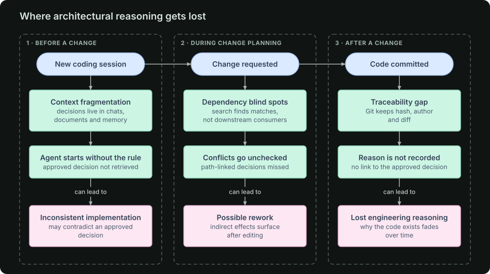
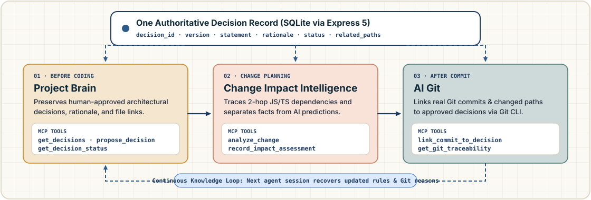
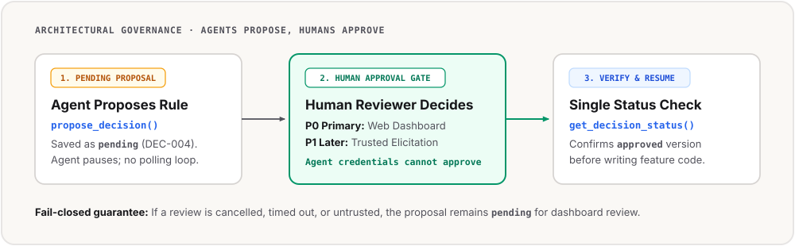

<div align="center">
  
</div>

<p align="center">
  <a href="#the-problem-projectos-solves">The Problem</a> ·
  <a href="#why-this-matters-in-ai-assisted-development">Why It Matters</a> ·
  <a href="#the-three-core-features">Core Features</a> ·
  <a href="#system-architecture--boundaries">System Architecture</a> ·
  <a href="#end-to-end-operational-workflow">Operational Workflow</a> ·
  <a href="#human-approval--governance">Human Governance</a> ·
  <a href="#the-seven-mcp-tools">7 MCP Tools</a> ·
  <a href="#end-to-end-example-the-teamflow-scenario">TeamFlow Example</a> ·
  <a href="#mvp-scope-roadmap--current-status">MVP &amp; Roadmap</a>
</p>

---

## What Is ProjectOS?

**ProjectOS** is an MCP-centric software engineering platform that connects AI coding agents—starting with **Codex** alongside compatible clients such as Claude Code and Antigravity—with a project's human-approved architectural decisions, real source-code dependency relationships, and Git commit provenance.

ProjectOS does **not** replace the developer's coding agent, host a separate LLM, or wrap Git in automatic commits. Instead, it runs a local **Model Context Protocol (MCP)** server next to the developer's repository and pairs it with a shared **Express.js 5 + SQLite** backend and a **React** governance dashboard:

1. **Before writing code**, the coding agent retrieves active, human-approved architectural decisions and rationale from **Project Brain**.
2. **While planning a change**, **Change Impact Intelligence** uses `ts-morph` to trace actual JavaScript/TypeScript code dependencies up to two hops, surfaces affected decisions, and separates verified source evidence from AI predictions.
3. **When an architectural rule needs to change**, the agent submits a pending proposal that only an **authorized human** can approve or reject.
4. **After the developer commits code**, **AI Git** uses `Git CLI` to bind the real commit hash and changed file paths to the approved decision version so future sessions can recover *why* the change was made.

---

## The Problem ProjectOS Solves

When a developer works with an AI coding agent, the source tree shows *what* the code looks like today, not the engineering decisions that shaped it. Across multiple coding sessions, feature branches, or teammates, architectural knowledge breaks down at three distinct stages of development:

<div align="center">
  
</div>

| Development Stage | What Breaks Down | What Happens in Practice |
| :--- | :--- | :--- |
| **1. Before a Change** *(Context Fragmentation)* | Architectural rules, rejected alternatives, and system constraints sit in old chat threads, PR comments, or a single developer's memory. | A fresh coding session—or a teammate opening the same repository—has no reliable way to retrieve active architectural rules before editing files. |
| **2. Change Planning** *(Impact Blind Spots)* | Keyword search and prompt-only LLM guesses cannot reliably trace transitive module imports or check how a change interacts with existing rules. | A feature that looks local silently touches downstream consumers two imports away or contradicts an approved architectural decision. |
| **3. After a Change** *(Traceability Gaps)* | `git log` and `git diff` preserve commit hashes, authors, and line changes, but not the structured architectural decision or human approval that authorized them. | Months later, engineers and coding agents can see *which* lines changed in a service, but cannot answer *why* that design rule exists or whether it is safe to remove. |

---

## Why This Matters in AI-Assisted Development

Modern AI coding agents can generate and edit multi-file changes in seconds, which shifts the engineering bottleneck from **writing syntax** to **maintaining architectural coherence**:

* **Speed amplifies architectural drift:** When an agent can modify five modules in one turn, an unspotted conflict with a permission rule or transaction boundary creates immediate rework.
* **Agents need structured tools, not longer system prompts:** Stuffing every past decision into a static instruction file scales poorly and provides no workflow for proposing, reviewing, or superseding rules as the system evolves.
* **Guesses are not evidence:** Developers reviewing an AI-proposed refactor need to know which warnings come from actual static imports in the repository (`ts-morph`) and which warnings are semantic hypotheses from the model.
* **Accountability requires a human checkpoint:** Allowing an AI tool to edit local files is an editor permission; changing a project's architectural policy is an engineering governance decision that must remain under explicit human control.

---

## The Three Core Features

ProjectOS is built around three capabilities—**Project Brain**, **Change Impact Intelligence**, and **AI Git**—that read and write to **one authoritative decision record** in SQLite.

<div align="center">
  
</div>

| Developer Question | Lifecycle Stage | Answering Feature | Underlying Mechanism |
| :--- | :--- | :--- | :--- |
| *"What have we already decided on this topic or file, and why?"* | **Before Coding** | **Project Brain** | Parameterized SQLite lookup over decision titles, statements, rationale, and normalized repository-relative file bindings (`get_decisions`). |
| *"Who approved replacing the old rule, and what did it supersede?"* | **Before / After** | **Project Brain** | Immutable decision versions with atomic supersession transitions (`pending` → `approved`, predecessor → `superseded`). |
| *"If we make this change, which connected files and active decisions are involved?"* | **Change Planning** | **Change Impact Intelligence** | Reverse AST dependency traversal via `ts-morph` (up to 2 hops) combined with path-matched Project Brain decisions (`analyze_change`). |
| *"Which warnings are proven source imports versus AI hypotheses?"* | **Change Planning** | **Change Impact Intelligence** | Verified dependency edges (`E-001`..) stored separately from agent-submitted semantic predictions (`record_impact_assessment`). |
| *"Which real Git commits implemented this approved decision?"* | **After Commit** | **AI Git** | Local `Git CLI` commit resolution bound to the approved decision ID and version (`link_commit_to_decision`). |
| *"Why was this file or commit changed in an earlier session?"* | **After Commit** | **AI Git → Project Brain** | Bidirectional provenance lookup by `decision_id`, `commit_hash`, or `file_path` (`get_git_traceability`). |

---

## System Architecture & Boundaries

ProjectOS is structured into four connected layers that separate **local repository operations** on the developer's machine from **shared application state and human approval** in the backend and web dashboard.

<div align="center">
  
</div>

### How the Four Layers Communicate

1. **Layer 01 — Developer & External AI Coding Agent:**
   * The **developer** defines the feature request, reviews impact evidence, approves or rejects architectural proposals, tests code edits, and creates normal Git commits.
   * The **AI coding agent** (**Codex** as the first target client) interprets natural-language requests, identifies candidate starting files, calls ProjectOS MCP tools, reasons about indirect consequences, and writes code in the IDE/CLI.
   * **External LLM reasoning:** All model inference runs inside the connected coding agent's environment. ProjectOS hosts **no internal LLM** and makes **zero separately billed LLM API calls** (`NF-01`).
2. **Layer 02 — Local ProjectOS MCP Server & Repository Adapters:**
   * Built with the **Official TypeScript MCP SDK**, the local MCP server exposes the seven ProjectOS tools to the coding agent over MCP (`tools/list`, `tools/call`, and later `elicitation/create`).
   * It invokes **`ts-morph`** (for JavaScript/TypeScript static dependency analysis) and **`Git CLI`** (for read-only commit and diff resolution) **independently** against the local Git repository. `Git CLI` does not feed into `ts-morph` as a sequential pipeline.
   * The MCP server never opens the SQLite database directly; it exchanges structured JSON records and bounded evidence snippets with the Express backend over REST.
3. **Layer 03 — Express.js 5 Backend & SQLite Database:**
   * **Express.js 5** (`Node.js`, `TypeScript`) is the single authoritative service (`WS-04`) for project scoping, **Zod** runtime schema validation, decision lifecycle rules, and durable writes to **SQLite**.
   * **Strict authentication split:** Browser dashboard reviews use authenticated **Express Sessions** (`HttpOnly` cookies, `SameSite` policy, CSRF protection), whereas ordinary MCP-to-API requests use a project-scoped agent credential that is restricted from calling approval routes.
4. **Layer 04 — React Web Dashboard:**
   * Built with **React.js**, **TypeScript**, **Vite**, and **React Flow**, the dashboard provides five **independent views** (*Project Setup*, *Project Brain*, *Decision Review*, *Impact Report*, and *AI Git Timeline*) that read and mutate shared state over REST.

### Local-First Execution vs. Planned AWS Deployment

| Environment | What Runs Locally on the Developer's Machine | What Runs in the Shared Application Layer |
| :--- | :--- | :--- |
| **`P0` — Local Hackathon MVP** *(Current Priority)* | Developer IDE/CLI, Codex agent, Local ProjectOS MCP server, `ts-morph`, `Git CLI`, and the Local Git Repository — plus the local Express 5 API, SQLite file, and React dashboard over loopback HTTP. | All components run locally on the developer workstation with zero cloud dependency. |
| **`P1` — Planned Cloud Deployment** *(After Local Gate Passes)* | Developer IDE/CLI, Codex agent, Local ProjectOS MCP server, `ts-morph`, `Git CLI`, and the Local Git Repository **remain strictly local**. | Express 5 API and the built React frontend run on **AWS EC2** over HTTPS, with SQLite and session state persisted on an attached **Amazon EBS** volume. EC2 never mounts or reads the developer's raw local disk. |

---

## End-to-End Operational Workflow

The diagram below traces the complete operational lifecycle across four phases—**01 Setup + Retrieve**, **02 Analyze**, **03 Decide**, and **04 Record**—showing how tasks move between the **Developer** (lavender), the **Coding Agent** (blue), **ProjectOS** (peach), and **Human Review** (green), with **MCP tool calls** shown as dashed connectors:

<div align="center">
  
</div>

### Stage-by-Stage Breakdown

1. **01 Setup + Retrieve (`WS-01..04`, `PB-01..02`):**
   * The developer registers the local Git repository with a stable `project_id` (storing machine-specific folder paths locally) and connects the MCP coding agent (`tools/list`).
   * Project Brain is seeded with the team's approved architectural decisions (either created in the dashboard or proposed and approved).
   * When the developer requests a feature, the coding agent calls `get_decisions` via MCP to load active approved decisions before proposing edits.
2. **02 Analyze (`CI-01..08`):**
   * The coding agent identifies candidate starting files or symbols from the user's request and invokes `analyze_change`.
   * ProjectOS runs `ts-morph` locally to trace direct (1-hop) and indirect (2-hop) reverse dependencies, looks up active decisions linked to those paths in Project Brain, and saves an impact report in SQLite.
   * The agent interprets the report and optionally calls `record_impact_assessment` to save potential decision conflicts or broader architectural hypotheses as separately labelled **AI predictions**.
3. **03 Decide (`PB-03..08`):**
   * The human reviews the impact findings and chooses one of three paths:
     * **No decision change:** If the implementation respects existing approved rules, the agent proceeds directly to coding without creating an unnecessary proposal (`PB-08`).
     * **Redesign:** If the impact report reveals an unwanted conflict, the developer revises the plan and re-analyzes.
     * **New or replacement decision:** The agent calls `propose_decision` via MCP. ProjectOS saves the record as `pending` (`DEC-004`). The human approves or rejects it in the dashboard (`P0`), or via trusted in-client elicitation (`P1`). If rejected, the old rule stays active; if approved, the decision becomes active (and atomically supersedes any targeted predecessor).
4. **04 Record (`GT-01..05`):**
   * Once resumed (`get_decision_status`), the coding agent implements the reviewed plan in the IDE.
   * The developer reviews, tests, and creates a normal Git commit.
   * The agent (or developer) calls `link_commit_to_decision`. Local `Git CLI` verifies the full commit hash and changed file paths, storing the association in SQLite.
   * Any future agent session can call `get_decisions` and `get_git_traceability` to recover both the active architectural rule and the commits that implemented it.

---

## Deep Dive: How Each Core Feature Works

### 1. Project Brain: Structured Memory & Lifecycle Rules

Project Brain is designed around strict state invariants so an AI coding agent never confuses a tentative suggestion with an approved architectural rule:

* **Rich Decision Schema (`PB-01`):** Every decision stores `project_id`, `decision_id`, `version`, `title`, `decision` statement, `rationale`, `status` (`pending`, `approved`, `rejected`, `superseded`), `reviewer`, review channel, timestamps, `related_paths` (normalized repository-relative paths), and optional `predecessor_id`.
* **Bounded, Deterministic Retrieval (`PB-02`):** `get_decisions` uses parameterized SQLite keyword matching over title, statement, and rationale plus exact file-path joins (default limit `10`, hard cap `50` with truncation indicators). It does not rely on an external embedding service or claim fuzzy semantic omniscience. Discovery defaults strictly to `approved` records; `pending`, `rejected`, and `superseded` records are returned only when explicitly requested by status, exact ID, or `include_history: true`.
* **Immutable Revisions & Atomic Supersession (`PB-03`, `PB-04`):** Approved decisions are never mutated in place. Proposing a replacement creates a new `pending` proposal pointing to the active predecessor while the predecessor remains active. When an authorized human approves the exact pending version, Express activates the replacement and transitions the predecessor to `superseded` in one database transaction—preserving earlier rationale and commit links intact.

---

### 2. Change Impact Intelligence: Verified AST Evidence vs. AI Predictions

A central engineering principle of ProjectOS is separating **what the code scanner proved** from **what the LLM inferred**.

<div align="center">
  
</div>

* **Why starting candidates come from the agent (`CI-01`):** A static AST analyzer cannot guess which file corresponds to a natural-language prompt like *"handle employee leave."* The coding agent uses its repository exploration tools to pick concrete `starting_files` or `starting_symbols`, which ProjectOS validates against the registered repository root.
* **Reverse 2-Hop Traversal & Safety Bounds (`CI-02`, `CI-08`):** Starting from the target file, `ts-morph` follows reverse dependency edges (files that import or reference the target) up to **two hops** using a visited set to terminate cleanly on cyclic graphs. Output is bounded (initially `100` files, `300` edges, and a configurable time budget), returning an explicit partial-result indicator if any limit is reached.
* **Four Distinct Categories of Information (`CI-03..05`):**
  1. **Verified Repository Edges (`dependency_edges`):** Confirmed by `ts-morph` (e.g., `E-001`, `E-002`, `E-003`), recording source path, target path, relationship type (`direct_dependent` or `indirect_dependent`), line range, bounded snippet, and traversal chain.
  2. **Recorded Decision Associations:** Active Project Brain decisions explicitly mapped to the starting or discovered file paths.
  3. **AI Predictions (`predictions`):** Saved via `record_impact_assessment` with agent attribution, rationale, and optional references to `evidence_ids` or `decision_ids`. Stored in a separate SQLite table so predictions can never overwrite verified edges.
  4. **Explicit Limitations & Freshness (`CI-06`):** Every report records `HEAD`, a worktree content fingerprint for analyzed files, and consulted decision versions. If files or decisions change later, the report is shown as a historical snapshot or marked stale.

---

### 3. AI Git: Bidirectional Commit-to-Decision Provenance

Git records *what* changed; AI Git records *which approved decision explains the change* without interfering with standard Git usage.

* **Read-Only Local `Git CLI` Adapter (`GT-01`):** ProjectOS never runs `git commit`, `git branch`, `git rebase`, or `git push`. When `link_commit_to_decision` is called after a normal commit, the local adapter invokes `Git CLI` with fixed argument arrays to resolve the full 40-character SHA, parent hashes, author metadata, commit message, and actual changed file paths.
* **Many-to-Many Links & Provenance (`GT-02`, `GT-04`):** One commit can link to multiple decisions, and one decision can span multiple commits. ProjectOS deduplicates repeated identical links, distinguishes commit-level membership from explicit `file_associations`, and records association provenance (`agent-recorded`, `human-recorded`, or `human-confirmed`).
* **Three-Way Traceability Lookup (`GT-03`, `GT-05`):** Calling `get_git_traceability` with:
  * `decision_id` → returns all commits and changed files that implemented that decision.
  * `commit_hash` → returns the approved decision(s) and recorded rationale behind that commit.
  * `file_path` → returns the historical commits and linked decisions affecting that file.
  If a commit has no linked decision, ProjectOS reports it as **unlinked** rather than asking an LLM to fabricate a retrospective excuse.

---

## Human Approval & Governance

The most critical security boundary in ProjectOS is preventing an AI coding agent from approving its own architectural proposals (`PB-05`–`PB-08`).

<div align="center">
  
</div>

### How the Two Review Channels Work

| Aspect | `P0` Primary Path: Authenticated Dashboard Review | `P1` Later Enhancement: Trusted MCP Elicitation |
| :--- | :--- | :--- |
| **When it is built** | Mandatory for the initial local MVP (`E04` / `T05`). | Added **only after** the entire `P0` local workflow passes (`E10` / `T04`). |
| **How review is triggered** | `propose_decision` saves the proposal as `pending` in SQLite and immediately returns `decision_id`, `version`, `status: "pending"`, and the dashboard review location. | `propose_decision` saves the proposal as `pending` first, negotiates client support, and issues a server-initiated protocol request (`elicitation/create` or input-required retry). |
| **What the agent does while waiting** | **Stops work cleanly.** No open database transaction is held, and no background polling loop runs. | Waits for the client's interactive human-input response within the active session. |
| **How human identity is verified** | Browser login protected by **Express Sessions**, `HttpOnly` cookies, `SameSite` policy, and CSRF tokens (`POST /api/projects/:id/decisions/:decisionId/review`). | The coding client UI (never the model) presents the exact proposal and submits the response over a **reviewer-bound channel** to the **same backend review service**. |
| **How the agent resumes** | When the developer returns and asks the agent to continue, the agent calls `get_decision_status` once to verify the persisted state. | If trusted immediate approval succeeds, `propose_decision` returns the persisted `approved` state directly. |
| **Failure / Fallback behavior** | Abandoned reviews remain `pending`; stale versions or replayed requests return `HTTP 409 Conflict`. | **Fails closed:** If elicitation is unsupported, cancelled, timed out, deferred, or untrusted, the proposal stays `pending` and falls back to the `P0` dashboard. |

---

## The Seven MCP Tools

ProjectOS exposes its entire agent interface through seven MCP tools. Every tool requires `project_id` to scope access to an authorized workspace.

| # | MCP Tool | Feature & Mode | Required Inputs | Optional / Conditional Inputs | What ProjectOS Does & Returns |
| :-: | :--- | :--- | :--- | :--- | :--- |
| **1** | **`get_decisions`** | Project Brain *(Read-only)* | `project_id` | `query`, `decision_id`, `related_files`, `status`, `include_history`, `limit` | Queries SQLite via Express for matching decisions, statements, rationale, status, file bindings, and opt-in history. Defaults to active `approved` decisions. |
| **2** | **`analyze_change`** | Change Impact *(Analyze + Save)* | `project_id`, `change_description`, plus starting code | `starting_files` or `starting_symbols` (at least one required) | Validates paths locally, runs 2-hop `ts-morph` reverse dependency traversal, looks up path-linked decisions, persists report (`IMP-001`), and returns verified edges (`E-001`..), snippets, snapshot state, and limits. |
| **3** | **`record_impact_assessment`** | Change Impact *(Write Predictions)* | `project_id`, `report_id`, `predictions` | Per prediction: `evidence_ids`, `decision_ids` | Validates referenced IDs and saves the coding agent's semantic predictions and conflict warnings in SQLite separately from verified AST edges. |
| **4** | **`propose_decision`** | Project Brain *(Write Proposal)* | `project_id`, `title`, `decision`, `rationale`, `related_paths` | `related_decision_ids`, `impact_report_id`, `supersedes_decision_id` | Persists a new or replacement proposal as `pending` (`DEC-004`) with idempotency protection. Returns pending ID, version, and dashboard URL in `P0` (or initiates trusted elicitation in `P1`). |
| **5** | **`get_decision_status`** | Project Brain *(Read Status)* | `project_id`, `decision_id` | — | Reads the latest persisted review outcome (`approved`, `pending`, `rejected`, `superseded`), version, reviewer feedback, and timestamp on manual resumption. |
| **6** | **`link_commit_to_decision`** | AI Git *(Write Link)* | `project_id`, `commit_hash`, `decision_id` | `file_associations` | Uses local `Git CLI` to resolve the full commit hash and changed paths, verifies the decision is `approved` for the project, and stores an idempotent association. |
| **7** | **`get_git_traceability`** | AI Git *(Read-only)* | `project_id`, plus one selector | One of: `decision_id`, `commit_hash`, or `file_path` | Retrieves stored commit-to-decision associations, rationale, supersession history, and live local Git metadata where available; flags unlinked changes honestly. |

<details>
<summary><strong>Inspect All Seven MCP Tool JSON Payloads (TeamFlow Wire Examples)</strong></summary>

#### 1. `get_decisions` — Discover active rules by topic or file
```json
{
  "project_id": "teamflow",
  "query": "task reassignment",
  "status": "approved"
}
```

#### 2. `analyze_change` — Trace 2-hop dependencies from a starting file
```json
{
  "project_id": "teamflow",
  "change_description": "Automatically reassign unfinished tasks when an employee becomes unavailable",
  "starting_files": ["src/services/taskAssignmentService.ts"]
}
```

Example structured report returned by `analyze_change`:
```json
{
  "report_id": "IMP-001",
  "project_id": "teamflow",
  "starting_files": ["src/services/taskAssignmentService.ts"],
  "verified_relationships": [
    {
      "file": "src/routes/taskRoutes.ts",
      "type": "direct_dependent",
      "depends_on": "src/services/taskAssignmentService.ts",
      "evidence_id": "E-001"
    },
    {
      "file": "src/services/bulkTaskService.ts",
      "type": "direct_dependent",
      "depends_on": "src/services/taskAssignmentService.ts",
      "evidence_id": "E-002"
    },
    {
      "file": "src/services/projectOperations.ts",
      "type": "indirect_dependent",
      "chain": ["projectOperations.ts", "bulkTaskService.ts", "taskAssignmentService.ts"],
      "evidence_ids": ["E-003", "E-002"]
    }
  ],
  "related_decisions": ["DEC-001"],
  "limitations": ["Static dependency tracing does not establish all runtime behavior or required edits"]
}
```

#### 3. `record_impact_assessment` — Persist AI predictions separately from verified edges
```json
{
  "project_id": "teamflow",
  "report_id": "IMP-001",
  "predictions": [
    {
      "prediction": "Automatic reassignment may conflict with manager-only authorization.",
      "reason": "The proposed workflow changes ownership without manager approval.",
      "decision_ids": ["DEC-001"]
    },
    {
      "prediction": "A leave-status interface may be needed.",
      "reason": "Employees need a way to report that they are unavailable."
    }
  ]
}
```

#### 4. `propose_decision` — Submit a pending architectural decision
```json
{
  "project_id": "teamflow",
  "title": "Leave-related task reassignment",
  "decision": "Suggest reassignment options when an employee is unavailable; a manager must authorize any ownership change.",
  "rationale": "Reduce manual coordination while preserving managerial accountability.",
  "related_decision_ids": ["DEC-001"],
  "related_paths": ["src/services/taskAssignmentService.ts"],
  "impact_report_id": "IMP-002"
}
```

#### 5. `get_decision_status` — Verify human approval on resumption
```json
{
  "project_id": "teamflow",
  "decision_id": "DEC-004"
}
```

#### 6. `link_commit_to_decision` — Link a real Git commit to an approved decision
```json
{
  "project_id": "teamflow",
  "commit_hash": "<full hash of the actual local Git commit>",
  "decision_id": "DEC-004"
}
```

#### 7. `get_git_traceability` — Query why a file or commit was changed
```json
{
  "project_id": "teamflow",
  "file_path": "src/services/taskAssignmentService.ts"
}
```

</details>

---

## End-to-End Example: The TeamFlow Scenario

To see how ProjectOS operates across multiple sessions and developers, the specification defines the **TeamFlow** walkthrough—a TypeScript project-management application built by **Rahul** (using Codex) and later continued by his teammate **Ananya**.

### 1. Baseline Architecture in TeamFlow's Project Brain

Before Rahul starts his new feature, TeamFlow already has three human-approved decisions in Project Brain:

| Decision ID | Approved Decision Statement | Recorded Rationale | Linked Code Path |
| :--- | :--- | :--- | :--- |
| **`DEC-001`** | Only project managers can authorize task ownership changes. | Preserve accountability. | `src/services/taskAssignmentService.ts` |
| **`DEC-002`** | Every ownership change must appear in the activity log. | Maintain an audit trail. | `src/services/activityLog.ts` |
| **`DEC-003`** | Notifications are sent only after a change is successfully saved. | Avoid notifying people about failed changes. | `src/services/notificationService.ts` |

### 2. Rahul's Feature Request & Impact Discovery (Steps 1–8)

1. **Workspace setup & retrieval (Steps 1–4):** Rahul binds his local TeamFlow clone to `project_id: "teamflow"`, connects Codex to the local ProjectOS MCP server (`tools/list`), and starts a session. Codex calls `get_decisions({project_id: "teamflow"})` and loads `DEC-001`, `DEC-002`, and `DEC-003`.
2. **Natural-language request (Step 5):** Rahul asks Codex: *"Add a feature that automatically reassigns unfinished tasks when an employee goes on leave. Before editing, use ProjectOS to check what this might affect."*
3. **2-hop dependency analysis (Steps 6–7):** Codex identifies `src/services/taskAssignmentService.ts` as the candidate starting file and invokes `analyze_change`. Locally, `ts-morph` traces reverse dependencies:
   * **Direct (1-hop) consumers:** `src/routes/taskRoutes.ts` (`E-001`) and `src/services/bulkTaskService.ts` (`E-002`).
   * **Indirect (2-hop) consumer:** `src/services/projectOperations.ts` (`E-003`), which imports `bulkTaskService.ts` (even though `projectOperations.ts` contains none of the original leave/reassignment keywords).
   * **Related rule:** Project Brain surfaces `DEC-001` because it is bound to `taskAssignmentService.ts`.
4. **Separating facts from predictions (Step 8):** ProjectOS saves report **`IMP-001`**. Codex reasons that fully automatic reassignment conflicts with `DEC-001` (manager-only authorization) and that employees will need a leave-status UI. It calls `record_impact_assessment` to save those two points as **AI predictions** alongside `IMP-001`.

### 3. Human Redesign, Approval & Implementation (Steps 9–17)

5. **Redesigning around the constraint (Step 9):** Seeing the `DEC-001` conflict in `IMP-001`, Rahul decides not to bypass managers. Instead, TeamFlow will *suggest* reassignment options when an employee goes on leave and notify the manager to approve them. Codex re-runs `analyze_change` on the revised design, producing report **`IMP-002`**.
6. **Proposing `DEC-004` (Step 10):** To record this new rule for future sessions, Codex calls `propose_decision` referencing `DEC-001` and `IMP-002`. Express saves **`DEC-004`** (*"Leave-related task reassignment"*) with `status: "pending"`.
7. **Dashboard approval & resumption (Steps 11–12):** Codex pauses work on the architectural change. Rahul opens the ProjectOS React dashboard, reviews `DEC-004` with `IMP-002`, and clicks **Approve**. Returning to Codex, Rahul asks it to continue; Codex calls `get_decision_status({project_id: "teamflow", decision_id: "DEC-004"})`, confirms `status: "approved"`, and implements the feature across `taskAssignmentService.ts`, `managerApproval.ts`, and `leaveStatus.ts` (Steps 13–14).
8. **Normal Git commit & AI Git link (Steps 15–17):** Rahul reviews and tests the code, then creates a normal Git commit (`feat: add manager-approved task reassignment`, short display hash `a7c92f1`). Codex calls `link_commit_to_decision` with the full commit SHA and `DEC-004`. Local `Git CLI` verifies the commit and changed paths, persisting the link in SQLite.

### 4. Ananya's Fresh Session Reuse (Step 18)

Later, Rahul's teammate **Ananya** opens TeamFlow in a fresh coding session and asks:
> *"Why does task reassignment require manager approval? Can I remove that step?"*

Without access to Rahul's chat history, Ananya's coding agent calls `get_decisions` and `get_git_traceability({project_id: "teamflow", file_path: "src/services/taskAssignmentService.ts"})`. ProjectOS returns `DEC-001`, `DEC-004`, the exact recorded rationale (*"Reduce manual coordination while preserving managerial accountability"*), and the linked implementation commit `a7c92f1`.

---

## Technology Stack & Engineering Structure

| Layer | Finalized Technology | Role in ProjectOS |
| :--- | :--- | :--- |
| **Frontend** | **React.js**, **TypeScript**, **Vite**, **React Flow** | Human governance dashboard (*Project Setup*, *Project Brain*, *Decision Review*, *Impact Report*, *AI Git*) and interactive dependency graph visualization |
| **Backend** | **Node.js**, **Express.js 5**, **TypeScript**, **Zod** | Single authoritative REST API, domain services, runtime schema validation, access control, and transactional decision lifecycle rules |
| **Database** | **SQLite** | Relational persistence for projects, decisions, review events, impact reports, dependency edges, AI predictions, and Git commit associations |
| **MCP Integration** | **Model Context Protocol (MCP)**, **Official TypeScript MCP SDK** | Local server exposing the 7 ProjectOS business tools (`tools/list`, `tools/call`, and P1 `elicitation/create`) |
| **Code Intelligence** | **`ts-morph`**, **`Git CLI`** | Independent local adapters for 2-hop static JS/TS dependency tracing (`ts-morph`) and read-only commit/diff inspection (`Git CLI`) |
| **AI / LLM** | **Agent-Agnostic External LLM** *(Codex initial target)* | Connected coding agent interprets prompts, selects starting files, and suggests predictions; ProjectOS hosts no internal model |
| **APIs & Security** | **REST over HTTP(S)**, **Express Sessions**, **Scoped Credentials** | Protects human dashboard approvals with `HttpOnly`/CSRF-protected sessions while restricting MCP agent credentials from approval routes |
| **Planned Cloud** | **AWS EC2**, **Amazon EBS** *(P1 after local release gate)* | Hosts the shared Express API and built React frontend on EC2 with SQLite data persisted on an attached EBS volume |

<details>
<summary><strong>Target TypeScript Monorepo Architecture &amp; Module Ownership (ORG-01 – ORG-05)</strong></summary>

The PRD defines a mandatory TypeScript npm-workspaces monorepo layout where applications (`apps/web`, `apps/api`, `apps/mcp`) import declared shared packages (`packages/contracts`, `packages/repo-analysis`, `packages/git-adapter`), while shared packages never import application internals:

```text
projectos/
├── apps/
│   ├── web/                           # React + TypeScript + Vite dashboard (REST client only)
│   │   └── src/
│   │       ├── app/                   # App shell, routing, providers
│   │       ├── features/              # projects/, project-brain/, impact-analysis/, ai-git/
│   │       ├── components/            # Reusable accessible UI components
│   │       └── lib/                   # Shared browser REST client
│   ├── api/                           # Express.js 5 + TypeScript + SQLite authoritative backend
│   │   ├── src/
│   │   │   ├── modules/               # projects/, decisions/, impact-reports/, git-traceability/
│   │   │   ├── auth/                  # Express Session & scoped agent credential policies
│   │   │   ├── middleware/            # Zod boundary validation & error mapping
│   │   │   ├── db/                    # SQLite connection & migration runner
│   │   │   ├── app.ts                 # Express composition (no listen())
│   │   │   └── server.ts              # Process entry point
│   │   └── migrations/                # Ordered immutable SQL migrations (0001-initial-schema.sql)
│   └── mcp/                           # Official TypeScript MCP SDK local server
│       └── src/
│           ├── tools/                 # 7 tool handlers (get-decisions.tool.ts .. get-git-traceability.tool.ts)
│           ├── clients/               # Backend REST client
│           ├── repository/            # Local binding & canonical path containment
│           └── server.ts              # MCP server registration
├── packages/
│   ├── contracts/                     # Shared Zod schemas and transport-independent DTOs (@projectos/contracts)
│   ├── repo-analysis/                 # Deterministic local ts-morph AST dependency analyzer
│   └── git-adapter/                   # Read-only local Git CLI evidence adapter
├── tests/                             # Integration, E2E, and controlled real-source/Git fixtures
└── package.json                       # Root lockfile and verification contract (npm ci, lint, typecheck, test, build)
```

</details>

---

## MVP Scope, Roadmap & Current Status

### Current Repository Status

> [!IMPORTANT]
> **Specification Complete · Monorepo Implementation in Progress:**
> This repository currently contains the public architectural overview and visual diagrams for ProjectOS. The runnable TypeScript monorepo workspaces (`apps/web`, `apps/api`, `apps/mcp`, `packages/*`), SQLite migrations, and root `package.json` scripts specified in the PRD are planned engineering deliverables (`E01`–`E11`) and have not yet been committed to this public repository.

### Prioritized Delivery Roadmap (`P0` → `P2`)

| Priority | Milestone | Deliverable & Verification Target |
| :--- | :--- | :--- |
| **`P0`** | **Basic Prototype Checkpoint** | Bootstrap npm workspaces monorepo (`E01`), persist an approved decision in SQLite (`E02`), demonstrate one live Codex-to-ProjectOS MCP retrieval (`E03`), and render a minimal functional UI. |
| **`P0`** | **Integrated Local Hackathon MVP** | All three core features with the 7-tool MCP contract, two-hop `ts-morph` dependency evidence (`E05`–`E06`), authenticated dashboard approval and manual resumption (`E04`), explicit `Git CLI` commit linking (`E07`), React views with React Flow (`E08`), persistence across restarts, and full TeamFlow verification (`E09` / acceptance tests `T01`–`T13`). |
| **`P1`** | **Trusted MCP Elicitation** *(After Local Gate)* | Extend `propose_decision` with interactive in-client human review (`elicitation/create`) backed by the same Express review service and reviewer-bound verification, while preserving fail-closed dashboard fallback (`E10` / `T04`). |
| **`P1`** | **AWS Cloud Deployment** *(After Local Gate)* | Host the verified Express 5 API and React build on **AWS EC2** over HTTPS with SQLite and sessions persisted on **Amazon EBS** (`E11` / `T14`). Local MCP server, `ts-morph`, `Git CLI`, and the repository remain local. |
| **`P2`** | **Scoped Enhancements** | Richer dashboard filters, graph navigation polish, optional file-level commit associations, and broader JS/TS syntax support where time permits. |

### Explicit Non-Goals & Deferred Capabilities

To keep the engineering scope honest and verifiable, ProjectOS explicitly excludes:

* **No standalone coding agent or paid inference API:** ProjectOS never replaces the developer's IDE/agent and makes no independent LLM calls.
* **No automatic Git mutations:** ProjectOS never auto-commits, auto-pushes, creates experimental branches, or runs competing experimental architectures.
* **No claim of universal impact recall or runtime interception:** Static `ts-morph` analysis is scoped initially to JavaScript/TypeScript, does not guarantee complete runtime impact detection, and cannot forcibly block an external agent that holds direct local filesystem permissions.
* **Capabilities explicitly on hold:** Proof Engine, Cross-Agent Conflict Detection, Decision Comparison, automated testing/CI orchestration as a product feature, automatic architectural-violation detection, universal token optimization, Intent Drift Detector, Assumption Radar, MCP Tool Trust Sentinel, MCP RetryShield, and MCP Value Meter.

---

## Maintainer

**Prajwal Govekar** — [@prajwal-govekar17](https://github.com/prajwal-govekar17)
