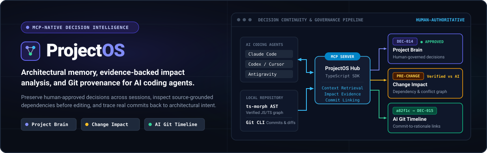
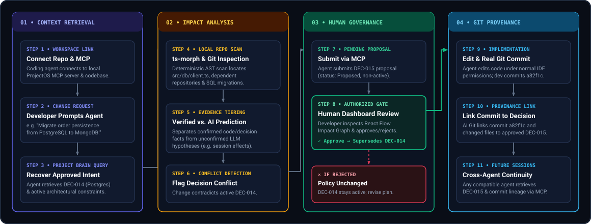
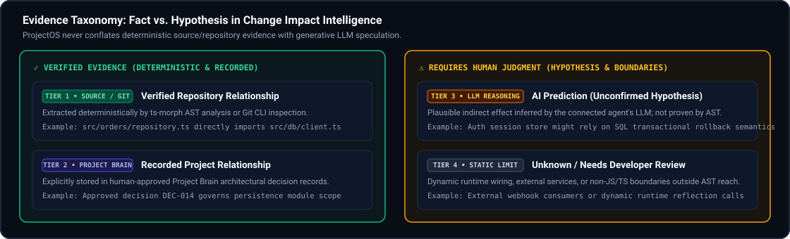

<div align="center">



<br/>

[](docs/architecture.md)
[](docs/architecture.md)
[](docs/core-features.md)
[](docs/architecture.md)
[](docs/core-features.md)

**An MCP-centric architectural decision intelligence platform that connects AI coding agents with human-approved architectural decisions, repository-grounded change-impact analysis, and Git commit provenance.**

[**System Architecture**](docs/architecture.md) · [**Core Features & Lifecycle**](docs/core-features.md) · [**Workflow & Governance**](docs/workflow-and-governance.md)

</div>

---

## Overview

**ProjectOS** brings architectural continuity and human decision governance to AI-assisted software engineering.

When developers build with AI coding agents (**Claude Code**, **Codex**, **Antigravity**, or any MCP-compatible client), critical design choices—why a database was selected, which module boundaries are enforced, and which alternatives were rejected—are routinely lost between chat sessions or across different tools. Agents can inspect source files, but source code alone rarely explains the architectural decisions that shaped it.

ProjectOS solves this by uniting three capabilities around a **single authoritative decision record**:

1. **Project Brain** — Persistent, human-approved architectural decisions, rationales, constraints, and supersession history accessible to any compatible agent via **Model Context Protocol (MCP)**.
2. **Change Impact Intelligence** — Pre-change repository analysis combining deterministic **`ts-morph` static AST inspection**, **`Git CLI` facts**, and **Project Brain bindings** to reveal affected files and decision conflicts—explicitly separating verified evidence from AI predictions.
3. **AI Git Timeline** — Bidirectional provenance linking real Git commits and modified files back to the human-approved architectural decisions that motivated them.

> [!IMPORTANT]
> **What ProjectOS Is—and Is Not:** ProjectOS is **not** a standalone AI coding agent, code generator, project tracker, or Git replacement. Developers keep their existing MCP-compatible coding agent and standard Git workflow. ProjectOS provides the **architectural context layer** over MCP while keeping **human developers in sole control of approving architectural policy**.

---

## Navigation

| Section | Focus | Deep-Dive Documentation |
| :--- | :--- | :--- |
| [**1. The Engineering Problem**](#1-the-engineering-problem) | Why AI-assisted software development loses architectural continuity | — |
| [**2. Three Interconnected Core Features**](#2-three-interconnected-core-features) | How **Project Brain**, **Change Impact**, and **AI Git** share one decision spine | [`docs/core-features.md`](docs/core-features.md) |
| [**3. End-to-End Developer Workflow**](#3-end-to-end-developer-workflow) | The 4-phase loop from prompt to impact analysis, human approval, and Git link | [`docs/workflow-and-governance.md`](docs/workflow-and-governance.md) |
| [**4. System Architecture & MCP Boundaries**](#4-system-architecture--mcp-boundaries) | 4-layer decomposition and the local-workstation vs. shared-backend boundary | [`docs/architecture.md`](docs/architecture.md) |
| [**5. Human Governance & Evidence Taxonomy**](#5-human-governance--evidence-taxonomy) | Why AI agents cannot self-approve decisions and how facts differ from LLM predictions | [`docs/workflow-and-governance.md`](docs/workflow-and-governance.md) |
| [**6. Technology Stack**](#6-technology-stack) | Production stack across MCP, Static Analysis, Backend, Storage, and UI | [`docs/architecture.md`](docs/architecture.md) |
| [**7. Competitive Differentiation**](#7-competitive-differentiation) | Factual comparison with ProjectMem, GitNexus, AsDecided, and Entire | — |
| [**8. Implementation Status & MVP Scope**](#8-implementation-status--mvp-scope) | Transparent summary of finalized design specifications, MVP scope, and roadmap | — |

---

## 1. The Engineering Problem

AI coding agents excel at reading and modifying files, yet three structural blind spots repeatedly break multi-session and team-scale AI development:

| Structural Failure Mode | What Happens in Practice | Engineering Consequence |
| :--- | :--- | :--- |
| **1. Ephemeral Decision Context** | Architectural constraints, rejected designs, and approved choices live scattered across old chat sessions, PR comments, and developer memory. | A fresh agent session—or a different coding agent—proposes or implements changes that directly violate an approved architectural decision. |
| **2. Unverified Change Blast Radius** | A prompt that sounds local touches transitive dependencies or invalidates an active architectural boundary. | Relying on free-form LLM guesses about affected files misses concrete imports or conflates speculative hypotheses with verified code dependencies. |
| **3. Context-Free Git History** | Git faithfully records *what* lines changed (`commit SHA`, `diff`, `author`), but not the structured architectural decision or human approval behind the change. | Months later—or after switching coding tools—engineers see a diff in `src/db/client.ts` without knowing which architectural decision authorized it. |

**The core thesis of ProjectOS:**
> *Before changing code, recover human-approved intent and inspect source-grounded impact. After changing code, link the real Git commit back to its approved architectural reason.*

---

## 2. Three Interconnected Core Features

Rather than bundling three separate developer tools, ProjectOS operates as a **continuous architectural decision lifecycle** anchored by a single canonical Decision Record (`DEC-ID`).

<div align="center">
  
</div>

### 2.1 Project Brain — Authoritative Architectural Memory

Project Brain stores structured, versioned architectural decision records—not raw conversation logs or unindexed notes.

* **Structured Record Schema:** Preserves a stable Decision ID (e.g., `DEC-014`), title, approved technical choice, architectural scope, engineering rationale, tradeoffs/constraints, approver identity, affected module bindings, and supersession pointers.
* **Strict Lifecycle Governance:** Decisions progress through four well-defined states:
  * **`Proposed` (Pending):** Submitted by a developer or connected AI agent via MCP; never treated as active policy until reviewed.
  * **`Approved`:** Explicitly authorized by a human in the ProjectOS dashboard; served to connected agents as active project policy.
  * **`Rejected`:** Declined after review; retained in historical audit records so future sessions know why the approach was rejected.
  * **`Superseded`:** Replaced by a newer human-approved decision (e.g., `DEC-015` supersedes `DEC-014`) while preserving full historical lineage.

### 2.2 Change Impact Intelligence — Source-Grounded Blast Radius

Before a significant change is implemented, Change Impact Intelligence inspects the **actual local repository** alongside Project Brain records to answer: *"What files, modules, and approved decisions will this change affect, and why?"*

* **Deterministic Local Code Analysis:** Uses **`ts-morph`** to extract real TypeScript/JavaScript import graphs, symbol references, and module dependencies, paired with **`Git CLI`** repository facts.
* **Decision Conflict Detection:** Cross-references affected modules against active Project Brain decisions to surface direct architectural contradictions (e.g., proposing MongoDB where `DEC-014` mandates PostgreSQL).
* **Visual Impact Graph (`React Flow`):** Renders an interactive dependency and conflict graph in the web dashboard so developers can inspect blast radius before approving a proposal.

### 2.3 AI Git Timeline — Bidirectional Commit-to-Decision Provenance

AI Git Timeline bridges the gap between version control and architectural reasoning without altering how developers use Git.

* **Real Git Integration:** Uses local `Git CLI` data (real commit hashes, file lists, and diffs) and binds them to Project Brain Decision IDs.
* **Bidirectional Traceability:** Navigate from commit `a82f1c` (`src/db/client.ts`) directly to `DEC-015 — Migrate persistence to MongoDB` and its supersession of `DEC-014`, or start from any decision to inspect every commit that implemented it.
* **Non-Intrusive Guarantees:** Never creates hidden experimental branches, never auto-commits or auto-merges code, and never rewrites Git history.

> 📄 **Deep Dive:** See [**Core Features & Continuous Decision Lifecycle (`docs/core-features.md`)**](docs/core-features.md) for the complete decision schema, state machine, concrete PostgreSQL-to-MongoDB impact walkthrough, and scope boundaries.

---

## 3. End-to-End Developer Workflow

ProjectOS integrates into an engineer's existing IDE and MCP agent workflow across four sequential phases:

<div align="center">
  
</div>

| Phase | Step Sequence | Actor & Mechanism | Outcome |
| :--- | :--- | :--- | :--- |
| **01 • Context Retrieval** | **Steps 1–3:** Developer prompts an architectural change (e.g., *"Migrate order persistence to MongoDB"*). The connected agent queries ProjectOS via MCP. | **AI Coding Agent** ↔ **Local MCP Server** | Agent recovers active decision `DEC-014` (PostgreSQL), its rationale, and governed module boundaries instead of acting on an empty chat context. |
| **02 • Impact Analysis** | **Steps 4–6:** Local analyzer scans the codebase and cross-checks active decisions. Agent contributes indirect consequence reasoning. | **`ts-morph`** + **`Git CLI`** + **Agent LLM** | Produces a tiered Impact Report identifying verified dependencies (`src/db/client.ts`, `src/orders/repository.ts`), conflicts (`DEC-014`), and labeled AI predictions. |
| **03 • Human Governance** | **Steps 7–8:** Agent submits pending proposal `DEC-015` via MCP. Developer reviews the React Flow Impact Graph in the dashboard and clicks **Approve** or **Reject**. | **Developer** via **Authenticated React Dashboard** | **If Approved:** `DEC-015` becomes active and supersedes `DEC-014`.<br/>**If Rejected:** `DEC-014` remains active policy; agent revises plan. |
| **04 • Git Provenance** | **Steps 9–11:** Agent edits code under standard IDE permissions; developer tests and commits (`a82f1c`). AI Git records the explicit link `a82f1c ↔ DEC-015`. | **Developer (`git commit`)** + **AI Git via MCP** | Commit `a82f1c` is permanently linked to `DEC-015`. Any future MCP-compatible agent session immediately recovers the updated architectural state. |

> 📄 **Deep Dive:** See [**End-to-End Workflow & Human Governance Model (`docs/workflow-and-governance.md`)**](docs/workflow-and-governance.md) for the full 12-step narrative and protocol sequence diagram.

---

## 4. System Architecture & MCP Boundaries

ProjectOS is structured into four decoupled layers connected by three explicit interfaces: **MCP**, **REST over HTTP(S)**, and **Authenticated Session REST**.

<div align="center">
  
</div>

### Architectural Interface Contracts

| Interface | Source → Destination | Protocol | Security & Data Boundary |
| :--- | :--- | :--- | :--- |
| **Agent Tool Plane** | External AI Coding Agent → Local ProjectOS MCP Server | **Model Context Protocol (MCP)** | Agent can read decisions, request impact scans, submit `Proposed` records, and link commits; **no approval tool exists in the MCP surface**. |
| **State Sync Plane** | Local ProjectOS MCP Server → Shared Express Backend | **REST / HTTP(S)** | Exchanges structured decision records, proposal payloads, impact metadata, and Git SHA associations validated by **Zod**. |
| **Human Governance Plane** | React Web Dashboard → Shared Express Backend | **Authenticated REST + Express Sessions** | Enforces human login and session authorization for approving or rejecting architectural decisions. |

> [!NOTE]
> **Local Workstation Privacy Boundary:** Even when the Express 5 backend, SQLite database, and React dashboard are deployed to a shared cloud environment (**AWS EC2** with **Amazon EBS**), the coding agent, ProjectOS MCP server, `ts-morph` static analyzer, `Git CLI`, and local Git repository remain strictly on the **developer's machine**. The remote backend never directly accesses local source files.

> 📄 **Deep Dive:** See [**System Architecture & Protocol Boundaries (`docs/architecture.md`)**](docs/architecture.md) for layer-by-layer specifications and responsibility matrices.

---

## 5. Human Governance & Evidence Taxonomy

Two foundational guardrails distinguish ProjectOS from unconstrained AI memory or automated coding wrappers:

### 5.1 Evidence Before Speculation

Change Impact Intelligence strictly classifies every finding into one of four tiers so developers can trust what is factual and scrutinize what is speculative:

<div align="center">
  
</div>

### 5.2 IDE Tool Permission vs. ProjectOS Architectural Approval

Allowing an AI coding tool to write to a file in an IDE is **not** the same as approving an architectural change:

| Dimension | IDE / Coding Tool File Permission | ProjectOS Architectural Approval |
| :--- | :--- | :--- |
| **Scope of Action** | Permits or denies an immediate file edit or shell command | Approves or rejects a durable change to the project's architectural policy |
| **Where It Lives** | Ephemeral prompt inside a single IDE/terminal session | Authenticated record in Project Brain (`SQLite`), enforced by the Express backend |
| **Cross-Agent Durability** | Vanishes when the session ends or when switching coding agents | Persists across sessions and is retrievable by any MCP-compatible coding agent |
| **Auditability** | Leaves no structured record of *why* the architecture changed | Preserves rationale, supersession history (`DEC-015 → DEC-014`), and Git commit provenance |

---

## 6. Technology Stack

ProjectOS uses a cohesive, type-safe TypeScript stack across local code intelligence, MCP orchestration, backend governance, and interactive graph visualization:

| Layer / Domain | Core Technologies | Architectural Role in ProjectOS |
| :--- | :--- | :--- |
| **MCP Integration** | **Model Context Protocol**, **Official TypeScript MCP SDK** | Standardized, agent-agnostic interface connecting Claude Code, Codex, Antigravity, and other MCP clients to ProjectOS |
| **Code & VCS Intelligence** | **`ts-morph`**, **`Git CLI`** | Deterministic local TypeScript/JavaScript AST dependency extraction (`ts-morph`) and factual commit/diff inspection (`Git CLI`) |
| **Application Backend** | **Node.js**, **Express.js 5**, **TypeScript**, **Zod** | REST API orchestration, Project Brain lifecycle state machine, and strict Zod runtime schema validation at every boundary |
| **Auth & Governance** | **Express Sessions**, **REST over HTTPS** | Authenticated human review sessions ensuring AI agents cannot self-approve architectural proposals |
| **Persistent Storage** | **SQLite** | Zero-overhead relational persistence for decision records, approval audit logs, impact reports, and commit-to-decision links |
| **Web Dashboard** | **React.js**, **TypeScript**, **Vite**, **React Flow** | Human governance UI featuring Project Brain review, interactive **React Flow** Impact Graphs, and the AI Git Timeline |
| **AI Reasoning Model** | **Agent-Agnostic (External Client LLM)** | Leverages the developer's connected coding agent for natural-language interpretation and indirect impact predictions—no separate proprietary model required |
| **Cloud Hosting (Planned)** | **AWS EC2**, **Amazon EBS** | Planned deployment target for the shared Express backend and React dashboard, with EBS preserving SQLite database durability |

---

## 7. Competitive Differentiation

Existing developer tools address isolated segments of the AI engineering workflow—such as cross-session memory, dependency graphing, read-only ADR rules, or prompt-to-commit logging. ProjectOS's innovation lies in **unifying persistent architectural memory, evidence-tiered impact analysis, human decision governance, and Git commit provenance through MCP**.

| Capability Dimension | Representative Existing Solutions | How ProjectOS Integrates & Advances the Workflow |
| :--- | :--- | :--- |
| **Decision Continuity** | **ProjectMem** — Persistent cross-agent memory, decision history, and pre-commit warnings | Preserves human-approved architectural decisions (`Project Brain`) with explicit lifecycle states (`Proposed`, `Approved`, `Rejected`, `Superseded`) rather than flat session memory |
| **Change Impact Analysis** | **GitNexus** — Codebase dependency mapping and pre-change impact analysis | Combines `ts-morph` repository dependency graphs with active Project Brain decisions, explicitly distinguishing **verified repository/decision evidence** from **AI predictions** |
| **Decision Governance** | **AsDecided** — Architectural decision management, read-only MCP access, and compliance checks | Supports bidirectional MCP workflows where agents submit impact-informed pending proposals while an authenticated human approval gate governs policy changes |
| **Implementation Traceability** | **Entire** — Links AI coding sessions, prompts, and reasoning to Git history | Links real Git commits and modified files (`AI Git Timeline`) directly to canonical, human-approved architectural decision records and supersession history |
| **End-to-End Integration** | Fragmented point solutions across memory, static graphs, governance, and Git logs | **One canonical decision record** powering pre-change context retrieval, evidence-backed impact review, human approval, and post-commit Git provenance over MCP |

---

## 8. Implementation Status & MVP Scope

In keeping with our engineering principle of **honest technical scope**, this section transparently distinguishes finalized architectural specifications, planned Hackathon MVP implementation targets, and known boundaries.

### Current Repository Status

* **Architecture & Specification Phase (Complete):** The product architecture, 4-layer protocol boundaries, decision lifecycle state machine, 4-tier evidence taxonomy, security/approval boundaries, and user workflows are fully specified and documented in this repository.
* **Application Source Implementation (Hackathon MVP Target):** The runnable monorepo packages (Local MCP Server, Express 5 + SQLite Backend, and React + Vite + React Flow Dashboard) represent the defined Hackathon MVP implementation scope detailed below.

### Hackathon MVP Scope vs. Future Roadmap

| Subsystem | Hackathon MVP Scope | Known Boundaries & Future Roadmap |
| :--- | :--- | :--- |
| **Project Brain** | Full decision lifecycle (`Proposed`, `Approved`, `Rejected`, `Superseded`), rationale storage, supersession linking, and MCP retrieval/proposal tools | Future: Multi-repository decision inheritance and fine-grained team RBAC policies |
| **Change Impact Intelligence** | Local `ts-morph` static dependency analysis for **JavaScript/TypeScript** projects, `Git CLI` inspection, decision conflict matching, 4-tier evidence classification, and React Flow Impact Graph | Static analysis does not capture dynamic runtime reflection, external webhook contracts, or non-JS/TS languages; polyglot AST support is a future extension |
| **AI Git Timeline** | Local `Git CLI` commit/diff reader, explicit bidirectional linking between real commit hashes/files and Project Brain Decision IDs, and confirmed vs. suggested link badges | Does not auto-commit, branch, or rewrite Git history; future support for automated PR review summaries |
| **Deployment & Hosting** | Local MCP server running alongside the developer's repository + shared Express 5 / SQLite / React dashboard stack | Planned shared cloud deployment on **AWS EC2** with **Amazon EBS** persistent volume storage |

---

## 9. Repository Structure

```text
ProjectOS/
├── README.md                              # Concise product & architectural overview
├── assets/
│   └── projectos-architecture.png         # Original whiteboard architecture reference
└── docs/
    ├── architecture.md                    # 4-layer system architecture, protocols & deployment boundaries
    ├── core-features.md                   # Deep dive: Project Brain, Change Impact Intelligence & AI Git
    ├── workflow-and-governance.md         # 12-step end-to-end lifecycle, sequence diagram & design principles
    └── assets/
        ├── hero-banner.svg                # Custom SVG product hero & MCP pipeline schematic
        ├── core-features-triad.svg        # Custom SVG continuous decision lifecycle diagram
        ├── system-architecture.svg        # Custom SVG 4-layer architecture & workstation boundary diagram
        ├── end-to-end-workflow.svg        # Custom SVG 4-phase developer & agent workflow diagram
        └── governance-and-evidence.svg    # Custom SVG 4-tier evidence taxonomy (Verified vs. AI Predicted)
```

---

## 10. Contributors & Acknowledgements

Developed by **Prajwal Govekar** ([@prajwal-govekar17](https://github.com/prajwal-govekar17)) and the **ProjectOS Team**.

Built with the [**Model Context Protocol (MCP)**](https://modelcontextprotocol.io) ecosystem, **`ts-morph`**, **React Flow**, **Express 5**, and **SQLite** to advance human-governed, decision-aware AI software engineering.
