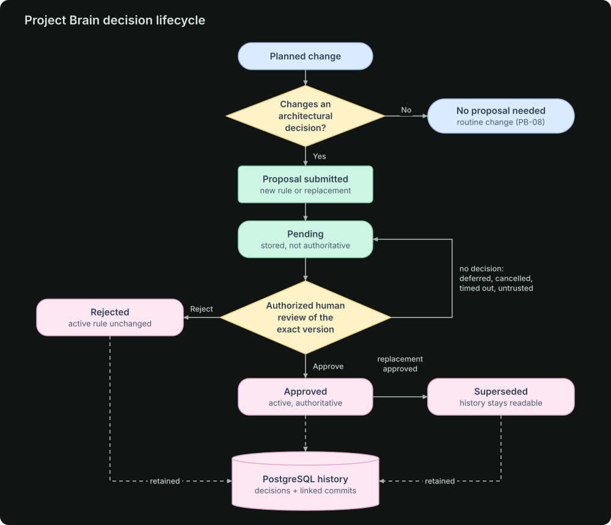
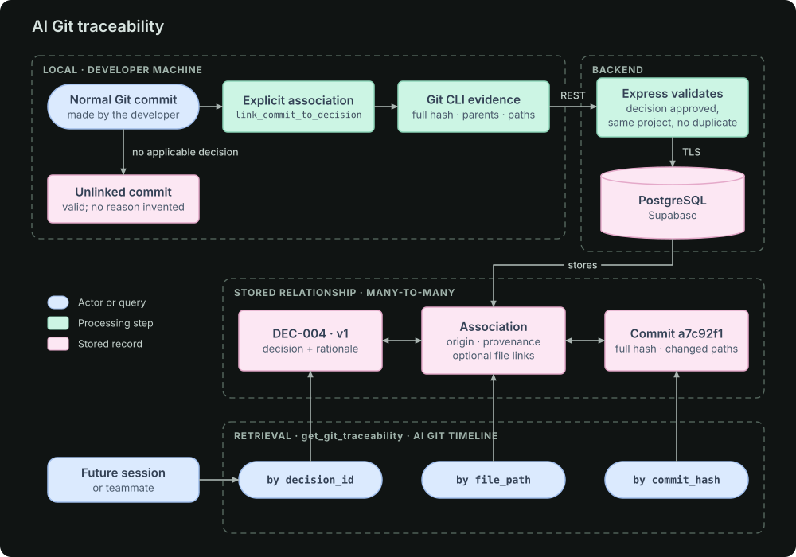
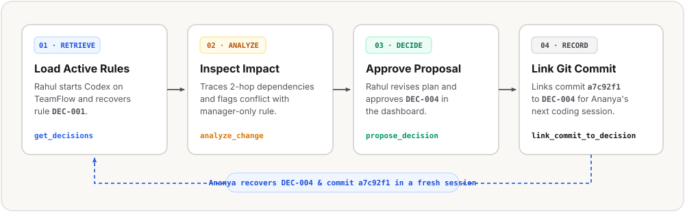
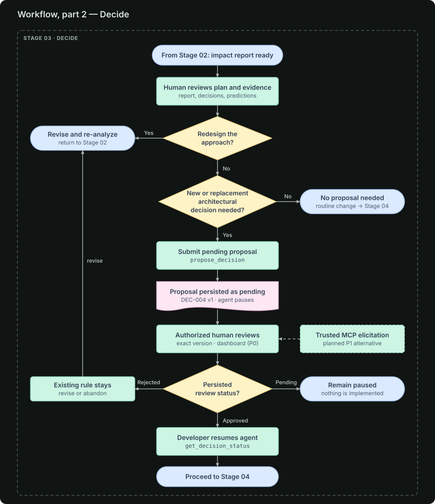
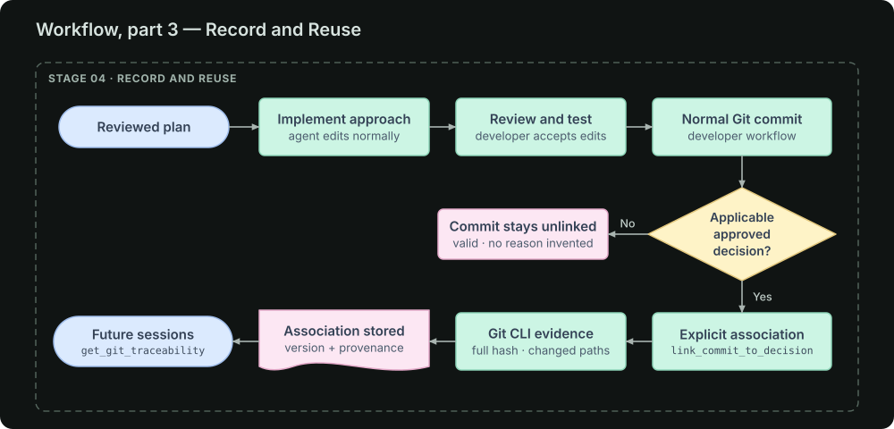
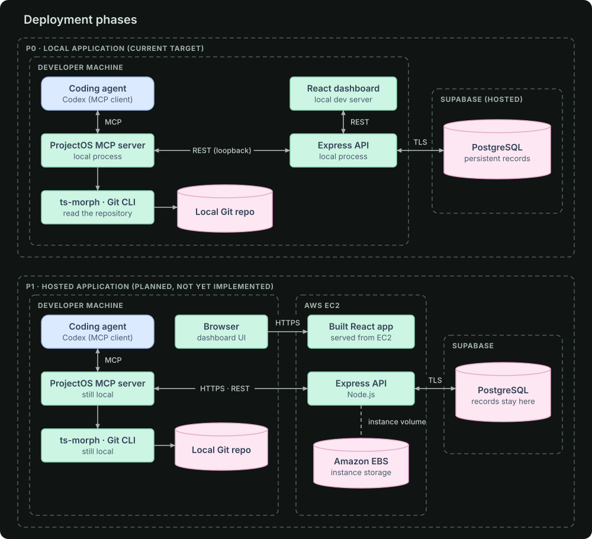

# ProjectOS

**Architectural decision memory, repository-backed change-impact analysis, and Git commit provenance for MCP-compatible AI coding agents.**

[Introduction](#1-introduction) · [The Problem](#2-the-problem) · [Core Capabilities](#3-core-capabilities) · [System Architecture](#4-system-architecture) · [Operational Workflow](#5-operational-workflow) · [Human Approval Governance](#6-human-approval-governance) · [MCP Tool Reference](#7-mcp-tool-reference) · [TeamFlow Example](#8-teamflow-example) · [Technology Stack](#9-technology-stack) · [Deployment and Security](#10-deployment-and-security) · [Development Roadmap and Current Status](#11-development-roadmap-and-current-status) · [Getting Started](#12-getting-started) · [Maintainer and Technical References](#13-maintainer-and-technical-references)

---

## 1. Introduction

**ProjectOS** is an MCP-centric software engineering platform designed for developers and teams who use AI coding agents to build and evolve software repositories. It works alongside existing MCP-compatible coding clients—with **Codex** as the initial integration target—by connecting the agent to three things source files alone do not retain: **human-approved architectural decisions**, **verified source-code dependency graphs**, and **Git commit-to-decision provenance**.

When a developer works with an AI coding agent in an IDE or CLI, the agent can read files in the repository, but source code shows *what* the system does today rather than *why* specific rules or constraints were adopted. If you are new to the **Model Context Protocol (MCP)**, it is an open protocol that lets an AI coding client discover (`tools/list`) and invoke (`tools/call`) external tools with structured JSON inputs and outputs.

ProjectOS does **not** replace the developer's coding agent, host a separate Large Language Model (LLM), or wrap Git in automatic commits or branches. Instead, it runs a local **ProjectOS MCP Server** next to the developer's repository and pairs it with an **Express.js 5** backend, a **PostgreSQL** database hosted on **Supabase**, and a **React** governance dashboard.

<p align="center">
  
</p>

At a high level, ProjectOS supports four continuous steps across development sessions:

1. **Before writing code**, the coding agent calls **Project Brain** over MCP to retrieve active, human-approved architectural decisions and rationale for the project or files being edited.
2. **While planning a change**, **Change Impact Intelligence** uses `ts-morph` on the local repository to trace real JavaScript/TypeScript dependencies (proposed up to two hops for the MVP), matches affected decisions, and keeps verified static evidence separate from AI predictions.
3. **When an architectural rule needs to be added or replaced**, the agent submits a pending proposal that only an **authorized human** can approve or reject.
4. **After the developer creates a normal Git commit**, **AI Git** uses `Git CLI` to bind the real commit hash and changed file paths to the approved decision version so future sessions and teammates can recover *why* the code exists.

---

## 2. The Problem

In AI-assisted software development, coding agents can generate and edit multi-file changes quickly, shifting the engineering bottleneck from writing syntax to preserving architectural coherence across sessions. Without a persistent architectural system of record, knowledge breaks down at three distinct stages of a change:

<p align="center">
  
</p>

### 1. Context Fragmentation Before a Change
Architectural decisions, rejected alternatives, and design constraints typically live across expired chat transcripts, pull-request discussions, or an individual developer's memory rather than in a structured store that coding agents can query. When a developer starts a new coding session—or a teammate opens the same repository—the agent begins without the approved rules and can propose an implementation that contradicts an existing architectural decision.

### 2. Dependency Blind Spots and Unchecked Decision Conflicts During Change Planning
When planning a feature or refactor, keyword search finds text matches rather than downstream modules that import or reference the target code, and prompt-only LLM guesses cannot reliably trace transitive imports or verify which path-linked decisions apply. Indirect effects and policy conflicts often surface only after files have already been edited, causing avoidable rework.

### 3. Commit-to-Decision Traceability Gaps After a Change
Standard Git history (`git log`, `git show`, `git diff`) records *what* changed, *when*, and *by whom*, but it does not link a commit or its modified files to the structured, human-approved architectural decision that motivated the change. Months later, returning developers and coding agents can inspect the diff, yet the engineering reasoning behind the code is lost.

> [!NOTE]
> **Scope of these problem statements:** As noted in the product specification (`docs/ProjectOS_PRD.md`), these user problems are product hypotheses informed by the team's development experience and design discussions rather than validated market research or measured productivity benchmarks.

---

## 3. Core Capabilities

ProjectOS addresses these three failure points through three independent capabilities—**Project Brain**, **Change Impact Intelligence**, and **AI Git**—that read and write shared project records through the Express.js 5 REST API into **PostgreSQL on Supabase**.

Crucially, these three capabilities are **not mandatory sequential service dependencies**. One service does not have to call the next in a rigid pipeline; instead, each capability is invoked independently through MCP or inspected through its own dashboard view whenever the developer's workflow calls for it, while sharing canonical decision records (`DEC-001`, `DEC-004`, etc.).

<p align="center">
  
</p>

| Developer Question | Lifecycle Stage | Capability | MCP Tools Involved |
| :--- | :--- | :--- | :--- |
| *"What have we already decided on this topic or file, and why?"* | **Before Implementation** | **Project Brain** | `get_decisions` |
| *"How do we propose a new or replacement architectural rule for human review?"* | **During Design / Governance** | **Project Brain** | `propose_decision`, `get_decision_status` |
| *"If we change this file or symbol, which connected files and active rules are involved?"* | **During Change Planning** | **Change Impact Intelligence** | `analyze_change`, `record_impact_assessment` |
| *"Which real Git commits implemented this approved decision, or why was this file changed?"* | **After a Normal Commit** | **AI Git** | `link_commit_to_decision`, `get_git_traceability` |

---

### 3.1 Project Brain — Structured Architectural Decision Memory

**Problem addressed:** Prevents context fragmentation before coding and stops tentative AI suggestions from being treated as authoritative architectural policy.

<p align="center">
  
</p>

* **Inputs:**
  * For retrieval (`get_decisions`): `project_id`, plus optional `query` keywords, `decision_id`, `related_files`, `status` filter, `include_history`, and `limit`.
  * For proposal (`propose_decision`): `project_id`, `title`, `decision` statement, `rationale`, repository-relative `related_paths`, and optional `related_decision_ids`, `impact_report_id`, or `supersedes_decision_id`.
  * For status verification (`get_decision_status`): `project_id` and `decision_id`.
* **Components involved:** Coding agent, local ProjectOS MCP server (`apps/mcp`), Express 5 REST API (`apps/api`), React dashboard (`apps/web` — *Project Brain* and *Decision Review* views), and PostgreSQL on Supabase.
* **Internal operation:**
  * **Structured schema (`PB-01`):** Each record stores `project_id`, stable `decision_id`, reviewed `version`, `title`, `decision` statement, `rationale`, `status` (`pending`, `approved`, `rejected`, or `superseded`), `reviewer`, review channel, timestamps, normalized repository-relative `related_paths`, and optional `predecessor_id`. An initially empty Project Brain returns an explicit empty state rather than fabricating architecture.
  * **Bounded deterministic retrieval (`PB-02`):** `get_decisions` performs parameterized PostgreSQL queries matching title, decision statement, and rationale alongside exact file-path joins (recommended initial default limit `10`, hard cap `50` with a truncation flag). Discovery defaults strictly to `approved` records; `pending`, `rejected`, and `superseded` records are returned only when explicitly requested by status, exact ID, or `include_history: true`.
  * **Immutable revisions and atomic supersession (`PB-03`, `PB-04`):** Approved decisions are never overwritten in place. A replacement proposal starts as `pending` pointing to the currently active approved predecessor while the predecessor remains active. Only when an authorized human approves the exact pending version does Express activate the replacement and mark the predecessor `superseded` in the same database transaction.
  * **No redundant approval gates (`PB-08`):** Routine code changes that already comply with active decisions require no proposal.
* **Outputs and persistence:** Canonical decision records, versioned proposals, and append-only review audit events persisted in PostgreSQL on Supabase.
* **Workflow contribution:** Establishes the authoritative set of active architectural rules before coding begins and provides the stable `decision_id` targets referenced by impact reports and Git commits.
* **Limitations:** Retrieval uses deterministic keyword, ID, status, and file-path matching rather than vector embeddings or automatic natural-language conflict proof.

---

### 3.2 Change Impact Intelligence — Repository-Backed Blast Radius & Predictions

**Problem addressed:** Eliminates dependency blind spots during change planning and strictly separates deterministic static code relationships from LLM hypotheses.

<p align="center">
  
</p>

* **Inputs:**
  * For static analysis (`analyze_change`): `project_id`, `change_description`, and at least one agent-selected starting code reference via `starting_files` (repository-relative paths) or `starting_symbols` (resolvable symbols).
  * For AI assessment (`record_impact_assessment`): `project_id`, `report_id`, and an array of structured `predictions` (each containing `prediction`, `reason`, and optional `evidence_ids` or `decision_ids`).
* **Components involved:** Coding agent (selects candidate starting code and interprets results), local ProjectOS MCP server, local `ts-morph` analyzer (`packages/repo-analysis`), Express 5 REST API, PostgreSQL on Supabase, and React dashboard (*Impact Report* view using **React Flow**).
* **Internal operation:**
  * **Agent-supplied starting points (`CI-01`):** A static AST analyzer cannot guess which file corresponds to a natural-language feature prompt. The coding agent interprets the developer's request, selects candidate starting files or symbols, and passes them to `analyze_change`. If no reliable starting code can be identified, the agent asks for more context or reports uncertainty rather than inventing targets.
  * **Source import direction vs. reverse dependency traversal (`CI-02`):** In source code on disk, a consumer file imports a target module (`Consumer ──imports──> Target`). To determine what could be affected by changing `Target`, `ts-morph` traverses those verified import and symbol-reference edges **in reverse** from the starting file (`Target ──is imported by──> Consumer`), up to **two hops** by default for the MVP. In the TeamFlow example (`IMP-001`), starting at `src/services/taskAssignmentService.ts` (hop 0) discovers direct 1-hop dependents `src/routes/taskRoutes.ts` (`E-001`) and `src/services/bulkTaskService.ts` (`E-002`), and follows `bulkTaskService.ts` one hop further to discover the 2-hop indirect dependent `src/services/projectOperations.ts` (`E-003`).
  * **Path-linked decision matching (`CI-04`):** The MCP server combines the analyzed file paths (starting files plus discovered dependents) with active approved decisions from Project Brain whose `related_paths` match those files (such as `DEC-001`), without treating a path match as automatic proof of a semantic violation.
  * **Fact vs. prediction separation (`CI-05`):** After `analyze_change` persists the verified report (`IMP-001`), the coding agent can call `record_impact_assessment` to store semantic predictions—such as a potential conflict with `DEC-001` or a missing leave-status interface—in a separate predictions store linked to the report. AI predictions never overwrite verified edges or alter decision statuses.
  * **Cycle safety, bounds, and snapshot metadata (`CI-06`, `CI-08`):** Traversal maintains a visited set so cyclic imports terminate cleanly, enforces recommended initial bounds (`2` hops, `100` files, `300` edges, configurable timeout) returning an explicit partial-result indicator if reached, and records `HEAD`, a worktree content fingerprint, analyzer options, and consulted decision versions.
* **Outputs and persistence:** Persisted impact report snapshot (`IMP-001`, `IMP-002`), verified dependency edges (`E-001`..`E-003`) with file paths, line ranges, and short bounded code snippets (`≤ 5` lines or `≤ 300` characters per edge), plus separately labelled AI predictions in PostgreSQL.
* **Workflow contribution:** Gives the developer and agent concrete repository evidence before code is edited, enabling informed redesigns (such as revising `IMP-001` into `IMP-002`) and providing supporting evidence for decision proposals.
* **Limitations (`CI-03`, `CI-07`):** Verified dependency edges prove structural connections in JavaScript/TypeScript source code, **not** guaranteed runtime breakage or required edits. Dynamic imports, reflection, external service calls, and non-JS/TS files outside `ts-morph` resolution are reported transparently as analysis limitations.

---

### 3.3 AI Git — Bidirectional Commit-to-Decision Provenance

**Problem addressed:** Closes the post-commit traceability gap by linking real Git commits and changed file paths to the approved architectural decisions that explain *why* those changes were made.

<p align="center">
  
</p>

* **Inputs:**
  * For recording an association (`link_commit_to_decision`): `project_id`, `commit_hash` (resolved against the local repository), `decision_id` (must be an `approved` decision in the same project), and optional `file_associations`.
  * For querying provenance (`get_git_traceability`): `project_id` and at least one selector (`decision_id`, `commit_hash`, or repository-relative `file_path`).
* **Components involved:** Developer (creates normal Git commits), coding agent, local ProjectOS MCP server, local read-only `Git CLI` adapter (`packages/git-adapter`), Express 5 REST API, PostgreSQL on Supabase, and React dashboard (*AI Git Timeline* view).
* **Internal operation:**
  * **Read-only local Git verification (`AG-01`, `AG-05`):** When `link_commit_to_decision` is called after a normal commit, the local MCP server invokes `Git CLI` in read-only mode to verify that the commit exists in the bound local repository and extracts the canonical full commit hash (displayed as a short hash such as `a7c92f1`), parent hashes, author, timestamp, commit message, and actual changed file paths.
  * **Approved-decision validation and many-to-many cardinality (`AG-01`, `AG-03`):** Express verifies that the target `decision_id` belongs to `project_id` and is currently `approved` (capturing the exact approved decision version). One decision can link to multiple commits, and one commit can link to multiple approved decisions; duplicate link requests are idempotent.
  * **Association provenance and file granularity (`AG-06`, `AG-07`):** Because a valid Git SHA proves that a commit exists—not that an agent-supplied decision link is accurate—every association records its origin (`agent-recorded`, `human-recorded`, or `human-confirmed`), actor, and timestamp. ProjectOS also distinguishes commit-level changed paths (all files touched by the commit) from optional explicit file-level decision associations (`file_associations`).
  * **Unlinked commits remain valid (`AG-02`):** Routine commits that do not implement an architectural decision stay unlinked; ProjectOS never fabricates a rationale for an unlinked commit.
* **Outputs and persistence:** Many-to-many commit-to-decision association records, commit metadata snapshots, provenance labels, and optional file-level bindings stored in PostgreSQL on Supabase.
* **Workflow contribution:** Enables bidirectional lookup—from an approved decision to its implementing commits, or from a file/commit back to the approved decision and rationale—so future sessions and teammates can recover architectural intent without prior chat logs.
* **Limitations:** ProjectOS never auto-commits, auto-pushes, creates branches, or rewrites Git history (`AG-05`). Bounded diff previews stay local and are never stored as full repository blobs in PostgreSQL.

---

## 4. System Architecture

ProjectOS is organized into four architectural layers across three trust and deployment boundaries: the **Local Developer Workstation** (Layers 1 and 2), the **Application Layer** (Layers 3 and 4, which run locally in `P0` and on **AWS EC2** in planned `P1`), and the **Hosted Database Layer** (**PostgreSQL on Supabase**).

<p align="center">
  
</p>

### Layer Responsibilities and Boundaries

1. **Layer 1 — Developer and External Coding Agent (Local Workstation):**
   * The **Developer** defines feature requests, reviews impact evidence, holds sole authority to approve or reject architectural decision proposals, tests code edits, and creates normal Git commits.
   * The **AI Coding Agent** (an MCP-compatible client, starting with **Codex**) discovers the seven ProjectOS tools via `tools/list`, selects starting files or symbols for impact scans, submits predictions and decision proposals via `tools/call`, and performs normal code edits in the developer's IDE.
   * **External LLM Reasoning** runs entirely inside the connected coding agent's environment. ProjectOS hosts no internal LLM and makes no separately billed model API calls.
2. **Layer 2 — Local ProjectOS MCP Server and Repository Intelligence (Local Workstation):**
   * The **ProjectOS MCP Server (`apps/mcp`)** is built with the **Official TypeScript MCP SDK**. It validates that requests match the registered `project_id` and canonical local repository root, orchestrates local repository tools, and calls the Express REST API. It never connects directly to PostgreSQL.
   * **`ts-morph` (`packages/repo-analysis`)** and **`Git CLI` (`packages/git-adapter`)** are invoked **independently** by the local MCP server against the registered local Git repository. `Git CLI` does not feed into `ts-morph` as a sequential pipeline stage.
3. **Layer 3 — Express.js 5 Backend and Domain Services (Application Layer):**
   * The **Express 5 REST API (`apps/api`)** is the single authoritative service that owns business rules, **Zod** request/response validation (`@projectos/contracts`), authentication and authorization checks, and database transactions.
   * Express connects over **TLS** using server-side credentials to **PostgreSQL hosted on Supabase**, storing projects, decision versions, review events, impact reports, verified dependency edges, AI predictions, and Git commit associations.
4. **Layer 4 — React Web Dashboard (Application Layer):**
   * The **React Dashboard (`apps/web`)** is built with **React**, **TypeScript**, **Vite**, and **React Flow**. It communicates with Express over REST using an authenticated **Express Session** (`HttpOnly` cookie with CSRF protection).
   * Its five feature areas—**Project Setup**, **Project Brain**, **Decision Review**, **Impact Graph (React Flow)**, and **AI Git Timeline**—are **independent views**, not sequential pipeline stages. React Flow renders the persisted dependency graph returned by Express rather than parsing source files in the browser.

---

## 5. Operational Workflow

The three connected flowcharts below trace the complete 18-step operational lifecycle defined in `docs/ProjectOS_Implementation_Reference_Detailed.md` across its four stages: **Stage 01 — Setup and Retrieve**, **Stage 02 — Analyze**, **Stage 03 — Decide**, and **Stage 04 — Record and Reuse**.

### Part 1: Stage 01 (Setup and Retrieve) & Stage 02 (Analyze)

<p align="center">
  
</p>

#### Stage 01 — Setup and Retrieve (Steps 1–4)
* **Step 1 — Register the project and bind the repository:** The developer creates or selects a project (for example, `project_id: "teamflow"`) and binds the local Git repository path in the local ProjectOS MCP configuration.
* **Step 2 — Connect the coding agent through MCP:** The developer's coding agent (Codex) connects to the local ProjectOS MCP server and discovers the seven callable business tools via `tools/list`.
* **Step 3 — Establish or seed Project Brain:** If no approved decisions exist yet, an authorized human records baseline architectural decisions in the dashboard (or approves agent-submitted proposals), such as `DEC-001`, `DEC-002`, and `DEC-003`.
* **Step 4 — Retrieve approved context at session start:** Before editing code, the coding agent calls `get_decisions`. Express queries PostgreSQL on Supabase and returns active `approved` decisions, rationale, and linked file paths.

#### Stage 02 — Analyze a Proposed Change Before Coding (Steps 5–8)
* **Step 5 — Interpret the request and pick starting code:** The developer requests a feature or refactor in natural language. The coding agent inspects the repository and selects candidate `starting_files` or resolvable `starting_symbols`. If the agent cannot identify a reliable starting point, it asks the developer for context or reports uncertainty rather than guessing.
* **Step 6 — Invoke `analyze_change`:** For changes that may affect dependencies or existing architectural rules, the agent calls `analyze_change` with the starting code and change description.
* **Step 7 — Trace reverse dependencies and match decisions:** The local MCP server runs `ts-morph` reverse dependency traversal (up to two hops by default in the MVP) and requests path-linked approved decisions from Express. Express persists the snapshot report (for example, `IMP-001`) in PostgreSQL.
* **Step 8 — Interpret findings and optionally record AI predictions:** The agent inspects the verified dependency edges and matched decisions. When useful to share with the human reviewer, the agent calls `record_impact_assessment` to store its semantic predictions and conflict warnings separately from verified AST edges.

---

### Part 2: Stage 03 (Decide)

<p align="center">
  
</p>

#### Stage 03 — Decide: Human Review and Architectural Governance (Steps 9–12)
* **Step 9 — Human reviews the plan and evidence:** The developer inspects the proposed approach alongside the impact report (`IMP-001`), matched decisions (`DEC-001`), and labelled AI predictions:
  * **Redesign branch (`Yes` on *"Redesign the approach?"*):** If the initial approach conflicts with an active rule that should remain in place, the developer and agent revise the plan and return to Stage 02 to run a fresh analysis (producing `IMP-002`).
  * **Routine change branch (`No` on *"New or replacement architectural decision needed?"*):** If the change complies with existing approved decisions (`PB-08`), no proposal is created and work proceeds directly to Stage 04.
* **Step 10 — Submit a pending decision proposal:** When a new or replacement architectural decision is required, the agent calls `propose_decision`. Express validates the payload and saves the record (for example, `DEC-004` version `1`) with `status: "pending"` in PostgreSQL. The agent pauses work on that architectural change without polling.
* **Step 11 — Authorized human review:** In `P0` (the primary path), the developer opens the authenticated React dashboard, inspects the exact proposal version and linked impact report, and chooses **Approve** or **Reject**. (In planned `P1`, the server can request human input in-client via trusted MCP elicitation, failing closed to `pending` and the dashboard whenever untrusted, deferred, or cancelled.)
* **Step 12 — Verify persisted status before continuing:**
  * **If `Rejected`:** The proposal is recorded as `rejected`, any predecessor decision stays active and unchanged, and the agent must revise or abandon the approach.
  * **If `Pending`:** Work remains paused; nothing is implemented.
  * **If `Approved`:** When the developer resumes the coding agent in `P0`, the agent calls `get_decision_status` once, confirms `status: "approved"`, and proceeds to Stage 04.

---

### Part 3: Stage 04 (Record and Reuse)

<p align="center">
  
</p>

#### Stage 04 — Record and Reuse (Steps 13–18)
* **Step 13 — Implement the reviewed approach:** The coding agent performs normal code edits in the developer's workspace according to the approved decision.
* **Step 14 — Review and test:** The developer inspects the modified files and runs the project's test suite.
* **Step 15 — Create a normal Git commit:** The developer creates a standard Git commit (for example, short display hash `a7c92f1`). ProjectOS never auto-commits or alters normal Git commands.
* **Step 16 — Associate the commit with the approved decision:** If an approved decision applies to the commit, the agent or developer calls `link_commit_to_decision`. The local MCP server uses `Git CLI` to resolve the full commit hash, parent hashes, and changed file paths, and Express stores the association, decision version, and provenance in PostgreSQL. (If no architectural decision applies, the commit stays unlinked, which is a valid state.)
* **Step 17 — Inspect traceability:** The developer can inspect the bidirectional link between the commit, its changed files, and the approved decision in the *AI Git Timeline* dashboard view.
* **Step 18 — Reuse in future sessions:** When a teammate or a fresh coding session works on those files later, calling `get_decisions` and `get_git_traceability` recovers both the active architectural rules and the commit provenance without needing earlier chat transcripts.

---

## 6. Human Approval Governance

Changing local files in an editor is a normal coding action; changing a project's architectural rules is a governance action. ProjectOS enforces a strict security boundary (`PB-05` through `PB-08`, `NF-02`) so an AI coding agent can **propose** decisions, but only an **authorized human** can **approve** or **reject** them.

<p align="center">
  
</p>

### P0 Primary Path: Dashboard-First Review and Manual Resumption
1. **Persist as `pending` first:** When the coding agent calls `propose_decision`, Express validates the request with Zod and persists the proposal (`DEC-004`, `version: 1`, `status: "pending"`) in PostgreSQL on Supabase.
2. **Clean pause without polling (`PB-06`):** `propose_decision` returns the `decision_id`, `version`, `status: "pending"`, and dashboard review location. The coding agent pauses architectural work cleanly—it does not hold open a long-running HTTP request or run a continuous polling loop, and the coding session may even close while waiting for human review.
3. **Authenticated dashboard review:** An authorized human logs into the React dashboard (protected by an **Express Session** with an `HttpOnly` cookie, `SameSite=Lax`, and CSRF validation), inspects the proposal alongside its linked impact report (`IMP-002`), and submits an explicit **Approve** or **Reject** action bound to that exact `decision_id` and `version`.
4. **Single status lookup on manual resumption:** When the developer returns to the coding agent and asks it to continue, the agent invokes `get_decision_status` once to read the persisted outcome from PostgreSQL before writing code.

### Planned P1 Enhancement: Trusted MCP Elicitation
* **How protocol elicitation works:** After the `P0` local release gate passes, `propose_decision` can be extended in `P1` (`E10`) to initiate an MCP protocol-level human-input request (`elicitation/create` or a structured input-required flow) after saving the `pending` proposal in PostgreSQL. The MCP client UI—**not** the LLM—presents the exact proposal title, statement, rationale, version, and linked report to the human user.
* **Not an eighth tool:** MCP elicitation is a server-to-client protocol request inside the execution of `propose_decision`; the agent contract remains fixed at seven business tools.
* **Shared backend review service and fail-closed fallback:** Both `P0` dashboard review and `P1` trusted elicitation call the **same backend review domain service**. As documented in PRD Section 3, MCP capability negotiation and a form response alone do not verify human reviewer identity to a shared backend; `P1` requires a reviewer-bound verification channel (`E10`). Whenever the client does not support elicitation, the channel is untrusted, or the user cancels, defers, or times out, ProjectOS **fails closed**: the proposal remains `pending` in PostgreSQL and falls back to `P0` dashboard approval.

### Security and Authorization Invariants

| Invariant | How ProjectOS Enforces It |
| :--- | :--- |
| **No agent self-approval (`PB-07`)** | Ordinary MCP-to-API requests authenticate with a project-scoped agent credential that permits reads and creating pending proposals, reports, predictions, and commit links, but is rejected (`HTTP 401/403`) on decision approval endpoints. |
| **No model-supplied approval boolean** | Neither `propose_decision` nor any other MCP tool accepts an `approved: true` argument from the model. |
| **Version-bound, one-time transitions (`NF-02`)** | Every review request must specify the exact pending `decision_id` and `version`. Replayed, concurrent, or stale review attempts against an already-reviewed or revised proposal fail with `HTTP 409 Conflict`. |
| **Atomic replacement supersession (`PB-04`)** | Approving a replacement proposal transitions the new decision to `approved` and its active predecessor to `superseded` inside one PostgreSQL transaction; rejecting it marks the proposal `rejected` and leaves the predecessor active. |

---

## 7. MCP Tool Reference

ProjectOS exposes its entire agent-facing contract through **seven MCP business tools** discovered via `tools/list` and called via `tools/call`. Every tool requires `project_id` and validates inputs and outputs through shared **Zod** schemas (`@projectos/contracts`).

| # | Tool Name | Category | Required Inputs | Optional / Conditional Inputs | Primary Return Fields |
| :-: | :--- | :--- | :--- | :--- | :--- |
| **1** | **`get_decisions`** | **Read** *(Project Brain)* | `project_id` | `query`, `decision_id`, `related_files`, `status`, `include_history`, `limit` | Matching `decisions` (`decision_id`, `version`, `title`, `decision`, `rationale`, `status`, `related_paths`, `predecessor_id`), `truncated` flag |
| **2** | **`analyze_change`** | **Analysis + Persistent Write** *(Change Impact)* | `project_id`, `change_description`, plus starting code | `starting_files` or `starting_symbols` (at least one usable starting point required) | `report_id`, `starting_files`, `verified_relationships` (`file`, `type`, `depends_on` / `chain`, `evidence_id` / `evidence_ids`), `related_decisions`, `limitations`, snapshot metadata |
| **3** | **`record_impact_assessment`** | **Persistent Write** *(Change Impact)* | `project_id`, `report_id`, `predictions` | Per prediction: `evidence_ids`, `decision_ids` | `report_id`, saved prediction IDs, `status: "recorded"` (stored separately from verified AST edges) |
| **4** | **`propose_decision`** | **Persistent Write (+ P1 Review)** *(Project Brain)* | `project_id`, `title`, `decision`, `rationale`, `related_paths` | `related_decision_ids`, `impact_report_id`, `supersedes_decision_id` | `decision_id`, `version`, `status` (`pending` in P0; or persisted review outcome in P1), dashboard `review_url` |
| **5** | **`get_decision_status`** | **Read** *(Project Brain)* | `project_id`, `decision_id` | — | `decision_id`, `version`, `status` (`pending`, `approved`, `rejected`, `superseded`), `reviewer`, `reviewed_at`, review notes |
| **6** | **`link_commit_to_decision`** | **Analysis + Persistent Write** *(AI Git)* | `project_id`, `commit_hash`, `decision_id` | `file_associations` | Canonical full `commit_hash`, short display hash, `decision_id`, `decision_version`, verified `changed_files`, `provenance` |
| **7** | **`get_git_traceability`** | **Read** *(AI Git)* | `project_id`, plus one selector | One of: `decision_id`, `commit_hash`, or `file_path` | Matching `commits`, linked `decisions` (`decision_id`, `version`, `title`, `decision`, `rationale`), `changed_files`, `file_associations`, `provenance`, unlinked indicators |

### How the Seven Tools Connect Across a Session
* **`get_decisions`** recovers existing approved rules before editing or planning.
* **`analyze_change`** uses local `ts-morph` to create a verified impact report (`IMP-001`) and surfaces path-linked decisions from Project Brain; **`record_impact_assessment`** attaches the coding agent's labelled semantic predictions to that `report_id`.
* **`propose_decision`** references the impact report (`impact_report_id: "IMP-002"`) and related or superseded decisions (`DEC-001`) to create a `pending` proposal (`DEC-004`); **`get_decision_status`** checks the human review result on resumption.
* **`link_commit_to_decision`** binds a real local Git commit to the approved `decision_id` (`DEC-004`); **`get_git_traceability`** queries those stored links in either direction during future sessions.

### Representative JSON Payloads

#### 1. `get_decisions`
```json
// Request: retrieve active decisions matching a topic
{
  "project_id": "teamflow",
  "query": "task reassignment",
  "status": "approved"
}
```
Other common invocation patterns from the implementation reference:
* Retrieve active decisions at session start: `{"project_id": "teamflow"}`
* Check decisions linked to a file before editing: `{"project_id": "teamflow", "related_files": ["src/services/taskAssignmentService.ts"]}`
* Inspect a specific decision with supersession history: `{"project_id": "teamflow", "decision_id": "DEC-001", "include_history": true}`

#### 2. `analyze_change`
```json
// Request
{
  "project_id": "teamflow",
  "change_description": "Automatically reassign unfinished tasks when an employee becomes unavailable",
  "starting_files": ["src/services/taskAssignmentService.ts"]
}
```
```json
// Response (illustrative TeamFlow report IMP-001)
{
  "report_id": "IMP-001",
  "project_id": "teamflow",
  "starting_files": ["src/services/taskAssignmentService.ts"],
  "verified_relationships": [
    {
      "file": "src/routes/taskRoutes.ts",
      "type": "direct_dependent",
      "depends_on": "src/services/taskAssignmentService.ts",
      "evidence_id": "E-001"
    },
    {
      "file": "src/services/bulkTaskService.ts",
      "type": "direct_dependent",
      "depends_on": "src/services/taskAssignmentService.ts",
      "evidence_id": "E-002"
    },
    {
      "file": "src/services/projectOperations.ts",
      "type": "indirect_dependent",
      "chain": [
        "projectOperations.ts",
        "bulkTaskService.ts",
        "taskAssignmentService.ts"
      ],
      "evidence_ids": ["E-003", "E-002"]
    }
  ],
  "related_decisions": ["DEC-001"],
  "limitations": [
    "Static dependency tracing does not establish all runtime behavior or required edits"
  ]
}
```

#### 3. `record_impact_assessment`
```json
{
  "project_id": "teamflow",
  "report_id": "IMP-001",
  "predictions": [
    {
      "prediction": "Automatic reassignment may conflict with manager-only authorization.",
      "reason": "The proposed workflow changes ownership without manager approval.",
      "decision_ids": ["DEC-001"]
    },
    {
      "prediction": "A leave-status interface may be needed.",
      "reason": "Employees need a way to report that they are unavailable."
    }
  ]
}
```

#### 4. `propose_decision`
```json
{
  "project_id": "teamflow",
  "title": "Leave-related task reassignment",
  "decision": "Suggest reassignment options when an employee is unavailable; a manager must authorize any ownership change.",
  "rationale": "Reduce manual coordination while preserving managerial accountability.",
  "related_decision_ids": ["DEC-001"],
  "related_paths": ["src/services/taskAssignmentService.ts"],
  "impact_report_id": "IMP-002"
}
```

#### 5. `get_decision_status`
```json
{
  "project_id": "teamflow",
  "decision_id": "DEC-004"
}
```

#### 6. `link_commit_to_decision`
```json
{
  "project_id": "teamflow",
  "commit_hash": "<full hash of the actual local Git commit>",
  "decision_id": "DEC-004"
}
```

#### 7. `get_git_traceability`
```json
{
  "project_id": "teamflow",
  "file_path": "src/services/taskAssignmentService.ts"
}
```

---

## 8. TeamFlow Example

To illustrate how ProjectOS works end to end across multiple developers and sessions, the specification uses **TeamFlow**, a TypeScript task-and-project management application worked on by **Rahul** (using Codex) and later by his teammate **Ananya** in a fresh coding session.

> [!NOTE]
> **Illustrative identifiers:** File paths (`src/services/taskAssignmentService.ts`), decision IDs (`DEC-001`–`DEC-004`), report IDs (`IMP-001`, `IMP-002`), evidence IDs (`E-001`–`E-003`), and the short commit display hash (`a7c92f1`) are illustrative specification fixtures used to trace data flow consistently across the diagrams and tool contracts.

### 1. Baseline Approved Decisions in TeamFlow (`DEC-001`–`DEC-003`)

Before Rahul begins his feature task, TeamFlow's Project Brain holds three human-approved architectural decisions stored in PostgreSQL on Supabase:

| Decision ID | Approved Decision Statement | Recorded Rationale | Linked Repository Path |
| :--- | :--- | :--- | :--- |
| **`DEC-001`** | Only project managers can authorize task ownership changes. | Preserve accountability. | `src/services/taskAssignmentService.ts` |
| **`DEC-002`** | Every ownership change must appear in the activity log. | Maintain an audit trail. | `src/services/activityLog.ts` |
| **`DEC-003`** | Notifications are sent only after a change is successfully saved. | Avoid notifying people about failed changes. | `src/services/notificationService.ts` |

### 2. Rahul's Session: Retrieval and Initial Impact Analysis (`IMP-001`)

1. **Setup and retrieval (Steps 1–4):** Rahul binds his local TeamFlow clone to `project_id: "teamflow"` and starts Codex. Codex discovers the seven ProjectOS tools via `tools/list` and calls `get_decisions({"project_id": "teamflow"})`, retrieving `DEC-001`, `DEC-002`, and `DEC-003`.
2. **Feature request (Step 5):** Rahul prompts Codex: *"Add a feature that automatically reassigns unfinished tasks when an employee goes on leave. Before editing, use ProjectOS to check what this might affect."*
3. **Static dependency scan (Steps 6–7):** Codex identifies `src/services/taskAssignmentService.ts` as the candidate starting file and calls `analyze_change`. Locally, `ts-morph` traces reverse imports up to two hops:
   * **1-hop direct dependents:** `src/routes/taskRoutes.ts` (`E-001`) and `src/services/bulkTaskService.ts` (`E-002`), both of which directly import `taskAssignmentService.ts`.
   * **2-hop indirect dependent:** `src/services/projectOperations.ts` (`E-003`), which imports `bulkTaskService.ts` (even though `projectOperations.ts` contains none of the words *"leave"* or *"reassignment"*).
   * **Path-linked decision:** Express matches `DEC-001` because it is bound to `src/services/taskAssignmentService.ts`, and saves report **`IMP-001`** in PostgreSQL.
4. **Recording AI predictions separately (Step 8):** Codex evaluates `IMP-001` and calls `record_impact_assessment` to record two labelled AI predictions alongside `IMP-001`: (a) automatic reassignment may conflict with `DEC-001`'s manager-only rule, and (b) a leave-status interface may be needed for employees to report unavailability.

### 3. Redesign (`IMP-002`), Proposal (`DEC-004`), Human Approval, and Commit (`a7c92f1`)

5. **Redesigning around `DEC-001` (Step 9):** Reviewing `IMP-001`, Rahul decides not to bypass managers. Instead, when an employee goes on leave, TeamFlow will *suggest* reassignment options and notify the project manager to approve them. Codex runs `analyze_change` on the revised plan, persisting report **`IMP-002`**.
6. **Proposing `DEC-004` (Step 10):** Codex calls `propose_decision` referencing `related_decision_ids: ["DEC-001"]` and `impact_report_id: "IMP-002"`. Express stores **`DEC-004`** (*"Leave-related task reassignment"*) as `status: "pending"` (version `1`), and Codex pauses work on the architectural change. Because `DEC-004` refines leave-related reassignment while preserving manager-only authorization, `DEC-001` remains active.
7. **Human approval and resumption (Steps 11–12):** In `P0`, Rahul opens the authenticated React dashboard, reviews `DEC-004` version `1` together with `IMP-002`, and clicks **Approve**. Returning to Codex, Rahul asks it to continue; Codex calls `get_decision_status({"project_id": "teamflow", "decision_id": "DEC-004"})`, verifies `status: "approved"`, and implements the changes across `src/services/taskAssignmentService.ts`, `src/services/managerApproval.ts`, and `src/ui/leaveStatus.ts` (Steps 13–14).
8. **Normal Git commit and AI Git link (Steps 15–17):** Rahul reviews and tests the edits, then creates a normal Git commit (`feat: add manager-approved task reassignment`, short display hash `a7c92f1`). Codex calls `link_commit_to_decision` with the commit hash and `DEC-004`. The local `Git CLI` adapter resolves the full commit hash and changed paths (`taskAssignmentService.ts`, `managerApproval.ts`, `leaveStatus.ts`), and Express stores the association in PostgreSQL on Supabase.

### 4. Ananya's Fresh Session: Cross-Session Continuity (Step 18)

Later, Rahul's teammate **Ananya** opens TeamFlow in a fresh coding session connected to the same ProjectOS project state and asks her coding agent:
> *"Why does task reassignment require manager approval? Can I remove that step?"*

Even though Ananya has none of Rahul's prior chat history, her agent calls `get_decisions` and `get_git_traceability({"project_id": "teamflow", "file_path": "src/services/taskAssignmentService.ts"})`. ProjectOS returns `DEC-001`, `DEC-004`, the approved rationale (*"Reduce manual coordination while preserving managerial accountability"*), and the implementing commit `a7c92f1`. If Ananya still wants to replace that policy, her agent can run impact analysis and submit a replacement proposal through the same human-governed workflow.

---

## 9. Technology Stack

Every technology in the finalized ProjectOS stack serves a specific architectural boundary:

| Layer | Technology | Why It Exists in ProjectOS |
| :--- | :--- | :--- |
| **Frontend** | **React.js**, **TypeScript**, **Vite**, **React Flow** | Renders the five independent governance views (*Project Setup*, *Project Brain*, *Decision Review*, *Impact Graph*, *AI Git Timeline*); **React Flow** visualizes persisted dependency chains and decision links returned by the backend. |
| **Backend** | **Node.js**, **Express.js 5**, **TypeScript**, **Zod** | Single authoritative REST service owning domain logic, **Zod** boundary validation (`@projectos/contracts`), authentication/authorization enforcement, and version-bound decision lifecycle transitions. |
| **Database** | **PostgreSQL**, **Supabase** | Authoritative relational persistence hosted on **Supabase** for projects, decision versions, review events, impact reports, verified dependency edges, AI predictions, and Git commit associations. |
| **MCP Integration** | **Model Context Protocol (MCP)**, **Official TypeScript MCP SDK** | Powers the local ProjectOS MCP server (`apps/mcp`) exposing the seven business tools (`tools/list`, `tools/call`, and planned `P1` `elicitation/create`). |
| **Code Intelligence** | **`ts-morph`**, **`Git CLI`** | Deterministic local repository adapters: **`ts-morph`** performs static JS/TS AST import and symbol reference traversal; **`Git CLI`** performs read-only commit, path, and bounded diff inspection. |
| **AI / LLM** | **Agent-Agnostic External LLM** *(Codex initial target)* | Runs inside the developer's connected MCP coding client to interpret prompts, select candidate starting code, and propose predictions or decisions without coupling ProjectOS to a proprietary model API. |
| **APIs & Security** | **REST over HTTP(S)**, **TLS**, **Express Sessions**, **Scoped Agent Credentials** | Separates human browser sessions (`HttpOnly` cookie + CSRF) from project-scoped MCP agent tokens and encrypts backend-to-Supabase PostgreSQL connections over **TLS**. |
| **Planned Cloud (`P1`)** | **AWS EC2**, **Amazon EBS** *(Planned, after local gate)* | Planned `P1` hosting for the Express API and built React frontend on **AWS EC2** with **Amazon EBS** providing EC2 instance storage while **PostgreSQL remains hosted on Supabase**. |

---

## 10. Deployment and Security

ProjectOS separates its **current `P0` local application target** from its **planned `P1` hosted application target**, while keeping **PostgreSQL hosted on Supabase** and **local repository analysis (`ts-morph` and `Git CLI`) on the developer's machine** in both phases.

<p align="center">
  
</p>

### P0 — Local Application with Hosted Supabase PostgreSQL (Current Target)
* **What runs locally on the developer machine:** The MCP-compatible coding agent (Codex), the ProjectOS MCP server (`apps/mcp`), `ts-morph`, `Git CLI`, the registered local Git repository, the Express 5 REST API (`apps/api`), and the React dashboard (`apps/web`).
* **How persistence works in `P0`:** The local Express API connects over **TLS** to **PostgreSQL hosted on Supabase** using server-side database credentials. Because the database is hosted on Supabase, `P0` requires network connectivity for database persistence and is not a completely offline mode.
* **Release gate (`T13`):** The complete `P0` workflow must pass end-to-end verification locally before any cloud deployment work begins.

### P1 — Hosted Application on AWS EC2 + Amazon EBS (Planned, Not Yet Implemented)
* **What moves to AWS in `P1` (`E11` / `T14`):** After the `P0` local gate passes, **AWS EC2** hosts the Express 5 REST API and the built React frontend over HTTPS, with **Amazon EBS** attached as EC2 instance storage.
* **Where PostgreSQL lives in `P1`:** Persistent application records **remain in PostgreSQL on Supabase**, accessed by the EC2-hosted Express service over TLS. PostgreSQL is **not** stored on the Amazon EBS volume.
* **Why the MCP server and repository tools stay local in `P1`:** A remote EC2 instance cannot directly inspect a developer's laptop filesystem or unpushed local `.git` object database. Each developer continues to run the ProjectOS MCP server, `ts-morph`, and `Git CLI` locally against their repository clone and connects to the shared `project_id` over HTTPS REST.

### Security Boundaries (`NF-03`, `NF-04`)
1. **Server-side database credentials:** Supabase PostgreSQL credentials exist only in the Express backend configuration (`apps/api`). Neither the React browser bundle nor the local MCP server ever connects directly to PostgreSQL.
2. **Human vs. agent credential separation:** Dashboard review endpoints require an authenticated human **Express Session** (`HttpOnly` cookie, `SameSite=Lax`, CSRF token; `Secure` enabled in HTTPS deployment). MCP-to-API endpoints use a project-scoped agent credential that cannot invoke decision approval transitions.
3. **Repository path confinement:** Before `ts-morph` or `Git CLI` reads any file, the local MCP server canonicalizes paths with `realpath`, verifies they reside inside the registered repository root, and rejects path traversal (`..`), escaped symlinks, and arbitrary shell flags.

---

## 11. Development Roadmap and Current Status

### Current Repository Status

> [!IMPORTANT]
> **Specification Complete · Implementation Workspace Pending (`E01`–`E11`):**
> This repository currently contains the finalized product and engineering specifications (`docs/ProjectOS_PRD.md` and `docs/ProjectOS_Implementation_Reference_Detailed.md`), repository guidelines (`AGENTS.md`), and technical documentation (`README.md` and SVG flowcharts in `assets/`). The runnable TypeScript monorepo workspaces (`apps/web`, `apps/api`, `apps/mcp`, `packages/*`), PostgreSQL migrations, and automated test suite are planned implementation tasks (`E01`–`E11`) and have not yet been committed to this repository.

### Prioritized Delivery Milestones (`P0` → `P2`)

| Priority | Milestone | Scope and Verification Target |
| :--- | :--- | :--- |
| **`P0`** | **Basic Prototype Checkpoint** | Bootstrap the TypeScript npm-workspaces monorepo (`E01`), persist an approved decision in **PostgreSQL on Supabase** via Express (`E02`), verify one live Codex-to-ProjectOS MCP retrieval (`E03`), and render a minimal functional UI. |
| **`P0`** | **Integrated Local Hackathon MVP** | Complete all three core features and all seven MCP tools: dashboard-first human approval and manual resumption (`E04`), two-hop `ts-morph` reverse dependency analysis (`E05`), impact report and separate AI prediction persistence (`E06`), read-only `Git CLI` commit linking and traceability (`E07`), five independent React views with React Flow (`E08`), and full TeamFlow verification (`E09`, acceptance tests `T01`–`T13`). |
| **`P1`** | **Trusted MCP Elicitation** *(Planned, after `P0` gate)* | Extend `propose_decision` with interactive in-client human review (`elicitation/create`) backed by a reviewer-bound verification channel and the shared Express review service, failing closed to `P0` dashboard review (`E10`, `T04`). |
| **`P1`** | **AWS EC2 + EBS Deployment** *(Planned, after `P0` gate)* | Deploy the verified Express 5 API and built React frontend to **AWS EC2** with **Amazon EBS** instance storage over HTTPS while keeping **PostgreSQL on Supabase** and local MCP repository analysis on the developer workstation (`E11`, `T14`). |
| **`P2`** | **Scoped Refinements** | Additional dashboard filtering, graph navigation polish, optional file-level commit association UI refinements, and broader JS/TS syntax coverage where time permits. |

### Engineering Implementation Plan (`E01`–`E11`)

| Task ID | Priority | Engineering Deliverable | Key Verification Targets |
| :-: | :-: | :--- | :--- |
| **`E01`** | `P0` | Workspace bootstrap (`apps/*`, `packages/*`) and shared `@projectos/contracts` Zod schemas | `npm run typecheck`, contract unit tests |
| **`E02`** | `P0` | Express 5 foundation, Supabase PostgreSQL connection over TLS, ordered SQL migrations, project registration | `T01`, migration and schema integration tests |
| **`E03`** | `P0` | Local MCP server bootstrap (`Official TypeScript MCP SDK`), repo binding, `get_decisions` | `T02`, MCP-to-API integration tests |
| **`E04`** | `P0` | Project Brain lifecycle (`propose_decision`, `get_decision_status`), human session auth, dashboard review endpoint, atomic supersession | `T03`, `T05`, `T06`, `T12` |
| **`E05`** | `P0` | Local `ts-morph` reverse dependency analyzer (`packages/repo-analysis`) with 2-hop bound and cycle protection | `T07`, fixture graph unit tests |
| **`E06`** | `P0` | `analyze_change` and `record_impact_assessment` integration, separating verified edges from AI predictions | `T07`, `T08` |
| **`E07`** | `P0` | Local `Git CLI` adapter (`packages/git-adapter`), `link_commit_to_decision`, `get_git_traceability` | `T09`, `T10`, temporary Git repo tests |
| **`E08`** | `P0` | React dashboard views (*Project Setup*, *Project Brain*, *Decision Review*, *Impact Graph* with React Flow, *AI Git Timeline*) | `T11`, UI component and keyboard review tests |
| **`E09`** | `P0` | End-to-end TeamFlow fixture verification (`DEC-001`..`DEC-004`, `IMP-001`, `IMP-002`, commit link, restart persistence) | `T01`–`T13` (`P0` local release gate) |
| **`E10`** | `P1` | Trusted MCP elicitation (`elicitation/create`) inside `propose_decision` with reviewer-bound verification and dashboard fallback | `T04` |
| **`E11`** | `P1` | AWS EC2 + Amazon EBS deployment for Express and React over HTTPS, connected to Supabase PostgreSQL over TLS | `T14` |

### Open Technical Decisions to Resolve During Implementation

Per PRD Section 5, the following implementation choices remain open until verified against the development environment and are not claimed as pre-selected:

* **PostgreSQL/Supabase access and sessions (`E02`):** Select the compatible Node.js PostgreSQL access method, connection configuration, migration runner, and durable Express Session store during `E02` based on the installed Node.js runtime.
* **Project-scoped agent credential (`E03`–`E04`) and `P1` reviewer-bound elicitation verification (`E10`):** Define the local/remote MCP-to-API agent token mechanism for `P0` and the cryptographic or session-bound reviewer verification channel for `P1` before enabling in-client elicitation approval.
* **Commit-association trigger (`E07`):** Default to explicit agent- or developer-initiated `link_commit_to_decision` calls after normal Git commits, with optional dashboard confirmation controls.

### Explicit Non-Goals and Held Ideas

To keep the scope verifiable, ProjectOS explicitly excludes:
* **No standalone coding agent or hosted LLM service:** ProjectOS works with external MCP coding clients and performs zero paid model API calls of its own.
* **No automatic Git mutations:** ProjectOS never auto-commits, auto-pushes, creates branches, or rewrites history.
* **No claim of universal impact recall or runtime enforcement:** Static `ts-morph` analysis targets JavaScript/TypeScript imports and symbol references within configured hop bounds and cannot block an external coding agent from editing local files directly if the user grants the agent filesystem write access.
* **Held capabilities (explicitly out of scope):** Proof Engine, Cross-Agent Conflict Detection, Decision Comparison, automated testing/CI orchestration as a product feature, automatic architectural-violation detection, universal token optimization, Intent Drift Detector, Assumption Radar, MCP Tool Trust Sentinel, MCP RetryShield, and MCP Value Meter.

### Target Monorepo File Structure (`ORG-01`–`ORG-05`)

When `E01` bootstraps the implementation workspace, the repository follows this npm-workspaces TypeScript monorepo layout where `apps/*` depend only on `packages/*`:

```text
projectos/
├── apps/
│   ├── web/                        # React + TypeScript + Vite dashboard (REST only)
│   │   └── src/
│   │       ├── app/                # Application shell, routing, session providers
│   │       ├── features/           # Independent views: projects, project-brain, impact, ai-git
│   │       ├── components/         # Shared accessible UI components
│   │       └── lib/                # Typed browser REST client
│   ├── api/                        # Express.js 5 + TypeScript REST backend
│   │   ├── src/
│   │   │   ├── modules/            # projects, decisions, impact, git-links (routes/service/repo)
│   │   │   ├── auth/               # Express Session auth & scoped agent credential checks
│   │   │   ├── middleware/         # Zod boundary validation, CSRF, structured error handler
│   │   │   ├── db/                 # Supabase PostgreSQL connection & migration runner
│   │   │   ├── app.ts              # Express app composition (exported without listen() for tests)
│   │   │   └── server.ts           # HTTP server entry point
│   │   └── migrations/             # Ordered immutable PostgreSQL SQL migrations
│   └── mcp/                        # Local ProjectOS MCP server (Official TypeScript MCP SDK)
│       └── src/
│           ├── tools/              # 7 MCP tool handlers (get-decisions through get-git-traceability)
│           ├── clients/            # Typed REST client to Express API
│           ├── repository/         # Local repo binding & canonical path confinement
│           └── server.ts           # MCP server bootstrap and tool registration
├── packages/
│   ├── contracts/                  # Shared Zod schemas & TypeScript DTOs (@projectos/contracts)
│   ├── repo-analysis/              # Deterministic local ts-morph AST dependency analyzer
│   └── git-adapter/                # Read-only local Git CLI commit & path evidence adapter
├── tests/
│   ├── fixtures/                   # Real JS/TS sample repo (TeamFlow) & temporary Git fixtures
│   ├── integration/                # API + PostgreSQL and MCP-to-API contract tests
│   └── e2e/                        # End-to-end P0 workflow verification tests (T01–T13)
├── docs/
│   ├── ProjectOS_PRD.md
│   └── ProjectOS_Implementation_Reference_Detailed.md
└── package.json                    # Root npm workspaces, lockfile & verification scripts
```

---

## 12. Getting Started

### Today: Reviewing the Specifications and Architecture

Because this repository is currently at the specification stage prior to task `E01`, there is no `package.json` or runnable build step in the root directory yet. To explore the complete design today:

1. **Read the authoritative Product Requirements Document:** [`docs/ProjectOS_PRD.md`](docs/ProjectOS_PRD.md) — covers problem statements, the three core features (`PB-01`–`PB-08`, `CI-01`–`CI-08`, `AG-01`–`AG-07`), the seven MCP tool contracts, security invariants (`NF-01`–`NF-06`), and acceptance tests (`T01`–`T14`).
2. **Read the Detailed Implementation Reference:** [`docs/ProjectOS_Implementation_Reference_Detailed.md`](docs/ProjectOS_Implementation_Reference_Detailed.md) — covers the 18-step operational workflow, the TeamFlow walkthrough (`DEC-001`–`DEC-004`, `IMP-001`, `IMP-002`, `a7c92f1`), monorepo coding standards (`ORG-01`–`ORG-05`), and tasks `E01`–`E11`.

### Planned Verification Commands (Once `E01`–`E09` Are Implemented)

Once the TypeScript monorepo (`E01`–`E09`) and a configured Supabase PostgreSQL connection are in place, the specification (`ORG-05`) defines a single non-interactive verification suite from the repository root:

```bash
# Install workspace dependencies from the committed lockfile
npm ci

# Run static linting, formatting, and workspace-wide TypeScript typechecking
npm run lint
npm run format:check
npm run typecheck

# Run unit, repository-fixture, and PostgreSQL integration tests
npm test

# Build all packages and applications (contracts, repo-analysis, git-adapter, api, mcp, web)
npm run build
```

---

## 13. Maintainer and Technical References

### Maintainer

**Prajwal Govekar** — [@prajwal-govekar17](https://github.com/prajwal-govekar17)

### Technical References

* [Model Context Protocol (MCP) Specification — Tools (`2025-06-18`)](https://modelcontextprotocol.io/specification/2025-06-18/server/tools)
* [Model Context Protocol (MCP) Specification — Elicitation (`2025-06-18`)](https://modelcontextprotocol.io/specification/2025-06-18/client/elicitation)
* [Official TypeScript MCP SDK (`@modelcontextprotocol/sdk`)](https://github.com/modelcontextprotocol/typescript-sdk)
* [Express.js 5 Documentation](https://expressjs.com/)
* [PostgreSQL Documentation](https://www.postgresql.org/docs/) & [Supabase Postgres Documentation](https://supabase.com/docs/guides/database/overview)
* [React Flow Documentation (`@xyflow/react`)](https://reactflow.dev/)
* [`ts-morph` Documentation](https://ts-morph.com/)
* [Zod Documentation](https://zod.dev/)
* [Git Reference Manual](https://git-scm.com/docs)
