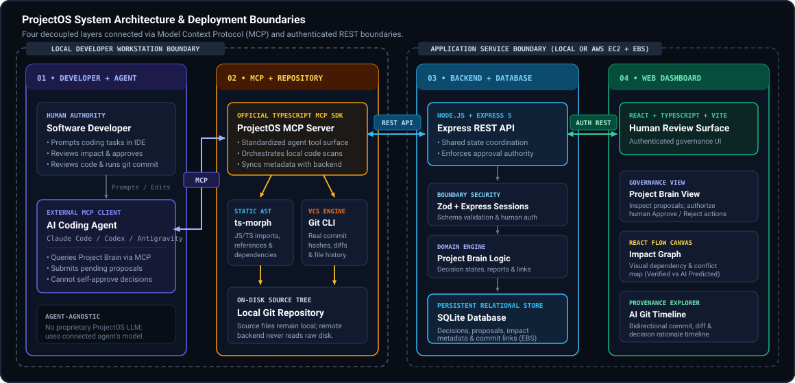
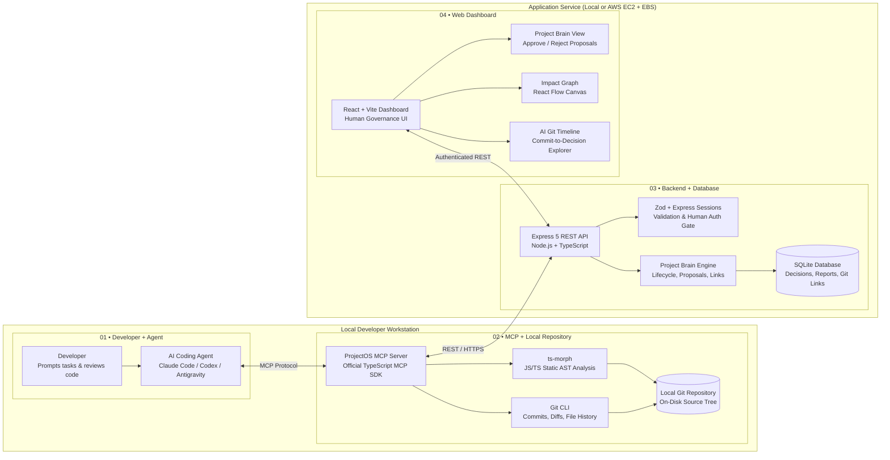

# System Architecture & Protocol Boundaries

[← Back to Main README](../README.md)

ProjectOS is architected as an **MCP-centric architectural decision intelligence platform** that decouples local repository inspection from shared decision governance.

  

---

## 1. Four-Layer Architectural Decomposition

### Layer 1 — Developer & External AI Coding Agent

The developer defines the engineering request, reviews architectural decisions, and remains the sole authority for whether an architectural change should proceed. Their AI coding agent (an external MCP-compatible client such as **Claude Code**, **Codex**, or **Antigravity**) interprets natural-language tasks, invokes ProjectOS MCP tools when configured, and performs code edits through its ordinary IDE or terminal workflow.

* **Primary Interface:** The external coding agent communicates with the local ProjectOS MCP server over the **Model Context Protocol (MCP)**.
* **Provider Neutrality:** ProjectOS does not host a proprietary LLM or require a dedicated model API key. The connected coding agent supplies LLM reasoning.

### Layer 2 — Local MCP Server & Repository Engines

The **ProjectOS MCP Server** is the standardized, agent-facing tool layer built with the official **TypeScript MCP SDK**. It coordinates requests for project decisions, pending proposals, change-impact evidence, and decision-linked commit information.

Two deterministic analysis engines run directly against the developer's local workspace:

1. **`ts-morph` Static Analyzer** — Performs deterministic Abstract Syntax Tree (AST) and TypeScript compiler inspection for supported JavaScript/TypeScript source relationships (imports, symbol references, module dependencies). It is a deterministic static analyzer, not a generative AI model.
2. **Git CLI** — Extracts factual commit hashes, author metadata, file histories, and line diffs directly from the local `.git` repository.

* **Primary Interface:** The local MCP server communicates with the Express backend over **REST / HTTP(S)**.

### Layer 3 — Application Backend & Persistent Store

The **Express REST API** (**Node.js**, **Express.js 5**, **TypeScript**) serves as the central state and governance service for both the local MCP server and the web dashboard.

* **Project Brain Domain Engine** — Manages the decision lifecycle (`Proposed`, `Approved`, `Rejected`, `Superseded`), rationale lineage, impact report associations, and explicit Git commit links.
* **Zod Validation** — Enforces strict runtime schema validation at every request and response boundary.
* **Authentication & Human Authorization** — Protects human approval endpoints using **Express Sessions**. An MCP tool callable by an AI coding agent can submit a `Proposed` record, but cannot invoke or bypass the human approval transition.
* **SQLite Database** — Persists structured architectural decision records, approval audit trails, impact report metadata, and commit-to-decision links in a single relational store without requiring a standalone database cluster.

* **Primary Interface:** The React dashboard queries and mutates state through **authenticated REST APIs**.

### Layer 4 — Web Dashboard (Human Governance Surface)

The **React Dashboard** (**React.js**, **TypeScript**, **Vite**) provides the human inspection and approval interface across three tightly linked views:

* **Project Brain View** — Browse active architectural decisions, inspect supersession history, review pending agent/developer proposals, and execute authorized **Approve** or **Reject** actions.
* **Impact Graph (`React Flow`)** — Visually explore affected files, module dependencies, conflicting decisions, and evidence classifications before code is modified.
* **AI Git Timeline** — Navigate actual repository commits, changed files, and their bidirectional links to approved Project Brain decisions and rationales.

---

## 2. Interface & Protocol Summary

| Source Component | Target Component | Protocol / Transport | Core Responsibility |
| :--- | :--- | :--- | :--- |
| **External Coding Agent** | **Local ProjectOS MCP Server** | **MCP** (Stdio / Local) | Retrieve active decisions, run pre-change impact scans, submit pending proposals, and record commit links |
| **Local ProjectOS MCP Server** | **Local Git Repository** | **Direct FS / Process** (`ts-morph` + `Git CLI`) | Deterministically extract JS/TS dependency graphs and factual Git commit/diff history |
| **Local ProjectOS MCP Server** | **Shared Express Backend** | **REST / HTTP(S)** | Synchronize decision context, pending proposals, impact metadata, and Git provenance links |
| **React Web Dashboard** | **Shared Express Backend** | **Authenticated REST / HTTP(S)** | Render project state, visualize React Flow impact graphs, and enforce human-only decision approval |

---

## 3. Local vs. Shared Deployment Boundary

> [!IMPORTANT]
> **Strict Local Source Privacy Boundary:** Even when the Express backend, SQLite database, and React dashboard are hosted on a shared cloud instance (**AWS EC2** backed by **Amazon EBS** persistent block storage), the external coding agent, ProjectOS MCP server, `ts-morph` analyzer, `Git CLI`, and raw source tree remain on the **developer's local workstation**. The remote backend operates exclusively on structured decision records, impact metadata, and Git hash associations sent over controlled REST endpoints—it never mounts or reads the developer's raw local disk.

---

## 4. Division of Responsibilities: AI vs. Deterministic Infrastructure

A core architectural principle of ProjectOS is separating **generative reasoning** from **deterministic verification** and **human authority**:

| System Actor | Architectural Role | Authority Boundary |
| :--- | :--- | :--- |
| **Connected Coding Agent & LLM** | Interprets natural-language prompts, reasons about indirect architectural consequences, and edits code via normal IDE permissions | **Advisory & Implementation:** Can propose decisions and suggest predicted impacts; cannot self-approve policy |
| **ProjectOS MCP Server** | Exposes standardized MCP tools, coordinates local repository scans, and bridges local findings with backend records | **Orchestration:** Relays structured context; does not autonomously alter repository files or approve proposals |
| **`ts-morph` Engine** | Deterministically parses TypeScript/JavaScript ASTs to map imports, exports, and symbol references | **Verified Code Fact:** Reports only confirmed static source relationships; zero hallucination risk |
| **Git CLI** | Queries the local `.git` object database for real commit SHA hashes, changed file paths, and diffs | **Verified VCS Fact:** Operates on real repository history; never simulates branches or rewrites history |
| **Express Backend & SQLite** | Enforces state machine transitions, Zod schemas, session authentication, and relational persistence | **System of Record:** Rejects unauthenticated approval calls; maintains immutable supersession lineage |
| **Developer (via React Dashboard)** | Reviews evidence-backed impact reports and approves or rejects architectural proposals | **Sole Governance Authority:** Only an authenticated human action can transition a decision to `Approved` |

---

## 5. System Architecture Mermaid Reference

For contributors maintaining architecture diagrams directly in Markdown, the canonical four-layer structure is represented below:

