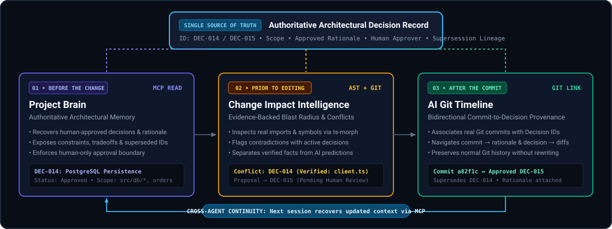
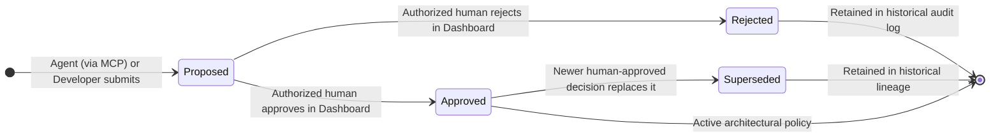
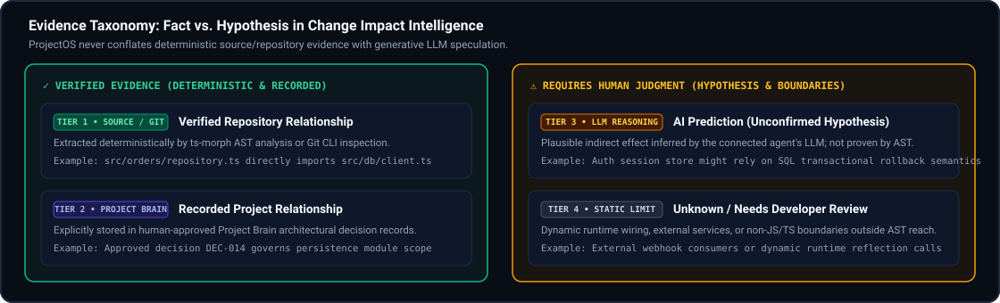
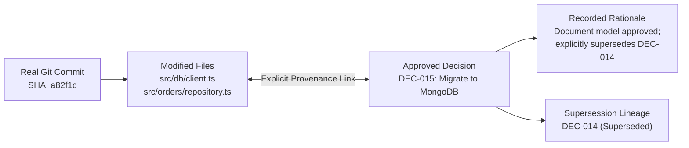

# Core Features & Continuous Decision Lifecycle

[← Back to Main README](../README.md)

ProjectOS unifies three capabilities—**Project Brain**, **Change Impact Intelligence**, and **AI Git Timeline**—around a **single authoritative architectural decision record**. Rather than operating as three disconnected developer utilities, they govern the entire lifecycle of an architectural change: **before** editing, **during** impact review, and **after** the Git commit.

  

---

## 1. Feature One — Project Brain

**Project Brain** serves as the authoritative, structured memory of significant project-level decisions. Unlike raw chat transcripts, static `AGENTS.md` files, or unindexed documentation folders, Project Brain treats architectural decisions as versioned, queryable entities with explicit human governance.

### Canonical Decision Record Schema

For every architectural decision, Project Brain captures and preserves:

| Field | Description | Example (`DEC-014`) |
| :--- | :--- | :--- |
| **Decision ID & Title** | Stable identifier and concise domain title | `DEC-014` — Primary Database Architecture |
| **Approved Choice & Scope** | The specific technical decision and its architectural boundary | `PostgreSQL` across persistence and order processing modules |
| **Rationale** | The engineering reasoning behind the choice | Relational order integrity, ACID transactions, and existing SQL schema |
| **Tradeoffs & Constraints** | Accepted limitations, rejected alternatives, and invariants | Requires structured SQL migrations; document flexibility traded for consistency |
| **Lifecycle Status** | Current governance state (`Proposed`, `Approved`, `Rejected`, `Superseded`) | `Approved` (Active architectural policy) |
| **Approval Provenance** | Which authorized human approved the decision and timestamp | Approved by Lead Architect via ProjectOS Dashboard |
| **Code & Module Bindings** | Known files, directories, or symbols governed by the decision | `src/db/client.ts`, `src/orders/repository.ts`, `db/migrations/` |
| **Supersession Lineage** | Bidirectional pointers to older decisions replaced by this record | Later superseded by `DEC-015` (retaining `DEC-014` in historical lineage) |

### Decision State Machine

| Lifecycle State | Operational Meaning in ProjectOS |
| :--- | :--- |
| **`Proposed` (Pending)** | A developer or connected coding agent suggests a new or revised decision via MCP. It is **not** authoritative policy yet. |
| **`Approved`** | An authorized human explicitly accepts the proposal in the ProjectOS dashboard. Connected agents retrieve it as active architectural policy. |
| **`Rejected`** | The proposal was evaluated and declined. It remains in the audit history so future sessions understand why an alternative was ruled out, but it is never treated as active policy. |
| **`Superseded`** | A previously approved decision has been replaced by a newer human-approved decision (e.g., `DEC-015` supersedes `DEC-014`). The original rationale remains permanently navigable. |

> [!IMPORTANT]
> **Human-Authoritative Boundary:** Only an authorized human interacting with the authenticated ProjectOS dashboard can transition a record to `Approved`. An AI coding agent can query decisions and submit `Proposed` records via MCP, but cannot approve its own proposal.

---

## 2. Feature Two — Change Impact Intelligence

**Change Impact Intelligence** answers a critical pre-implementation question:

> *"Before we implement this proposed change, what files, modules, and approved architectural decisions could be affected—and which warnings are verified code facts versus AI predictions?"*

Instead of relying on an LLM to guess affected files from a prompt alone, ProjectOS combines **local deterministic static analysis (`ts-morph`)**, **local Git inspection (`Git CLI`)**, and **Project Brain decision bindings** with the connected agent's reasoning.

  

### Four-Tier Evidence Classification

Every finding in a ProjectOS Impact Report is explicitly categorized so developers never confuse an LLM hypothesis with a confirmed dependency:

| Evidence Tier | Verification Source | Meaning | Concrete Example |
| :--- | :--- | :--- | :--- |
| **1. Verified Repository Relationship** | `ts-morph` AST / `Git CLI` | Confirmed directly by static source analysis or repository structure | `src/orders/repository.ts` directly imports `src/db/client.ts` |
| **2. Recorded Project Relationship** | Project Brain SQLite Store | Confirmed by an existing human-approved decision binding | `DEC-014` explicitly governs the PostgreSQL persistence layer |
| **3. AI Prediction** | Connected Agent LLM | Plausible indirect consequence inferred by the agent; not confirmed by static AST | Authentication session middleware may depend on SQL transaction behavior |
| **4. Unknown / Needs Review** | Explicit Boundary Marker | Runtime or external dependency that static analysis cannot establish confidently | Dynamic reflection, external service consumers, or non-JS/TS boundaries |

### Interactive Impact Graph (`React Flow`)

In the web dashboard, the **Impact Graph** (powered by **React Flow**) renders affected files, module dependencies, and decision conflicts as an interactive node graph. Developers can visually distinguish direct source dependencies from predicted effects before deciding whether to approve a proposal.

### Illustrative Impact Walkthrough (PostgreSQL → MongoDB Migration)

When an agent is asked to migrate persistence from PostgreSQL to MongoDB, Change Impact Intelligence produces a structured breakdown:

| Candidate Target | Why It Appears in the Report | Evidence Classification |
| :--- | :--- | :--- |
| `src/db/client.ts` | PostgreSQL connection pool and client initialization found in source | **Verified File Evidence** (`ts-morph`) |
| `src/orders/repository.ts` | Directly imports and invokes the database persistence client | **Verified Dependency** (`ts-morph`) |
| `db/migrations/` | SQL schema migration files detected in the repository tree | **Verified Repository Evidence** (`Git CLI`) |
| `DEC-014` | Active approved decision specifies PostgreSQL for transactional integrity | **Recorded Decision Conflict** (`Project Brain`) |
| Auth / Session Subsystem | Connected agent infers sessions might rely on relational persistence | **AI Prediction** (Pending Human Review) |

### Honest Static Analysis Scope

Static AST analysis cannot discover every runtime dependency, dynamic import, external microservice contract, or cross-language boundary. Deep source analysis is scoped to supported **JavaScript and TypeScript** workspaces via `ts-morph`. ProjectOS transparently labels unverified areas rather than claiming universal change coverage.

---

## 3. Feature Three — AI Git Timeline

**AI Git Timeline** closes the loop after code is written and committed, answering:

> *"This real Git commit or file modification exists in the repository. Which human-approved decision and recorded rationale explain why it was made?"*

AI Git Timeline builds **on top of standard Git** rather than replacing or wrapping it. The local `Git CLI` provides factual commit hashes, timestamps, changed file lists, and diffs, while ProjectOS stores explicit relational links between those real Git objects and Project Brain decision IDs.

### Capabilities & Bidirectional Navigation

* **Commit-to-Decision Lookup:** Select commit `a82f1c` or file `src/db/client.ts` in the timeline to immediately view `DEC-015`, its human approver, its rationale, and the fact that it superseded `DEC-014`.
* **Decision-to-Commit Lookup:** Select `DEC-015` in Project Brain to inspect every real Git commit and file diff that implemented that approved decision.
* **Confirmed vs. Suggested Provenance:** Clearly distinguishes between an agent-suggested commit association and a human-confirmed decision link.

### Strict Non-Intrusive Git Guarantees

To maintain trust in professional engineering workflows, AI Git Timeline enforces strict boundaries on what it **never** does:

* **No shadow branches:** Does not create hidden experimental branches or multi-architecture sandboxes.
* **No autonomous commits or merges:** Never executes automated `git commit`, `git merge`, or `git push` behind the developer's back.
* **No history rewriting:** Never runs `git rebase` or mutates commit messages or hashes silently.

---

## 4. Why the Three Features Belong Together

| Engineering Question | Stage | Answering Capability |
| :--- | :--- | :--- |
| *"What is our current architectural policy, and why did we choose it?"* | **Before Editing** | **Project Brain** |
| *"Who approved replacing the old architecture, and what did it supersede?"* | **Before / After** | **Project Brain** |
| *"Which files, imports, and active decisions will this proposed change impact?"* | **During Review** | **Change Impact Intelligence** |
| *"Is this impact warning backed by source AST facts or an LLM hypothesis?"* | **During Review** | **Change Impact Intelligence** |
| *"Which real Git commits actually implemented this approved decision?"* | **After Commit** | **AI Git Timeline** |
| *"Why was this specific file modified in commit `a82f1c` three months ago?"* | **After Commit** | **AI Git Timeline → Project Brain** |
