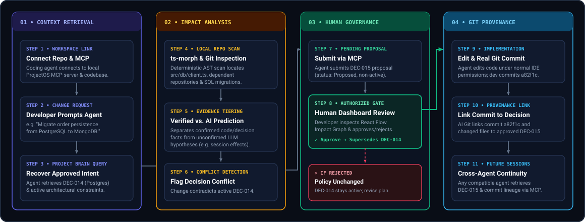

# End-to-End Workflow & Human Governance Model

[← Back to Main README](../README.md)

This document details the canonical 12-step developer and agent workflow in ProjectOS, the human approval governance model, and the nine core engineering principles that guide the platform.

<div align="center">
  
</div>

---

## 1. Canonical 12-Step Lifecycle Walkthrough

The complete loop—from a developer's initial prompt in an AI coding tool to cross-agent context recovery in a subsequent session—operates across four phases:

### Phase 01 — Setup & Context Retrieval

1. **Normal IDE & Agent Workflow:** The developer works inside their preferred MCP-compatible coding client (Claude Code, Codex, Antigravity, etc.) connected to the local ProjectOS MCP server.
2. **Existing Approved State in Project Brain:** Project Brain already holds human-approved architectural decisions—for example, `DEC-014` specifying **PostgreSQL** as the primary relational store with its transactional rationale and module bindings.
3. **Architectural Change Request:** The developer asks the coding agent to migrate application persistence from PostgreSQL to MongoDB.
4. **MCP Context Retrieval:** Before editing files, the coding agent invokes ProjectOS via MCP to retrieve active decisions and history rather than relying solely on the ephemeral chat window.

### Phase 02 — Repository-Backed Impact Analysis

5. **Local Source & Decision Inspection:** Change Impact Intelligence runs `ts-morph` and `Git CLI` locally against the repository. It identifies verified file dependencies (`src/db/client.ts`, `src/orders/repository.ts`, `db/migrations/`), flags the direct conflict with `DEC-014`, and explicitly separates confirmed repository evidence from the agent's own LLM predictions (such as potential session behavior changes).

### Phase 03 — Pending Proposal & Human Governance Gate

6. **Pending Proposal Submission via MCP:** Recognizing that the request contradicts `DEC-014`, the coding agent submits a pending decision proposal (`DEC-015: Migrate persistence to MongoDB`) along with its rationale and impact report via MCP. **The authoritative decision in Project Brain has not changed yet.**
7. **Human Dashboard Review:** The developer opens the ProjectOS React dashboard, inspects the pending proposal alongside the **React Flow Impact Graph**, and evaluates verified dependencies versus predicted risks.
8. **Authorized Approval or Rejection:**
   * **If Approved:** The authenticated Express backend transitions `DEC-015` to `Approved` and marks `DEC-014` as `Superseded` while preserving `DEC-014`'s historical rationale.
   * **If Rejected:** `DEC-015` is recorded as `Rejected` in the historical log; `DEC-014` remains the active architectural policy, and the developer/agent revises the implementation plan.

### Phase 04 — Implementation, Real Git Commit & Cross-Agent Continuity

9. **Standard Code Implementation:** Once approved, the coding agent and developer implement the code changes in their normal IDE under standard editor file-write permissions. ProjectOS never secretly modifies files or bypasses IDE confirmation prompts.
10. **Developer-Created Git Commit:** The developer tests the changes and creates a real Git commit (e.g., commit hash `a82f1c`).
11. **Explicit Commit-to-Decision Linking (AI Git):** The commit hash `a82f1c` and modified files (`src/db/client.ts`) are explicitly linked to `DEC-015`. Inspecting the commit in the AI Git Timeline immediately surfaces the approved architectural reason behind the diff.
12. **Cross-Agent Context Recovery:** When a different coding agent or teammate starts a new session later, querying ProjectOS via MCP returns `DEC-015`, its supersession of `DEC-014`, and its linked commits—preventing regression to outdated assumptions.

---

## 2. Sequence Diagram: Agent, MCP, Backend, and Human Authority

```mermaid
sequenceDiagram
    autonumber
    actor Dev as Developer (IDE & Dashboard)
    participant Agent as AI Coding Agent (MCP Client)
    participant MCP as Local ProjectOS MCP Server
    participant Repo as Local Repo (ts-morph + Git CLI)
    participant API as Express 5 Backend + SQLite

    Dev->>Agent: Prompt: "Migrate order persistence to MongoDB"
    Agent->>MCP: get_project_decisions() via MCP
    MCP->>API: GET /api/decisions (Active context)
    API-->>MCP: Return DEC-014 (Approved: PostgreSQL)
    MCP-->>Agent: Active policy DEC-014 + scope constraints

    Agent->>MCP: analyze_change_impact(target="persistence", proposal="MongoDB")
    MCP->>Repo: Run ts-morph AST dependency scan + Git inspection
    Repo-->>MCP: Verified files (client.ts, repository.ts, migrations/)
    MCP->>API: Store impact report (Verified facts vs. AI predictions)
    MCP-->>Agent: Impact Report + Conflict with DEC-014

    Agent->>MCP: submit_decision_proposal(DEC-015, supersedes="DEC-014")
    MCP->>API: POST /api/proposals (Status = Proposed)
    API-->>Dev: Pending proposal visible in React Dashboard

    Note over Dev,API: Human Governance Gate (Authenticated Session Required)
    Dev->>API: Inspect Impact Graph & Click "Approve DEC-015"
    API->>API: Transition DEC-015 -> Approved; DEC-014 -> Superseded

    Dev->>Agent: Proceed with approved implementation
    Agent->>Dev: Edit source files via normal IDE permissions
    Dev->>Repo: git commit -m "Migrate persistence client" (SHA: a82f1c)

    Agent->>MCP: link_commit_to_decision(sha="a82f1c", decision="DEC-015")
    MCP->>Repo: Verify commit SHA & changed file paths via Git CLI
    MCP->>API: POST /api/git-links (a82f1c <-> DEC-015)
    API-->>Dev: AI Git Timeline updated with bidirectional provenance
```

---

## 3. What Human Approval Really Means

A common misconception in AI developer tooling is equating **IDE tool-execution permission** with **architectural governance**. ProjectOS draws a strict boundary between the two:

| Dimension | Coding Tool / IDE File Permission | ProjectOS Architectural Approval |
| :--- | :--- | :--- |
| **Core Question Answered** | *"May the agent edit this file or run this shell command right now?"* | *"Should this proposed change become our project's authoritative architectural policy?"* |
| **Enforcement Boundary** | Ephemeral prompt inside the local IDE or terminal session | Authenticated Express session action persisted in the Project Brain SQLite store |
| **Temporal Scope** | Applies to an immediate, single-turn file write or command | Persists across sessions, branches, contributors, and different MCP coding agents |
| **Audit & Provenance** | Leaves no structured architectural rationale once the terminal closes | Preserves rationale, rejected alternatives, supersession lineage, and Git commit links |

* A developer can **reject** an architectural proposal in ProjectOS even when their coding agent has local file-write permissions in the IDE.
* Conversely, **approving** a decision in ProjectOS updates architectural policy in Project Brain—it never grants an AI agent unchecked filesystem or Git commit privileges.

---

## 4. Nine Core Engineering Principles

1. **MCP-Native Usefulness** — External coding agents both retrieve authoritative context and contribute structured proposals/impact queries directly through MCP, rather than treating the platform as a passive web dashboard.
2. **Human-Authoritative Decisions** — AI-submitted proposals never become active architectural context on their own. Only an authenticated human action can approve or supersede a decision.
3. **Evidence Before Speculation** — A static TypeScript import (`ts-morph`) or a Git commit hash (`Git CLI`) is a verified fact; an LLM's inferred indirect consequence is labeled as a prediction.
4. **Single Source of Truth** — Project Brain stores each decision record once; Change Impact Intelligence and AI Git Timeline reference that canonical Decision ID.
5. **Real Git, Not Simulated Git** — All provenance links point to real commits and diffs in the developer's actual `.git` repository without shadow branches or silent history rewrites.
6. **Agent-Agnostic Continuity** — Developers can switch between Claude Code, Codex, Antigravity, or other MCP clients and recover identical architectural context without copying chat histories.
7. **Local Repository Privacy** — Static code analysis and Git CLI operations execute locally next to the codebase; remote services handle only structured decision records and metadata via controlled REST APIs.
8. **Grounded Explainability** — Commit and file explanations in AI Git Timeline point to recorded decisions and human rationales rather than fabricating post-hoc LLM guesses about past intent.
9. **Honest Technical Scope** — Delivering reliable, transparent JavaScript/TypeScript static analysis (`ts-morph`) with clearly stated runtime boundaries is prioritized over exaggerated claims of universal code omniscience.
